# Awesome GPT Image Prompts

**100 image prompts. A hundred places to begin.** Photography, illustration, anime, fantasy, ink, 3D, and graphic design.

[English](README.md) · [简体中文](README.zh-CN.md) · [Explore the gallery](https://heydreaming.com/gpt-image-prompts)

Each example includes a preview, the complete prompt, its own page, and a HeyDreaming generation entry. Click an image or **Try this prompt** to open that exact example.

<table><tr>
<td width="33%"><a href="https://heydreaming.com/gpt-image-prompts?id=2&utm_source=github&utm_medium=prompt-library&utm_campaign=awesome-gpt-image-prompts&utm_content=2"></a><br /><a href="https://heydreaming.com/gpt-image-prompts?id=2&utm_source=github&utm_medium=prompt-library&utm_campaign=awesome-gpt-image-prompts&utm_content=2">Prism portrait ↗</a></td>
<td width="33%"><a href="https://heydreaming.com/gpt-image-prompts?id=8&utm_source=github&utm_medium=prompt-library&utm_campaign=awesome-gpt-image-prompts&utm_content=8">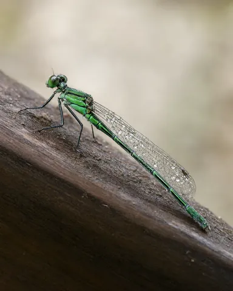</a><br /><a href="https://heydreaming.com/gpt-image-prompts?id=8&utm_source=github&utm_medium=prompt-library&utm_campaign=awesome-gpt-image-prompts&utm_content=8">Rainwing on walnut ↗</a></td>
<td width="33%"><a href="https://heydreaming.com/gpt-image-prompts?id=3&utm_source=github&utm_medium=prompt-library&utm_campaign=awesome-gpt-image-prompts&utm_content=3">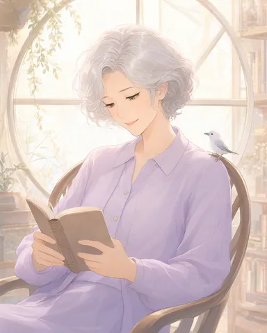</a><br /><a href="https://heydreaming.com/gpt-image-prompts?id=3&utm_source=github&utm_medium=prompt-library&utm_campaign=awesome-gpt-image-prompts&utm_content=3">Moon garden reader ↗</a></td>
</tr></table>

**[Browse all 100 on HeyDreaming →](https://heydreaming.com/gpt-image-prompts)**

## How to use

1. Pick an image and open its example page.
2. Copy the full prompt. Change the subject, setting, palette, or camera angle.
3. Choose **Try this prompt** to carry the selected prompt into the image generator, including through sign-in.
4. Review the prompt and aspect ratio, then choose Generate.

## Browse by style

| Style | Prompts |
| --- | ---: |
| [Illustration](#style-illustration) | 17 |
| [Photography](#style-photography) | 14 |
| [Anime](#style-anime) | 19 |
| [Cinematic & Fantasy](#style-cinematic-fantasy) | 22 |
| [Ink & Paper](#style-ink-paper) | 13 |
| [3D & Miniatures](#style-3d-miniatures) | 8 |
| [Graphic Design](#style-graphic-design) | 7 |

## Images & prompts

<a id="style-illustration"></a>

## Illustration

<a id="prompt-1"></a>

### 001. Canopy mapmaker

<a href="https://heydreaming.com/gpt-image-prompts?id=1&utm_source=github&utm_medium=prompt-library&utm_campaign=awesome-gpt-image-prompts&utm_content=1">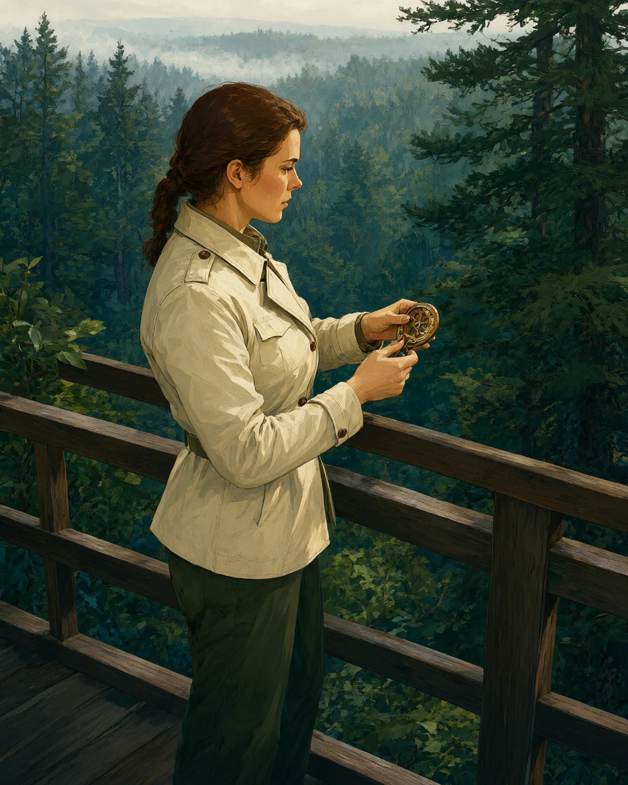</a>

An adult female mapmaker with a short chestnut braid wears a fitted cream field coat and dark green trousers. She stands sideways on a high wooden lookout, unfolding a small circular…

**4:5** · Illustration · fantasy paint

<details>
<summary>View the full prompt</summary>

```text
An adult female mapmaker with a short chestnut braid wears a fitted cream field coat and dark green trousers. She stands sideways on a high wooden lookout, unfolding a small circular brass surveying tool. A layered forest canopy and distant mist fill the background. Three-quarter figure, face visible in profile, strong diagonal railing, calm alert expression. Visual medium: Richly painted illustration, controlled brush texture, polished focal detail, simplified value grouping and layered atmospheric color. Preserve illustrated edges rather than a plain photographic finish. Palette: deep pine green, warm cream, small copper accents. Lighting: cool forest shade with a narrow amber rim. All human or humanlike figures are clearly adult and fully clothed. Original character and object designs. One coherent finished image, with no added lettering, logos, signatures or watermarks.
```

</details>

**[Try this prompt on HeyDreaming →](https://heydreaming.com/gpt-image-prompts?id=1&utm_source=github&utm_medium=prompt-library&utm_campaign=awesome-gpt-image-prompts&utm_content=1)** · [Permalink](https://heydreaming.com/gpt-image-prompts/canopy-mapmaker) · [TXT](prompts/001_canopy-mapmaker.txt)

---

<a id="prompt-6"></a>

### 006. Tide observatory keeper

<a href="https://heydreaming.com/gpt-image-prompts?id=6&utm_source=github&utm_medium=prompt-library&utm_campaign=awesome-gpt-image-prompts&utm_content=6">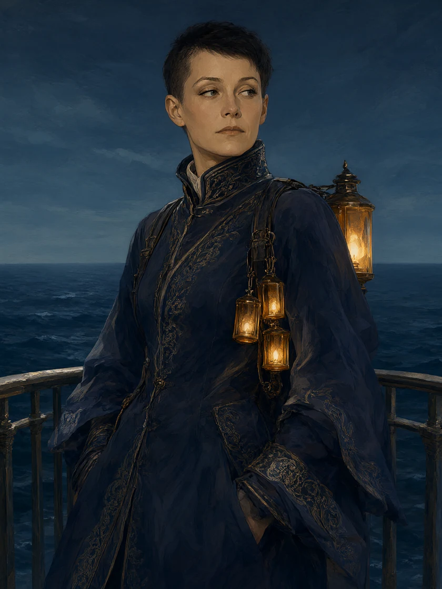</a>

An adult female keeper with dark cropped hair wears an ornate high-neck indigo travel coat. She carries three small amber glass instruments on a shoulder harness and stands on a storm…

**3:4** · Illustration · fantasy paint

<details>
<summary>View the full prompt</summary>

```text
An adult female keeper with dark cropped hair wears an ornate high-neck indigo travel coat. She carries three small amber glass instruments on a shoulder harness and stands on a storm observatory balcony above a dark sea. Waist-up three-quarter portrait, original practical costume, visible face, wind lifting loose fabric edges. Visual medium: Richly painted illustration, controlled brush texture, polished focal detail, simplified value grouping and layered atmospheric color. Preserve illustrated edges rather than a plain photographic finish. Palette: slate blue, ivory, restrained amber. Lighting: moonlit blue shadows with warm glass-lamp highlights. All human or humanlike figures are clearly adult and fully clothed. Original character and object designs. One coherent finished image, with no added lettering, logos, signatures or watermarks.
```

</details>

**[Try this prompt on HeyDreaming →](https://heydreaming.com/gpt-image-prompts?id=6&utm_source=github&utm_medium=prompt-library&utm_campaign=awesome-gpt-image-prompts&utm_content=6)** · [Permalink](https://heydreaming.com/gpt-image-prompts/tide-observatory-keeper) · [TXT](prompts/006_tide-observatory-keeper.txt)

---

<a id="prompt-14"></a>

### 014. Wind bridge courier

<a href="https://heydreaming.com/gpt-image-prompts?id=14&utm_source=github&utm_medium=prompt-library&utm_campaign=awesome-gpt-image-prompts&utm_content=14">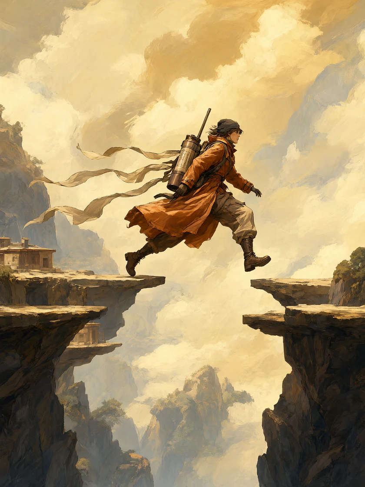</a>

An adult female courier in a long copper travel coat leaps between two suspended stone walkways, carrying a cylindrical message case across her back. Streaming canvas ribbons trace the…

**3:4** · Illustration · action paint

<details>
<summary>View the full prompt</summary>

```text
An adult female courier in a long copper travel coat leaps between two suspended stone walkways, carrying a cylindrical message case across her back. Streaming canvas ribbons trace the jump. Wide diagonal motion, clearly readable anatomy, layered cliffs and small architectural platforms behind, sharp foreground edges and painterly motion in the atmosphere. Visual medium: Richly painted illustration, controlled brush texture, polished focal detail, simplified value grouping and layered atmospheric color. Preserve illustrated edges rather than a plain photographic finish. Palette: warm cream, ochre, charcoal. Lighting: golden light through rolling cloud and dust. All human or humanlike figures are clearly adult and fully clothed. Original character and object designs. One coherent finished image, with no added lettering, logos, signatures or watermarks.
```

</details>

**[Try this prompt on HeyDreaming →](https://heydreaming.com/gpt-image-prompts?id=14&utm_source=github&utm_medium=prompt-library&utm_campaign=awesome-gpt-image-prompts&utm_content=14)** · [Permalink](https://heydreaming.com/gpt-image-prompts/wind-bridge-courier) · [TXT](prompts/014_wind-bridge-courier.txt)

---

<a id="prompt-16"></a>

### 016. Forest glass botanist

<a href="https://heydreaming.com/gpt-image-prompts?id=16&utm_source=github&utm_medium=prompt-library&utm_campaign=awesome-gpt-image-prompts&utm_content=16">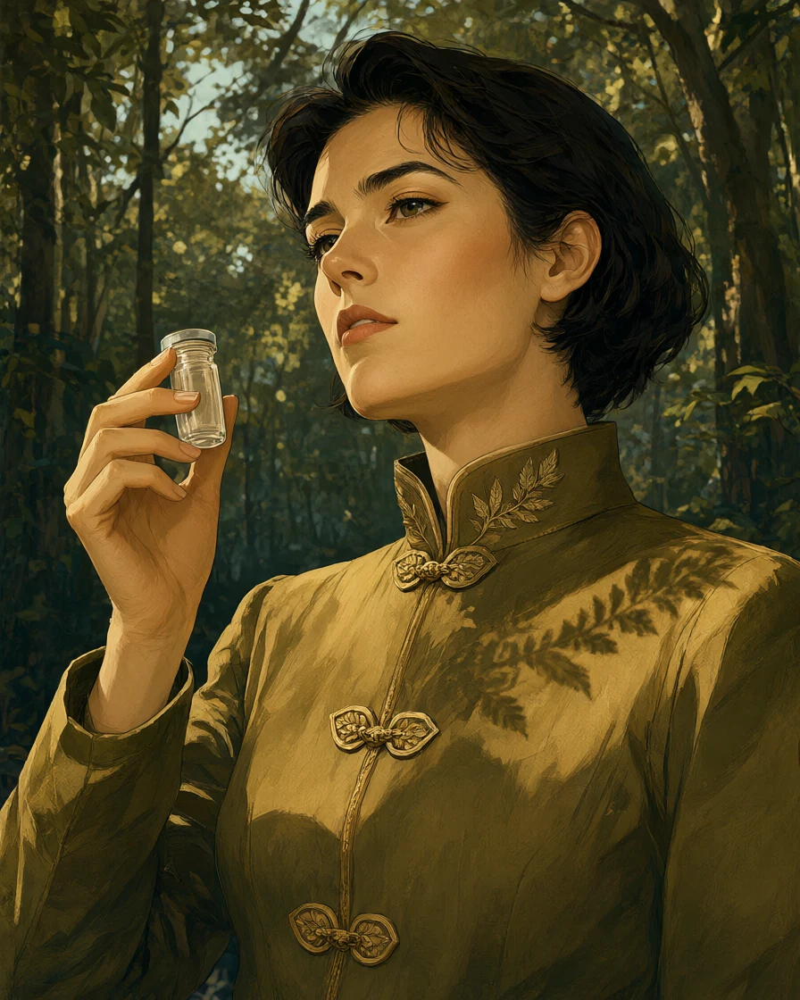</a>

An adult female botanist with short dark hair wears a finely tailored ochre field jacket with embroidered leaf-shaped fastenings. She holds a small clear sample vial and looks…

**4:5** · Illustration · fantasy paint

<details>
<summary>View the full prompt</summary>

```text
An adult female botanist with short dark hair wears a finely tailored ochre field jacket with embroidered leaf-shaped fastenings. She holds a small clear sample vial and looks thoughtfully toward the canopy. Waist-up portrait, face turned slightly left, fern shadows across the coat, layered woodland depth and refined illustrated facial features. Visual medium: Richly painted illustration, controlled brush texture, polished focal detail, simplified value grouping and layered atmospheric color. Preserve illustrated edges rather than a plain photographic finish. Palette: muted olive, antique gold, warm skin tones. Lighting: dappled afternoon sun with soft background bokeh. All human or humanlike figures are clearly adult and fully clothed. Original character and object designs. One coherent finished image, with no added lettering, logos, signatures or watermarks.
```

</details>

**[Try this prompt on HeyDreaming →](https://heydreaming.com/gpt-image-prompts?id=16&utm_source=github&utm_medium=prompt-library&utm_campaign=awesome-gpt-image-prompts&utm_content=16)** · [Permalink](https://heydreaming.com/gpt-image-prompts/forest-glass-botanist) · [TXT](prompts/016_forest-glass-botanist.txt)

---

<a id="prompt-22"></a>

### 022. Water garden terraces

<a href="https://heydreaming.com/gpt-image-prompts?id=22&utm_source=github&utm_medium=prompt-library&utm_campaign=awesome-gpt-image-prompts&utm_content=22">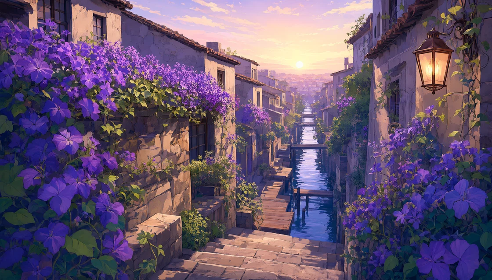</a>

A series of old stone rooftop gardens steps down toward a narrow blue canal. Creeping violet flowers spill over the walls, one copper lantern still glows, and wooden footpaths link the…

**16:9** · Illustration · painterly landscape

<details>
<summary>View the full prompt</summary>

```text
A series of old stone rooftop gardens steps down toward a narrow blue canal. Creeping violet flowers spill over the walls, one copper lantern still glows, and wooden footpaths link the terraces. Wide tranquil environment view, layered depth, delicate foliage, softly reflected light and a calm inviting place. No central character. Visual medium: Richly painted illustration, controlled brush texture, polished focal detail, simplified value grouping and layered atmospheric color. Preserve illustrated edges rather than a plain photographic finish. Palette: violet flowers, leafy green, soft peach. Lighting: a luminous sunrise filtered through thin clouds. All human or humanlike figures are clearly adult and fully clothed. Original character and object designs. One coherent finished image, with no added lettering, logos, signatures or watermarks.
```

</details>

**[Try this prompt on HeyDreaming →](https://heydreaming.com/gpt-image-prompts?id=22&utm_source=github&utm_medium=prompt-library&utm_campaign=awesome-gpt-image-prompts&utm_content=22)** · [Permalink](https://heydreaming.com/gpt-image-prompts/water-garden-terraces) · [TXT](prompts/022_water-garden-terraces.txt)

---

<a id="prompt-37"></a>

### 037. Rooftop camera repairer

<a href="https://heydreaming.com/gpt-image-prompts?id=37&utm_source=github&utm_medium=prompt-library&utm_campaign=awesome-gpt-image-prompts&utm_content=37">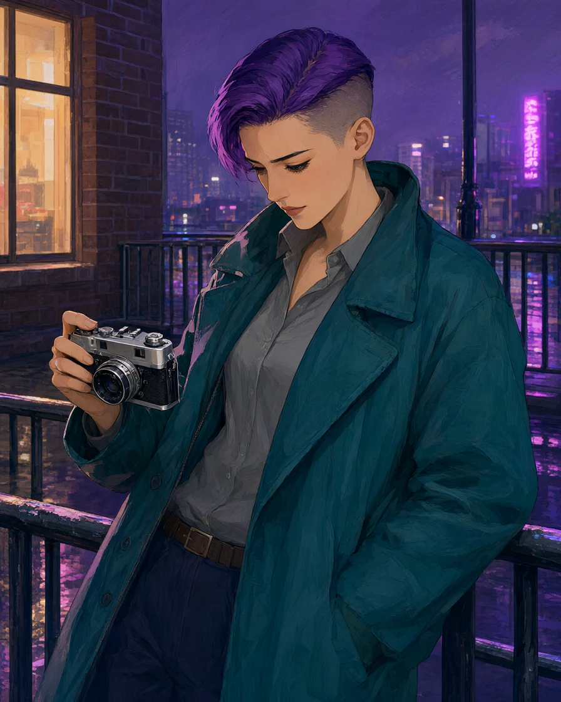</a>

An adult female camera repairer with a violet undercut wears a teal wool work coat and a simple gray shirt. She checks a small vintage camera beside the railing of a rainy rooftop bus…

**4:5** · Illustration · semi real portrait

<details>
<summary>View the full prompt</summary>

```text
An adult female camera repairer with a violet undercut wears a teal wool work coat and a simple gray shirt. She checks a small vintage camera beside the railing of a rainy rooftop bus stop. Waist-up candid portrait, natural posture, damp brick and distant city lights, polished illustrated features with tactile clothing. Visual medium: Richly painted illustration, controlled brush texture, polished focal detail, simplified value grouping and layered atmospheric color. Preserve illustrated edges rather than a plain photographic finish. Palette: violet, petrol blue, muted pink. Lighting: soft neon reflections and a warm window spill. All human or humanlike figures are clearly adult and fully clothed. Original character and object designs. One coherent finished image, with no added lettering, logos, signatures or watermarks.
```

</details>

**[Try this prompt on HeyDreaming →](https://heydreaming.com/gpt-image-prompts?id=37&utm_source=github&utm_medium=prompt-library&utm_campaign=awesome-gpt-image-prompts&utm_content=37)** · [Permalink](https://heydreaming.com/gpt-image-prompts/rooftop-camera-repairer) · [TXT](prompts/037_rooftop-camera-repairer.txt)

---

<a id="prompt-41"></a>

### 041. Moss branch sleeper

<a href="https://heydreaming.com/gpt-image-prompts?id=41&utm_source=github&utm_medium=prompt-library&utm_campaign=awesome-gpt-image-prompts&utm_content=41">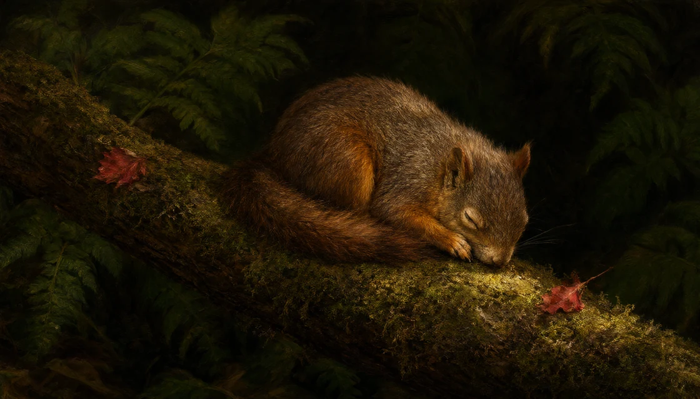</a>

A single red squirrel sleeps curled across a thick moss-covered branch, its long tail wrapped loosely behind its back and one small paw tucked beneath its muzzle. The branch runs…

**16:9** · Illustration · animal oil

<details>
<summary>View the full prompt</summary>

```text
A single red squirrel sleeps curled across a thick moss-covered branch, its long tail wrapped loosely behind its back and one small paw tucked beneath its muzzle. The branch runs diagonally from the lower left toward a deep green fern thicket. A few faded red leaves rest in the moss and catch narrow warm highlights. Close side view, the animal offset to the upper right, with a broad shadowed woodland background and richly painted fur, bark and velvety plant texture. Visual medium: Traditional narrative oil painting, rich dark glazing, soft visible brush marks, carefully lit animal faces and tactile painted fur. Palette: warm umber, faded red, deep green. Lighting: soft side light entering a dark fern thicket. All human or humanlike figures are clearly adult and fully clothed. Original character and object designs. One coherent finished image, with no added lettering, logos, signatures or watermarks.
```

</details>

**[Try this prompt on HeyDreaming →](https://heydreaming.com/gpt-image-prompts?id=41&utm_source=github&utm_medium=prompt-library&utm_campaign=awesome-gpt-image-prompts&utm_content=41)** · [Permalink](https://heydreaming.com/gpt-image-prompts/moss-branch-sleeper) · [TXT](prompts/041_moss-branch-sleeper.txt)

---

<a id="prompt-57"></a>

### 057. The season arch

<a href="https://heydreaming.com/gpt-image-prompts?id=57&utm_source=github&utm_medium=prompt-library&utm_campaign=awesome-gpt-image-prompts&utm_content=57">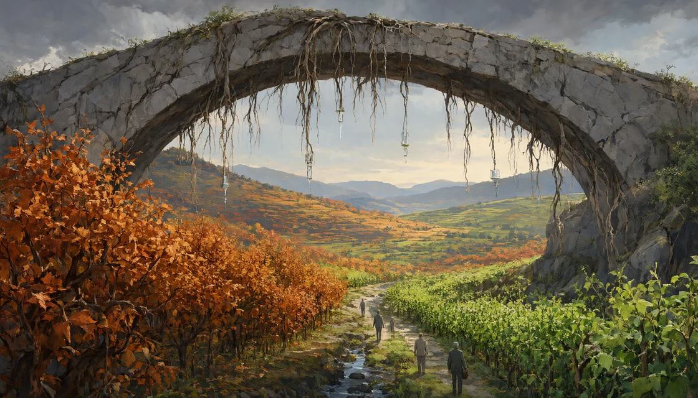</a>

A huge broken stone arch floats above a terraced orchard valley. Hanging roots and small glass rain collectors trail from the arch. Autumn copper foliage fills one diagonal region while…

**16:9** · Illustration · surreal landscape

<details>
<summary>View the full prompt</summary>

```text
A huge broken stone arch floats above a terraced orchard valley. Hanging roots and small glass rain collectors trail from the arch. Autumn copper foliage fills one diagonal region while fresh green growth gathers along a winding stream. Asymmetric environmental composition, dreamlike but coherent perspective and rich painted detail. No faces formed by the landscape. Visual medium: Richly painted illustration, controlled brush texture, polished focal detail, simplified value grouping and layered atmospheric color. Preserve illustrated edges rather than a plain photographic finish. Palette: slate gray, spring green, autumn copper. Lighting: soft storm light opening into clear late-afternoon sun. All human or humanlike figures are clearly adult and fully clothed. Original character and object designs. One coherent finished image, with no added lettering, logos, signatures or watermarks.
```

</details>

**[Try this prompt on HeyDreaming →](https://heydreaming.com/gpt-image-prompts?id=57&utm_source=github&utm_medium=prompt-library&utm_campaign=awesome-gpt-image-prompts&utm_content=57)** · [Permalink](https://heydreaming.com/gpt-image-prompts/the-season-arch) · [TXT](prompts/057_the-season-arch.txt)

---

<a id="prompt-66"></a>

### 066. The sky jelly at the coast

<a href="https://heydreaming.com/gpt-image-prompts?id=66&utm_source=github&utm_medium=prompt-library&utm_campaign=awesome-gpt-image-prompts&utm_content=66">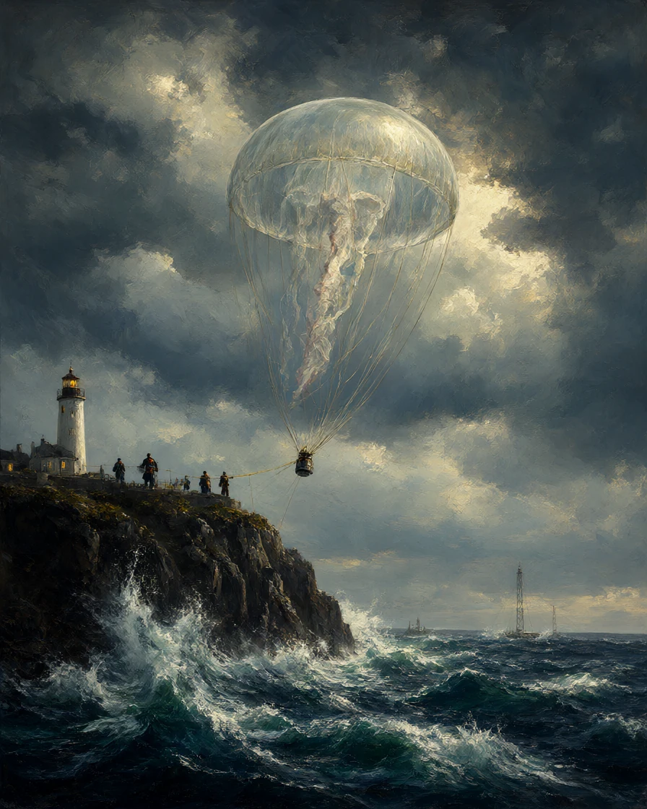</a>

An enormous translucent weather balloon shaped like a floating sea jelly drifts above a cliffside lighthouse complex. Its thin cables descend toward distant mooring towers rather than…

**4:5** · Illustration · storm oil

<details>
<summary>View the full prompt</summary>

```text
An enormous translucent weather balloon shaped like a floating sea jelly drifts above a cliffside lighthouse complex. Its thin cables descend toward distant mooring towers rather than into the water. Foaming dark waves, windblown spray, small warm windows and monumental atmospheric scale. Rich oil-paint texture, painterly cloud masses and luminous believable weather. Visual medium: Dramatic maritime oil painting, sweeping brushwork in clouds and waves, rich dark glazing and luminous breaks of light. Avoid a smooth digital 3D finish. Palette: storm slate, sea green, muted gold. Lighting: dramatic cloud breaks over rough ocean light. All human or humanlike figures are clearly adult and fully clothed. Original character and object designs. One coherent finished image, with no added lettering, logos, signatures or watermarks.
```

</details>

**[Try this prompt on HeyDreaming →](https://heydreaming.com/gpt-image-prompts?id=66&utm_source=github&utm_medium=prompt-library&utm_campaign=awesome-gpt-image-prompts&utm_content=66)** · [Permalink](https://heydreaming.com/gpt-image-prompts/the-sky-jelly-at-the-coast) · [TXT](prompts/066_the-sky-jelly-at-the-coast.txt)

---

<a id="prompt-75"></a>

### 075. Autumn herbalist

<a href="https://heydreaming.com/gpt-image-prompts?id=75&utm_source=github&utm_medium=prompt-library&utm_campaign=awesome-gpt-image-prompts&utm_content=75">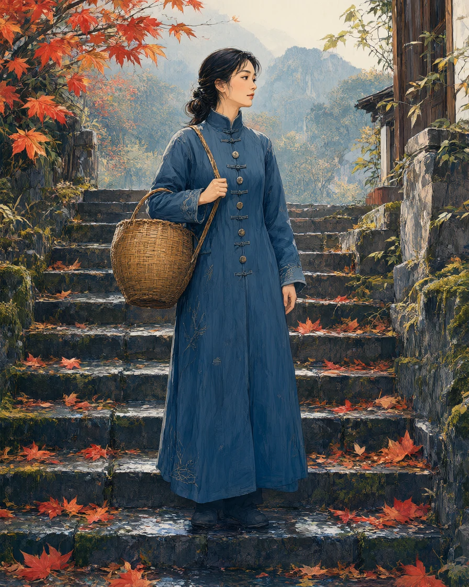</a>

An adult female herbalist in a buttoned slate-blue long coat carries a bamboo basket along old mossy stone stairs. Autumn maple leaves gather in the rain around a quiet mountain…

**4:5** · Illustration · painterly asian

<details>
<summary>View the full prompt</summary>

```text
An adult female herbalist in a buttoned slate-blue long coat carries a bamboo basket along old mossy stone stairs. Autumn maple leaves gather in the rain around a quiet mountain courtyard. Three-quarter full figure, tied-back dark hair, contemplative expression, vivid layered brushwork, fine ink accents and richly painted environmental depth. Visual medium: Richly painted illustration, controlled brush texture, polished focal detail, simplified value grouping and layered atmospheric color. Preserve illustrated edges rather than a plain photographic finish. Palette: slate blue, maple red, warm ivory. Lighting: soft rainy mountain daylight. All human or humanlike figures are clearly adult and fully clothed. Original character and object designs. One coherent finished image, with no added lettering, logos, signatures or watermarks.
```

</details>

**[Try this prompt on HeyDreaming →](https://heydreaming.com/gpt-image-prompts?id=75&utm_source=github&utm_medium=prompt-library&utm_campaign=awesome-gpt-image-prompts&utm_content=75)** · [Permalink](https://heydreaming.com/gpt-image-prompts/autumn-herbalist) · [TXT](prompts/075_autumn-herbalist.txt)

---

<a id="prompt-79"></a>

### 079. The terrace astronomy club

<a href="https://heydreaming.com/gpt-image-prompts?id=79&utm_source=github&utm_medium=prompt-library&utm_campaign=awesome-gpt-image-prompts&utm_content=79">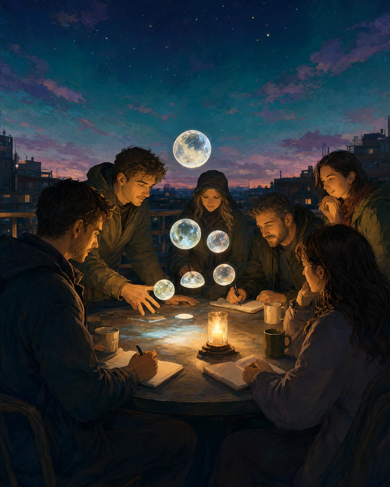</a>

A small group of clearly adult astronomy enthusiasts gathers around a round table on a roof terrace at dusk. Three floating glass models of tidal moons cast delicate light onto notebooks…

**4:5** · Illustration · cosmic paint

<details>
<summary>View the full prompt</summary>

```text
A small group of clearly adult astronomy enthusiasts gathers around a round table on a roof terrace at dusk. Three floating glass models of tidal moons cast delicate light onto notebooks and cups. Wide narrative scene, natural faces, intricate painted sky, expressive hands and rich warm-cool atmosphere. Everyone remains an ordinary fully clothed human. Visual medium: Richly painted illustration, controlled brush texture, polished focal detail, simplified value grouping and layered atmospheric color. Preserve illustrated edges rather than a plain photographic finish. Palette: deep teal, soft violet, warm amber. Lighting: candlelit faces beneath luminous glass celestial models. All human or humanlike figures are clearly adult and fully clothed. Original character and object designs. One coherent finished image, with no added lettering, logos, signatures or watermarks.
```

</details>

**[Try this prompt on HeyDreaming →](https://heydreaming.com/gpt-image-prompts?id=79&utm_source=github&utm_medium=prompt-library&utm_campaign=awesome-gpt-image-prompts&utm_content=79)** · [Permalink](https://heydreaming.com/gpt-image-prompts/the-terrace-astronomy-club) · [TXT](prompts/079_the-terrace-astronomy-club.txt)

---

<a id="prompt-86"></a>

### 086. Orchard canal dawn

<a href="https://heydreaming.com/gpt-image-prompts?id=86&utm_source=github&utm_medium=prompt-library&utm_campaign=awesome-gpt-image-prompts&utm_content=86">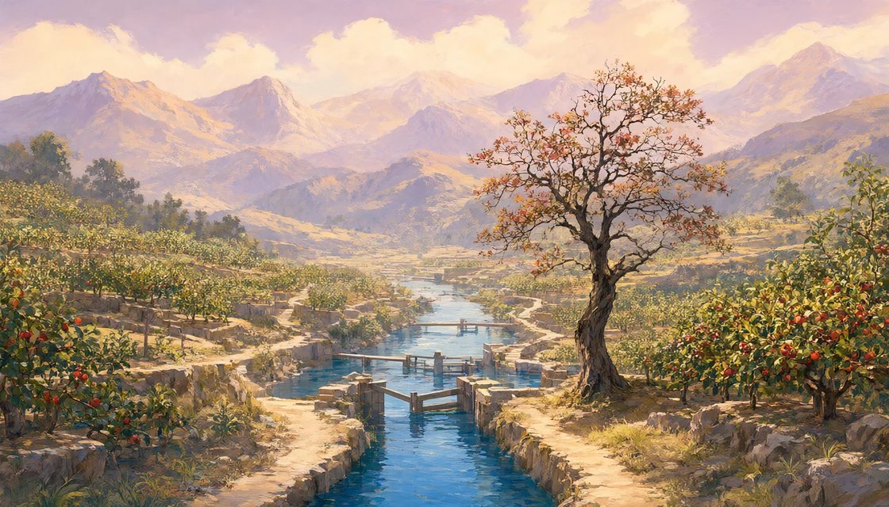</a>

A winding blue canal threads through terraced fruit orchards toward cream-colored mountain peaks. Small stone locks and footbridges punctuate the water, with clusters of autumn leaves…

**16:9** · Illustration · painterly landscape

<details>
<summary>View the full prompt</summary>

```text
A winding blue canal threads through terraced fruit orchards toward cream-colored mountain peaks. Small stone locks and footbridges punctuate the water, with clusters of autumn leaves catching the light. Wide sweeping composition, layered painted cloud, intricate natural texture and a peaceful luminous animated-landscape atmosphere. No single heroic tree or road. Visual medium: Richly painted illustration, controlled brush texture, polished focal detail, simplified value grouping and layered atmospheric color. Preserve illustrated edges rather than a plain photographic finish. Palette: pale peach, soft violet, jade, muted gold. Lighting: luminous early sun through thin mountain haze. All human or humanlike figures are clearly adult and fully clothed. Original character and object designs. One coherent finished image, with no added lettering, logos, signatures or watermarks.
```

</details>

**[Try this prompt on HeyDreaming →](https://heydreaming.com/gpt-image-prompts?id=86&utm_source=github&utm_medium=prompt-library&utm_campaign=awesome-gpt-image-prompts&utm_content=86)** · [Permalink](https://heydreaming.com/gpt-image-prompts/orchard-canal-dawn) · [TXT](prompts/086_orchard-canal-dawn.txt)

---

<a id="prompt-89"></a>

### 089. The weather balloon lantern

<a href="https://heydreaming.com/gpt-image-prompts?id=89&utm_source=github&utm_medium=prompt-library&utm_campaign=awesome-gpt-image-prompts&utm_content=89">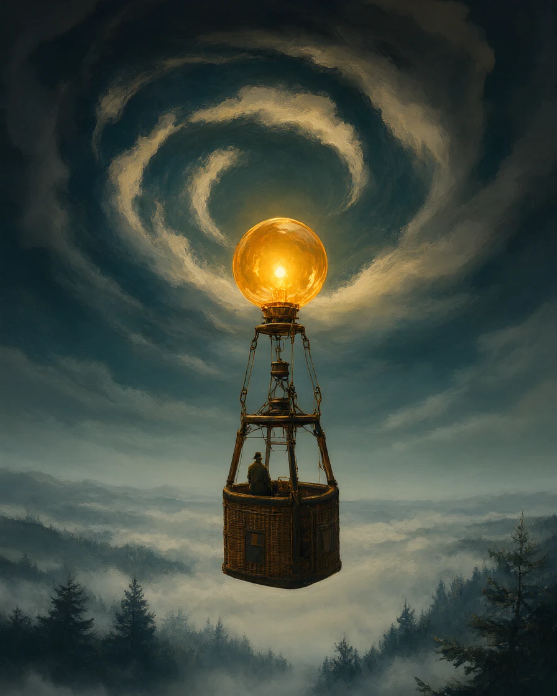</a>

An abandoned copper weather-balloon basket hangs below a small luminous amber glass sphere above a fog-filled valley. Slow cloud bands curl around the light and distant fir trees fade…

**4:5** · Illustration · atmospheric illustration

<details>
<summary>View the full prompt</summary>

```text
An abandoned copper weather-balloon basket hangs below a small luminous amber glass sphere above a fog-filled valley. Slow cloud bands curl around the light and distant fir trees fade below. Tall atmospheric illustration, delicately textured paint, rich warm-cool contrast and a mysterious quiet sense of scale. No streetlamp or moon motif. Visual medium: Richly painted illustration, controlled brush texture, polished focal detail, simplified value grouping and layered atmospheric color. Preserve illustrated edges rather than a plain photographic finish. Palette: deep teal, smoky gray, warm yellow. Lighting: one glowing glass sphere within a vast dark cloud spiral. All human or humanlike figures are clearly adult and fully clothed. Original character and object designs. One coherent finished image, with no added lettering, logos, signatures or watermarks.
```

</details>

**[Try this prompt on HeyDreaming →](https://heydreaming.com/gpt-image-prompts?id=89&utm_source=github&utm_medium=prompt-library&utm_campaign=awesome-gpt-image-prompts&utm_content=89)** · [Permalink](https://heydreaming.com/gpt-image-prompts/the-weather-balloon-lantern) · [TXT](prompts/089_the-weather-balloon-lantern.txt)

---

<a id="prompt-92"></a>

### 092. The snow kite captain

<a href="https://heydreaming.com/gpt-image-prompts?id=92&utm_source=github&utm_medium=prompt-library&utm_campaign=awesome-gpt-image-prompts&utm_content=92">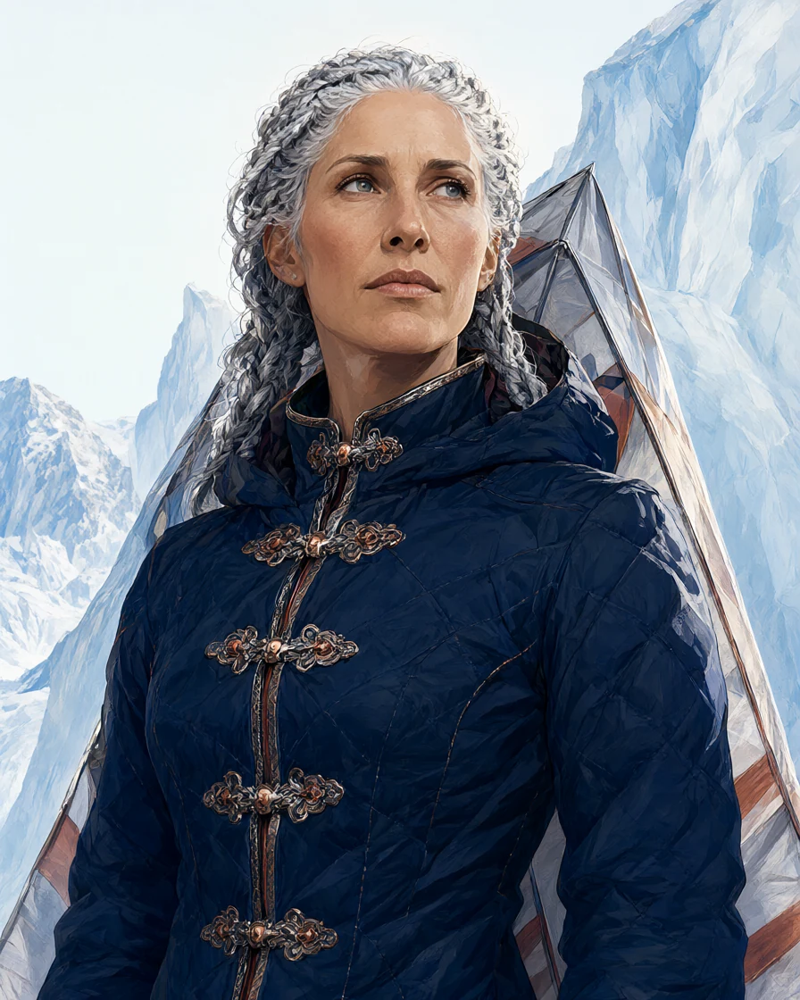</a>

An adult female mountain-rescue commander with silver braids wears a closed navy quilted flight coat with ornate copper fastenings. She carries a folded snow kite over one shoulder,…

**4:5** · Illustration · fantasy character

<details>
<summary>View the full prompt</summary>

```text
An adult female mountain-rescue commander with silver braids wears a closed navy quilted flight coat with ornate copper fastenings. She carries a folded snow kite over one shoulder, standing against a pale ice cliff. Three-quarter portrait, strong composed face, intricate practical costume design and polished illustrated materials. No exposed armor panels or weapon. Visual medium: Richly painted illustration, controlled brush texture, polished focal detail, simplified value grouping and layered atmospheric color. Preserve illustrated edges rather than a plain photographic finish. Palette: navy, silver, copper gold. Lighting: bright cold mountain light and soft edge glow. All human or humanlike figures are clearly adult and fully clothed. Original character and object designs. One coherent finished image, with no added lettering, logos, signatures or watermarks.
```

</details>

**[Try this prompt on HeyDreaming →](https://heydreaming.com/gpt-image-prompts?id=92&utm_source=github&utm_medium=prompt-library&utm_campaign=awesome-gpt-image-prompts&utm_content=92)** · [Permalink](https://heydreaming.com/gpt-image-prompts/the-snow-kite-captain) · [TXT](prompts/092_the-snow-kite-captain.txt)

---

<a id="prompt-94"></a>

### 094. The ceremonial drummer

<a href="https://heydreaming.com/gpt-image-prompts?id=94&utm_source=github&utm_medium=prompt-library&utm_campaign=awesome-gpt-image-prompts&utm_content=94">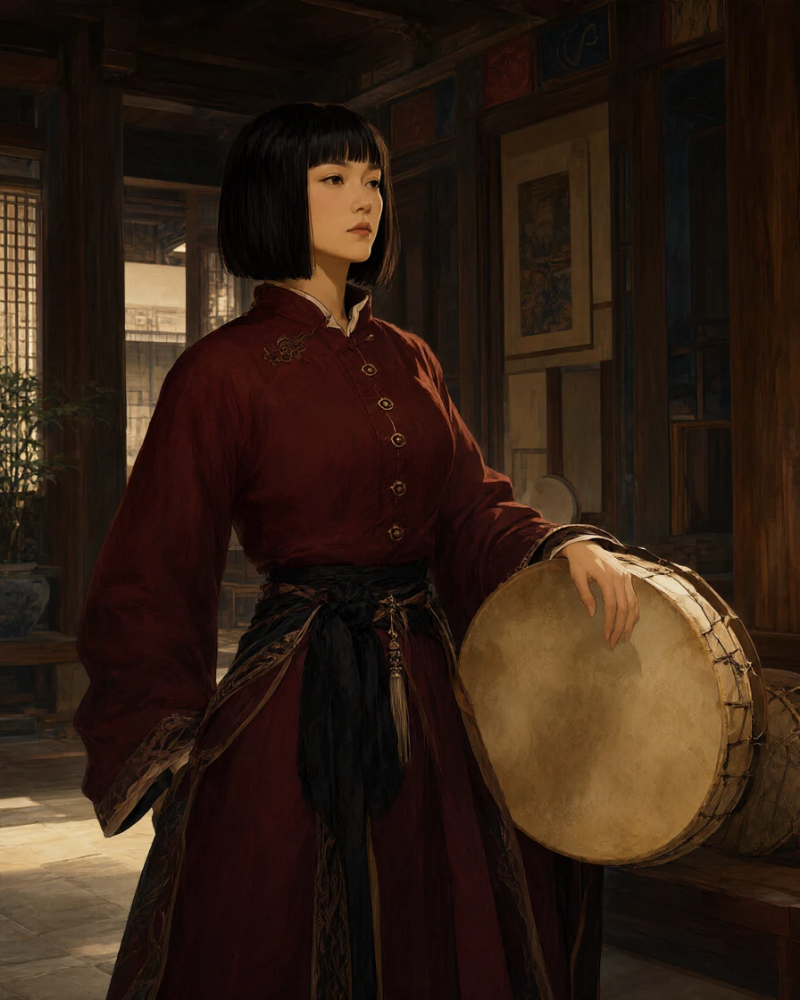</a>

An adult female ceremonial drummer with a straight dark bob wears a buttoned burgundy long coat and a layered black waist sash. She steadies a large circular frame drum beside a quiet…

**4:5** · Illustration · painterly character

<details>
<summary>View the full prompt</summary>

```text
An adult female ceremonial drummer with a straight dark bob wears a buttoned burgundy long coat and a layered black waist sash. She steadies a large circular frame drum beside a quiet timber courtyard. Three-quarter full figure, natural adult features, richly painted cloth, subtle ornamental details and an original strong silhouette. No sword or franchise costume. Visual medium: Richly painted illustration, controlled brush texture, polished focal detail, simplified value grouping and layered atmospheric color. Preserve illustrated edges rather than a plain photographic finish. Palette: burgundy, black, aged gold. Lighting: soft warm interior light with narrow bright highlights. All human or humanlike figures are clearly adult and fully clothed. Original character and object designs. One coherent finished image, with no added lettering, logos, signatures or watermarks.
```

</details>

**[Try this prompt on HeyDreaming →](https://heydreaming.com/gpt-image-prompts?id=94&utm_source=github&utm_medium=prompt-library&utm_campaign=awesome-gpt-image-prompts&utm_content=94)** · [Permalink](https://heydreaming.com/gpt-image-prompts/the-ceremonial-drummer) · [TXT](prompts/094_the-ceremonial-drummer.txt)

---

<a id="prompt-95"></a>

### 095. The floating orrery desk

<a href="https://heydreaming.com/gpt-image-prompts?id=95&utm_source=github&utm_medium=prompt-library&utm_campaign=awesome-gpt-image-prompts&utm_content=95">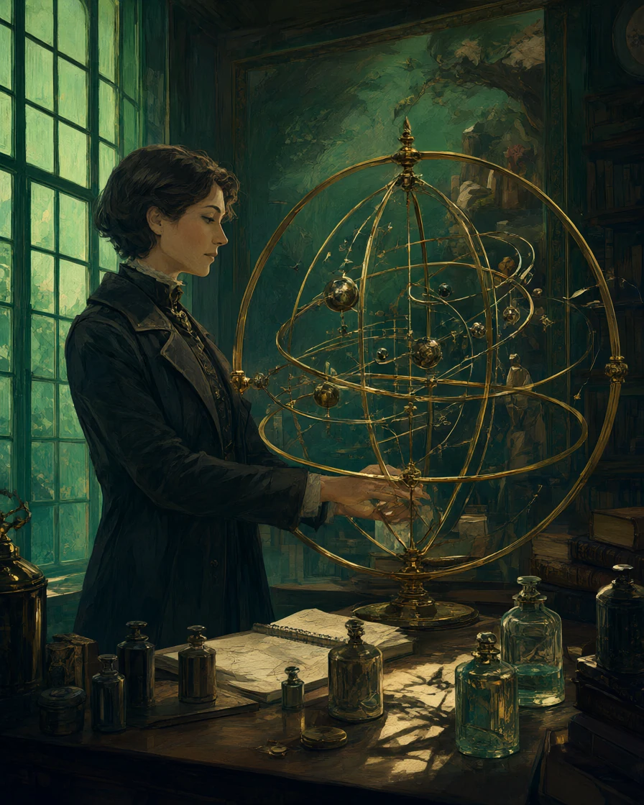</a>

An adult female archivist in a high-neck charcoal coat operates a floating orrery made of delicate brass ellipses above a library desk. Her short dark hair and calm side profile are…

**4:5** · Illustration · graphic magic

<details>
<summary>View the full prompt</summary>

```text
An adult female archivist in a high-neck charcoal coat operates a floating orrery made of delicate brass ellipses above a library desk. Her short dark hair and calm side profile are clearly visible. Tall windows, scattered plain glass weights, intricate painted shadows and refined magical realism. No pointed hat, spell symbols or writing. Visual medium: Richly painted illustration, controlled brush texture, polished focal detail, simplified value grouping and layered atmospheric color. Preserve illustrated edges rather than a plain photographic finish. Palette: charcoal, teal, glowing antique gold. Lighting: soft green window light balanced by luminous golden instrument rings. All human or humanlike figures are clearly adult and fully clothed. Original character and object designs. One coherent finished image, with no added lettering, logos, signatures or watermarks.
```

</details>

**[Try this prompt on HeyDreaming →](https://heydreaming.com/gpt-image-prompts?id=95&utm_source=github&utm_medium=prompt-library&utm_campaign=awesome-gpt-image-prompts&utm_content=95)** · [Permalink](https://heydreaming.com/gpt-image-prompts/the-floating-orrery-desk) · [TXT](prompts/095_the-floating-orrery-desk.txt)

---

<a id="prompt-100"></a>

### 100. Bronze marsh heron

<a href="https://heydreaming.com/gpt-image-prompts?id=100&utm_source=github&utm_medium=prompt-library&utm_campaign=awesome-gpt-image-prompts&utm_content=100">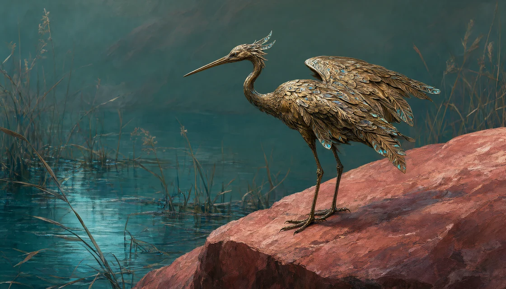</a>

A slender bronze mechanical heron stands on a sloping rose-red basalt ledge beside a quiet teal marsh. Its long wings are half-unfurled, each feather built from delicate overlapping…

**16:9** · Illustration · ornamental surreal

<details>
<summary>View the full prompt</summary>

```text
A slender bronze mechanical heron stands on a sloping rose-red basalt ledge beside a quiet teal marsh. Its long wings are half-unfurled, each feather built from delicate overlapping filigree plates with small pale-cyan enamel tips. The full bird is placed high on the right of a wide horizontal frame, its narrow legs and long beak forming a graceful angular silhouette. Open water fills the lower left, with loose reed stems and thin ribbons of cool reflected light. Intricately painted metal, weathered stone and atmospheric marsh haze remain tactile and clearly resolved. Visual medium: Richly painted illustration, controlled brush texture, polished focal detail, simplified value grouping and layered atmospheric color. Preserve illustrated edges rather than a plain photographic finish. Palette: bronze, deep teal, rose red, pale cyan. Lighting: cool reflected water light along warm bronze feathers. All human or humanlike figures are clearly adult and fully clothed. Original character and object designs. One coherent finished image, with no added lettering, logos, signatures or watermarks.
```

</details>

**[Try this prompt on HeyDreaming →](https://heydreaming.com/gpt-image-prompts?id=100&utm_source=github&utm_medium=prompt-library&utm_campaign=awesome-gpt-image-prompts&utm_content=100)** · [Permalink](https://heydreaming.com/gpt-image-prompts/bronze-marsh-heron) · [TXT](prompts/100_bronze-marsh-heron.txt)

---

<a id="style-photography"></a>

## Photography

<a id="prompt-2"></a>

### 002. Prism portrait

<a href="https://heydreaming.com/gpt-image-prompts?id=2&utm_source=github&utm_medium=prompt-library&utm_campaign=awesome-gpt-image-prompts&utm_content=2">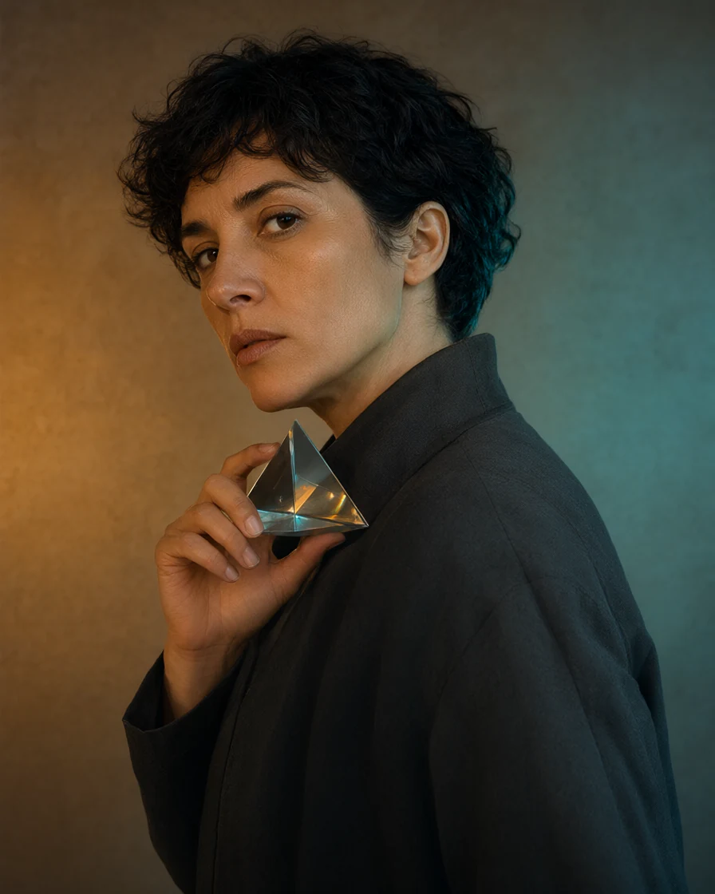</a>

An adult woman with short black curls wears a plain charcoal high-neck jacket. She holds a clear triangular prism near her shoulder while looking past the camera. Waist-up portrait,…

**4:5** · Photography · beauty photo

<details>
<summary>View the full prompt</summary>

```text
An adult woman with short black curls wears a plain charcoal high-neck jacket. She holds a clear triangular prism near her shoulder while looking past the camera. Waist-up portrait, asymmetric framing, natural unpainted skin, a textured studio wall receding behind her, one sharply focused eye and gently falling depth of field. Visual medium: High-end photographic realism, believable tactile materials, natural lens perspective, controlled depth of field and subtle fine grain. Keep texture clear without waxy smoothing. Palette: saturated amber, muted cyan, charcoal. Lighting: an amber side light and cyan rim light with deep soft shadows. All human or humanlike figures are clearly adult and fully clothed. Original character and object designs. One coherent finished image, with no added lettering, logos, signatures or watermarks.
```

</details>

**[Try this prompt on HeyDreaming →](https://heydreaming.com/gpt-image-prompts?id=2&utm_source=github&utm_medium=prompt-library&utm_campaign=awesome-gpt-image-prompts&utm_content=2)** · [Permalink](https://heydreaming.com/gpt-image-prompts/prism-portrait) · [TXT](prompts/002_prism-portrait.txt)

---

<a id="prompt-8"></a>

### 008. Rainwing on walnut

<a href="https://heydreaming.com/gpt-image-prompts?id=8&utm_source=github&utm_medium=prompt-library&utm_campaign=awesome-gpt-image-prompts&utm_content=8">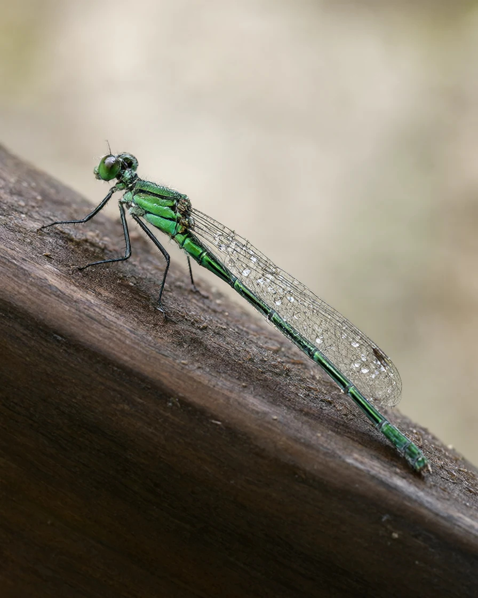</a>

A slender emerald dragonfly rests diagonally on a weathered walnut fence rail after a summer shower. Large rain droplets balance along its translucent wings, each catching a soft white…

**4:5** · Photography · surreal photo

<details>
<summary>View the full prompt</summary>

```text
A slender emerald dragonfly rests diagonally on a weathered walnut fence rail after a summer shower. Large rain droplets balance along its translucent wings, each catching a soft white glint. Extreme close view from the side, insect placed in the upper left, dark wet wood sweeping toward the lower right, with a broad creamy woodland blur behind it. The setting is life-sized outdoor nature; all surfaces have convincing damp texture. Visual medium: High-end photographic realism, believable tactile materials, natural lens perspective, controlled depth of field and subtle fine grain. Keep texture clear without waxy smoothing. Palette: forest green, walnut brown, milky white. Lighting: soft overcast daylight with tiny reflected highlights. All human or humanlike figures are clearly adult and fully clothed. Original character and object designs. One coherent finished image, with no added lettering, logos, signatures or watermarks.
```

</details>

**[Try this prompt on HeyDreaming →](https://heydreaming.com/gpt-image-prompts?id=8&utm_source=github&utm_medium=prompt-library&utm_campaign=awesome-gpt-image-prompts&utm_content=8)** · [Permalink](https://heydreaming.com/gpt-image-prompts/rainwing-on-walnut) · [TXT](prompts/008_rainwing-on-walnut.txt)

---

<a id="prompt-9"></a>

### 009. Hedgehog after rain

<a href="https://heydreaming.com/gpt-image-prompts?id=9&utm_source=github&utm_medium=prompt-library&utm_campaign=awesome-gpt-image-prompts&utm_content=9">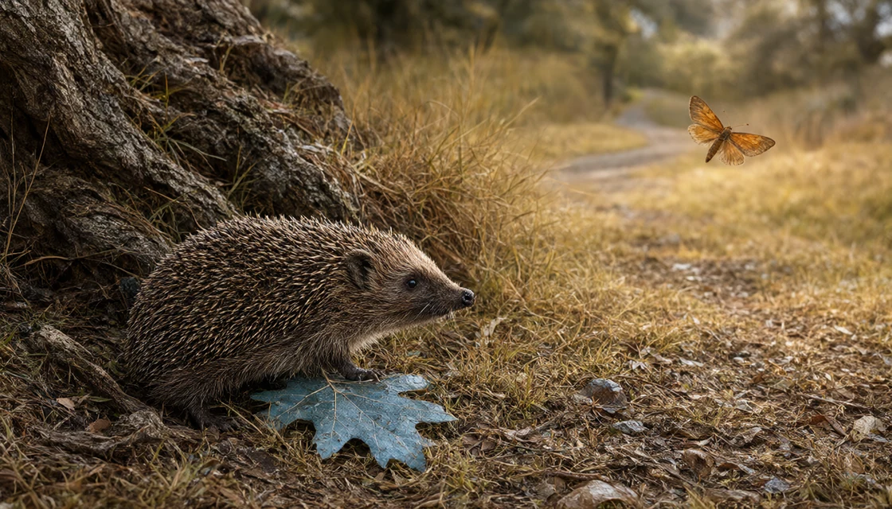</a>

A small wild hedgehog stretches beside a fallen blue oak leaf beneath an exposed tree root after rain. Its chestnut spines and tiny wet nose are sharply resolved. Ground-level side view,…

**16:9** · Photography · animal photo

<details>
<summary>View the full prompt</summary>

```text
A small wild hedgehog stretches beside a fallen blue oak leaf beneath an exposed tree root after rain. Its chestnut spines and tiny wet nose are sharply resolved. Ground-level side view, the whole animal occupying the lower left of a wide frame, damp golden grass and a winding trail receding into the distance on the right. A single amber moth hovers in a distant shaft of sun. Quiet natural wildlife behavior in an open woodland meadow. Visual medium: High-end photographic realism, believable tactile materials, natural lens perspective, controlled depth of field and subtle fine grain. Keep texture clear without waxy smoothing. Palette: warm chestnut brown, faded blue, muted brass gold. Lighting: natural soft daylight filtered through woodland leaves. All human or humanlike figures are clearly adult and fully clothed. Original character and object designs. One coherent finished image, with no added lettering, logos, signatures or watermarks.
```

</details>

**[Try this prompt on HeyDreaming →](https://heydreaming.com/gpt-image-prompts?id=9&utm_source=github&utm_medium=prompt-library&utm_campaign=awesome-gpt-image-prompts&utm_content=9)** · [Permalink](https://heydreaming.com/gpt-image-prompts/hedgehog-after-rain) · [TXT](prompts/009_hedgehog-after-rain.txt)

---

<a id="prompt-17"></a>

### 017. The fog bell field

<a href="https://heydreaming.com/gpt-image-prompts?id=17&utm_source=github&utm_medium=prompt-library&utm_campaign=awesome-gpt-image-prompts&utm_content=17">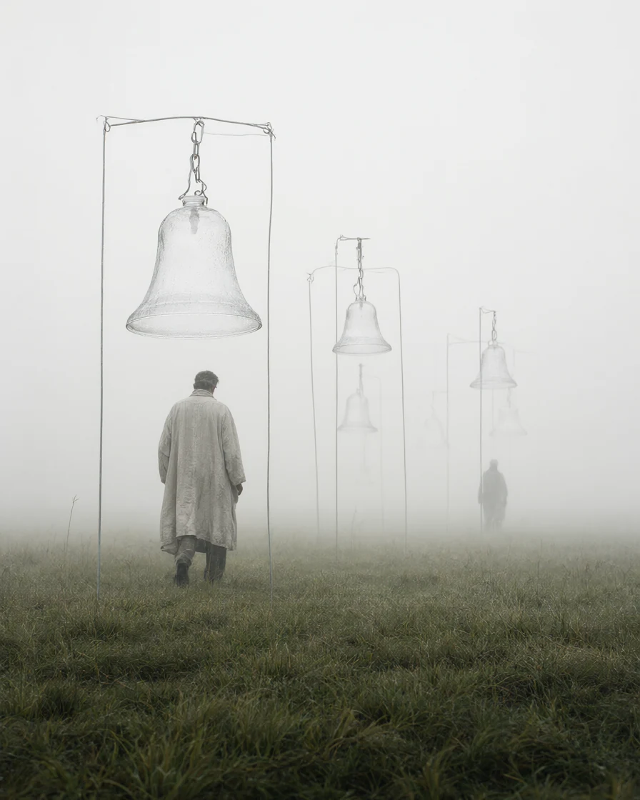</a>

A distant adult traveler in a long linen coat walks through a coastal meadow where enormous transparent glass bells hang from thin metal frames. Their shapes fade into fog at different…

**4:5** · Photography · surreal photo

<details>
<summary>View the full prompt</summary>

```text
A distant adult traveler in a long linen coat walks through a coastal meadow where enormous transparent glass bells hang from thin metal frames. Their shapes fade into fog at different depths. Quiet frontal landscape photograph, subtle wind in the grass, restrained contrast, unsettling calm and physically plausible wet surfaces. Visual medium: High-end photographic realism, believable tactile materials, natural lens perspective, controlled depth of field and subtle fine grain. Keep texture clear without waxy smoothing. Palette: fog gray, faded green, warm ivory. Lighting: very soft misty morning light. All human or humanlike figures are clearly adult and fully clothed. Original character and object designs. One coherent finished image, with no added lettering, logos, signatures or watermarks.
```

</details>

**[Try this prompt on HeyDreaming →](https://heydreaming.com/gpt-image-prompts?id=17&utm_source=github&utm_medium=prompt-library&utm_campaign=awesome-gpt-image-prompts&utm_content=17)** · [Permalink](https://heydreaming.com/gpt-image-prompts/the-fog-bell-field) · [TXT](prompts/017_the-fog-bell-field.txt)

---

<a id="prompt-20"></a>

### 020. Mountain marmot nap

<a href="https://heydreaming.com/gpt-image-prompts?id=20&utm_source=github&utm_medium=prompt-library&utm_campaign=awesome-gpt-image-prompts&utm_content=20">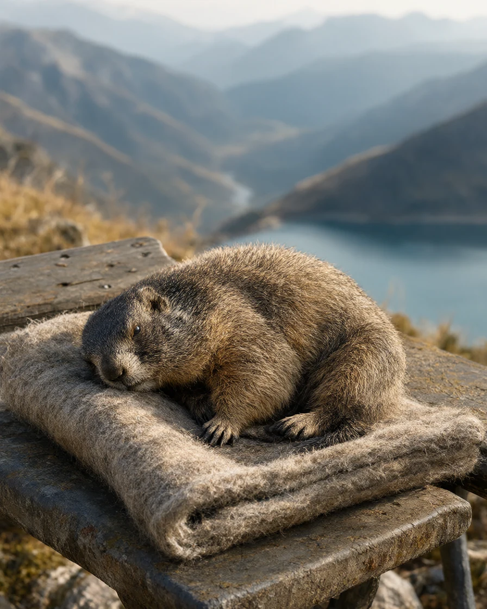</a>

A small marmot sleeps curled on a rolled wool blanket on a weathered camping bench. Far below, a calm mountain lake and layered ridges fall softly out of focus. Close animal portrait,…

**4:5** · Photography · animal photo

<details>
<summary>View the full prompt</summary>

```text
A small marmot sleeps curled on a rolled wool blanket on a weathered camping bench. Far below, a calm mountain lake and layered ridges fall softly out of focus. Close animal portrait, realistic fur detail, natural relaxed limbs, warm sun on the ear and a peaceful unforced wildlife moment. Visual medium: High-end photographic realism, believable tactile materials, natural lens perspective, controlled depth of field and subtle fine grain. Keep texture clear without waxy smoothing. Palette: warm tan, slate stone, alpine blue. Lighting: gentle late-afternoon sun. All human or humanlike figures are clearly adult and fully clothed. Original character and object designs. One coherent finished image, with no added lettering, logos, signatures or watermarks.
```

</details>

**[Try this prompt on HeyDreaming →](https://heydreaming.com/gpt-image-prompts?id=20&utm_source=github&utm_medium=prompt-library&utm_campaign=awesome-gpt-image-prompts&utm_content=20)** · [Permalink](https://heydreaming.com/gpt-image-prompts/mountain-marmot-nap) · [TXT](prompts/020_mountain-marmot-nap.txt)

---

<a id="prompt-21"></a>

### 021. The master potter

<a href="https://heydreaming.com/gpt-image-prompts?id=21&utm_source=github&utm_medium=prompt-library&utm_campaign=awesome-gpt-image-prompts&utm_content=21">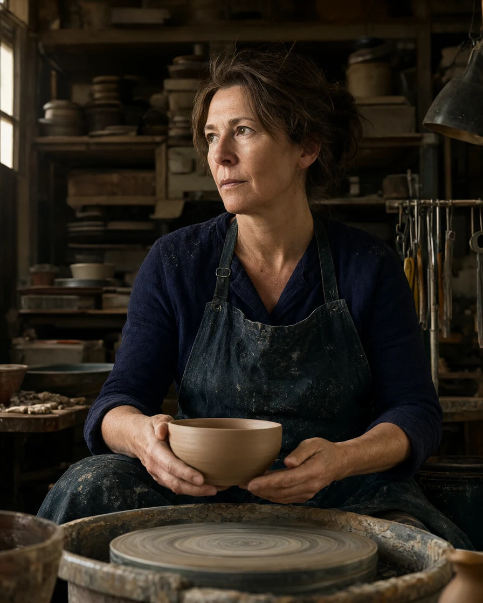</a>

A middle-aged female potter in a dark blue apron sits at a wheel in a rustic ceramics workshop. She pauses with a small unglazed bowl held between both hands, looking thoughtfully…

**4:5** · Photography · cinematic photo

<details>
<summary>View the full prompt</summary>

```text
A middle-aged female potter in a dark blue apron sits at a wheel in a rustic ceramics workshop. She pauses with a small unglazed bowl held between both hands, looking thoughtfully off-camera. Stacked kiln shelves and suspended tools recede behind her. Strong movie-poster composition without any text, atmospheric dust and tactile workwear. Visual medium: High-end photographic realism, believable tactile materials, natural lens perspective, controlled depth of field and subtle fine grain. Keep texture clear without waxy smoothing. Palette: amber, deep green, clay brown. Lighting: warm side-window light and dim practical lamps. All human or humanlike figures are clearly adult and fully clothed. Original character and object designs. One coherent finished image, with no added lettering, logos, signatures or watermarks.
```

</details>

**[Try this prompt on HeyDreaming →](https://heydreaming.com/gpt-image-prompts?id=21&utm_source=github&utm_medium=prompt-library&utm_campaign=awesome-gpt-image-prompts&utm_content=21)** · [Permalink](https://heydreaming.com/gpt-image-prompts/the-master-potter) · [TXT](prompts/021_the-master-potter.txt)

---

<a id="prompt-27"></a>

### 027. Opal gallery curator

<a href="https://heydreaming.com/gpt-image-prompts?id=27&utm_source=github&utm_medium=prompt-library&utm_campaign=awesome-gpt-image-prompts&utm_content=27">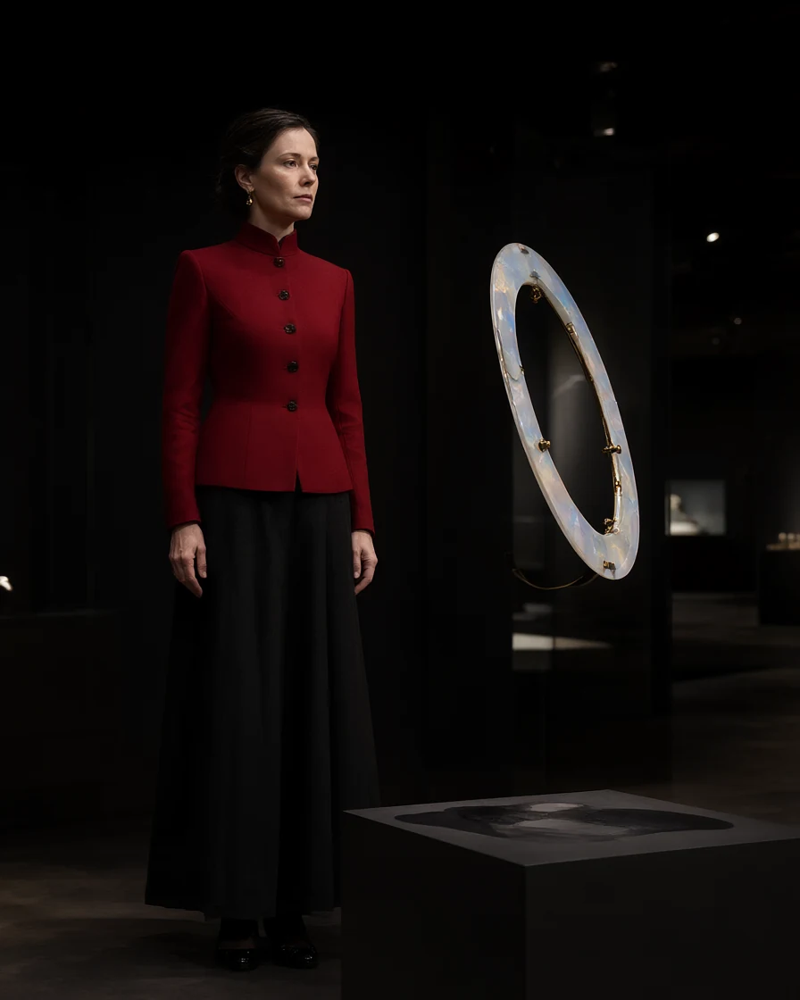</a>

An adult female curator wears a structured ruby-red high-neck jacket and a long dark skirt. She stands beside a levitating vertical ring of translucent opal glass in a nearly black…

**4:5** · Photography · surreal fashion

<details>
<summary>View the full prompt</summary>

```text
An adult female curator wears a structured ruby-red high-neck jacket and a long dark skirt. She stands beside a levitating vertical ring of translucent opal glass in a nearly black museum gallery. Natural visible face, calm poised stance, delicate gold fixtures, restrained cosmic reflections and polished editorial fashion photography. Visual medium: High-end photographic realism, believable tactile materials, natural lens perspective, controlled depth of field and subtle fine grain. Keep texture clear without waxy smoothing. Palette: black, antique gold, soft opal colors. Lighting: focused gallery spotlights with soft facial fill. All human or humanlike figures are clearly adult and fully clothed. Original character and object designs. One coherent finished image, with no added lettering, logos, signatures or watermarks.
```

</details>

**[Try this prompt on HeyDreaming →](https://heydreaming.com/gpt-image-prompts?id=27&utm_source=github&utm_medium=prompt-library&utm_campaign=awesome-gpt-image-prompts&utm_content=27)** · [Permalink](https://heydreaming.com/gpt-image-prompts/opal-gallery-curator) · [TXT](prompts/027_opal-gallery-curator.txt)

---

<a id="prompt-38"></a>

### 038. Olive window portrait

<a href="https://heydreaming.com/gpt-image-prompts?id=38&utm_source=github&utm_medium=prompt-library&utm_campaign=awesome-gpt-image-prompts&utm_content=38">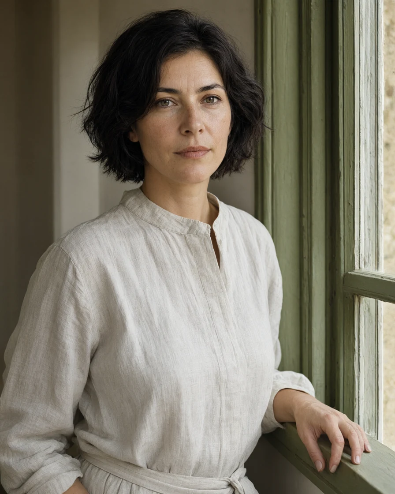</a>

An adult woman with short dark wavy hair and gray-hazel eyes stands beside an old olive-painted window. She wears a simple linen high-neck shirt and rests one hand loosely on the sill. A…

**4:5** · Photography · beauty photo

<details>
<summary>View the full prompt</summary>

```text
An adult woman with short dark wavy hair and gray-hazel eyes stands beside an old olive-painted window. She wears a simple linen high-neck shirt and rests one hand loosely on the sill. A few natural freckles, relaxed expression, waist-up asymmetric portrait, subtle film grain, believable skin and soft falling focus. No face paint. Visual medium: High-end photographic realism, believable tactile materials, natural lens perspective, controlled depth of field and subtle fine grain. Keep texture clear without waxy smoothing. Palette: warm skin tones, olive green, pale cream. Lighting: gentle late-afternoon window light. All human or humanlike figures are clearly adult and fully clothed. Original character and object designs. One coherent finished image, with no added lettering, logos, signatures or watermarks.
```

</details>

**[Try this prompt on HeyDreaming →](https://heydreaming.com/gpt-image-prompts?id=38&utm_source=github&utm_medium=prompt-library&utm_campaign=awesome-gpt-image-prompts&utm_content=38)** · [Permalink](https://heydreaming.com/gpt-image-prompts/olive-window-portrait) · [TXT](prompts/038_olive-window-portrait.txt)

---

<a id="prompt-40"></a>

### 040. Crystal pear hedgehog

<a href="https://heydreaming.com/gpt-image-prompts?id=40&utm_source=github&utm_medium=prompt-library&utm_campaign=awesome-gpt-image-prompts&utm_content=40">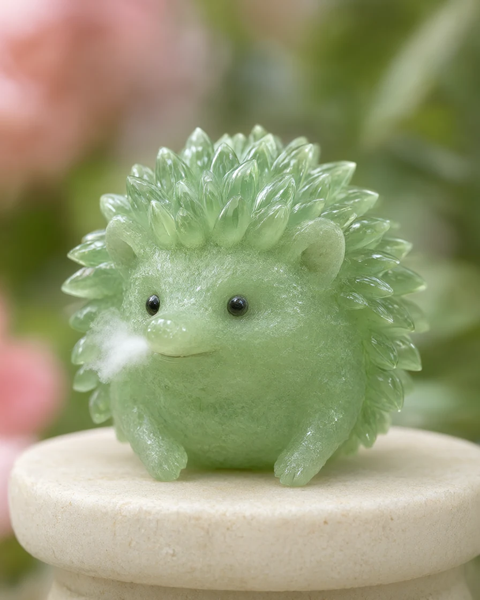</a>

A tiny original pear-shaped hedgehog made of translucent green crystal sits on a cream stone plinth. Its short spines resemble polished leaf tips, and a soft puff of mist escapes its…

**4:5** · Photography · macro whimsy

<details>
<summary>View the full prompt</summary>

```text
A tiny original pear-shaped hedgehog made of translucent green crystal sits on a cream stone plinth. Its short spines resemble polished leaf tips, and a soft puff of mist escapes its little nose. Close macro composition, charming natural expression, believable refraction and gentle shallow-focus garden colors behind. Visual medium: High-end photographic realism, believable tactile materials, natural lens perspective, controlled depth of field and subtle fine grain. Keep texture clear without waxy smoothing. Palette: pale jade, cream, blush pink. Lighting: diffuse daylight with delicate translucent highlights. All human or humanlike figures are clearly adult and fully clothed. Original character and object designs. One coherent finished image, with no added lettering, logos, signatures or watermarks.
```

</details>

**[Try this prompt on HeyDreaming →](https://heydreaming.com/gpt-image-prompts?id=40&utm_source=github&utm_medium=prompt-library&utm_campaign=awesome-gpt-image-prompts&utm_content=40)** · [Permalink](https://heydreaming.com/gpt-image-prompts/crystal-pear-hedgehog) · [TXT](prompts/040_crystal-pear-hedgehog.txt)

---

<a id="prompt-62"></a>

### 062. The grocery tote puppy

<a href="https://heydreaming.com/gpt-image-prompts?id=62&utm_source=github&utm_medium=prompt-library&utm_campaign=awesome-gpt-image-prompts&utm_content=62">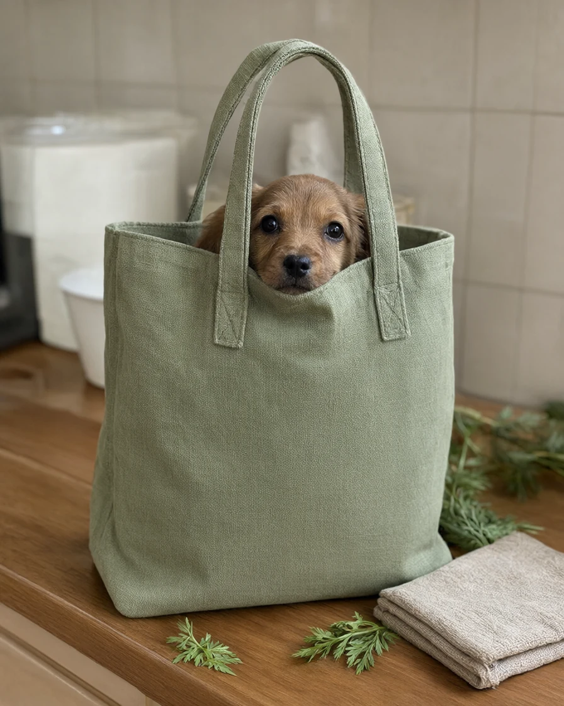</a>

A small brown puppy peeks out of a plain sage cloth grocery tote set on a wooden kitchen bench. A few carrot leaves and an empty folded towel sit beside the bag. Close candid pet…

**4:5** · Photography · pet snapshot

<details>
<summary>View the full prompt</summary>

```text
A small brown puppy peeks out of a plain sage cloth grocery tote set on a wooden kitchen bench. A few carrot leaves and an empty folded towel sit beside the bag. Close candid pet photograph, realistic curious eyes, soft fur and stitching detail, ordinary home background falling out of focus. No packaging logos or readable print. Visual medium: High-end photographic realism, believable tactile materials, natural lens perspective, controlled depth of field and subtle fine grain. Keep texture clear without waxy smoothing. Palette: oat beige, sage green, soft brown. Lighting: unposed kitchen window daylight. All human or humanlike figures are clearly adult and fully clothed. Original character and object designs. One coherent finished image, with no added lettering, logos, signatures or watermarks.
```

</details>

**[Try this prompt on HeyDreaming →](https://heydreaming.com/gpt-image-prompts?id=62&utm_source=github&utm_medium=prompt-library&utm_campaign=awesome-gpt-image-prompts&utm_content=62)** · [Permalink](https://heydreaming.com/gpt-image-prompts/the-grocery-tote-puppy) · [TXT](prompts/062_the-grocery-tote-puppy.txt)

---

<a id="prompt-78"></a>

### 078. Greenhouse afternoon

<a href="https://heydreaming.com/gpt-image-prompts?id=78&utm_source=github&utm_medium=prompt-library&utm_campaign=awesome-gpt-image-prompts&utm_content=78">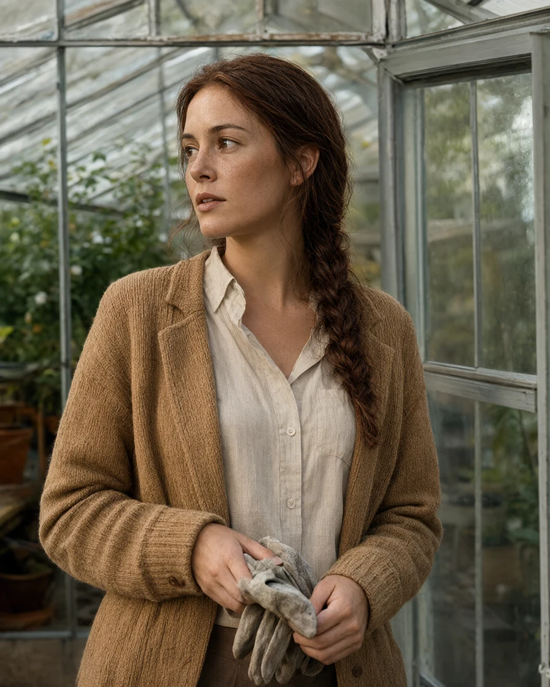</a>

An adult woman with a loose chestnut braid and natural freckles wears a camel knit jacket over a plain linen shirt. She holds gardening gloves while looking sideways toward an open…

**4:5** · Photography · beauty photo

<details>
<summary>View the full prompt</summary>

```text
An adult woman with a loose chestnut braid and natural freckles wears a camel knit jacket over a plain linen shirt. She holds gardening gloves while looking sideways toward an open greenhouse door. Waist-up candid portrait, relaxed shoulders, realistic skin texture, soft leaf reflections and cinematic shallow focus. No facial patterns or elaborate jewelry. Visual medium: High-end photographic realism, believable tactile materials, natural lens perspective, controlled depth of field and subtle fine grain. Keep texture clear without waxy smoothing. Palette: warm chestnut, oat cream, sage green. Lighting: soft late-afternoon light through old greenhouse glass. All human or humanlike figures are clearly adult and fully clothed. Original character and object designs. One coherent finished image, with no added lettering, logos, signatures or watermarks.
```

</details>

**[Try this prompt on HeyDreaming →](https://heydreaming.com/gpt-image-prompts?id=78&utm_source=github&utm_medium=prompt-library&utm_campaign=awesome-gpt-image-prompts&utm_content=78)** · [Permalink](https://heydreaming.com/gpt-image-prompts/greenhouse-afternoon) · [TXT](prompts/078_greenhouse-afternoon.txt)

---

<a id="prompt-80"></a>

### 080. Black glass orchid

<a href="https://heydreaming.com/gpt-image-prompts?id=80&utm_source=github&utm_medium=prompt-library&utm_campaign=awesome-gpt-image-prompts&utm_content=80">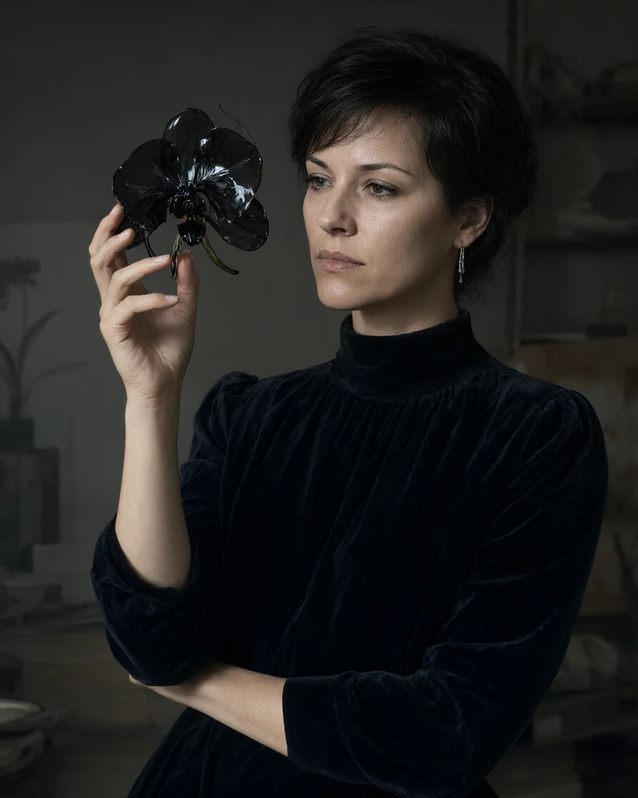</a>

An adult dark-haired botanical artist wears a high-neck gunmetal blouse in a dark velvet-lined studio. She holds one translucent black-glass orchid away from her body and studies its…

**4:5** · Photography · gothic photo

<details>
<summary>View the full prompt</summary>

```text
An adult dark-haired botanical artist wears a high-neck gunmetal blouse in a dark velvet-lined studio. She holds one translucent black-glass orchid away from her body and studies its shape. Tight three-quarter portrait, visible natural face, restrained jewelry, believable skin and glass textures, intense but composed expression. No hood or hand covering the mouth. Visual medium: High-end photographic realism, believable tactile materials, natural lens perspective, controlled depth of field and subtle fine grain. Keep texture clear without waxy smoothing. Palette: blue-black, muted emerald, pale natural skin. Lighting: soft low-key face lighting with a narrow green edge. All human or humanlike figures are clearly adult and fully clothed. Original character and object designs. One coherent finished image, with no added lettering, logos, signatures or watermarks.
```

</details>

**[Try this prompt on HeyDreaming →](https://heydreaming.com/gpt-image-prompts?id=80&utm_source=github&utm_medium=prompt-library&utm_campaign=awesome-gpt-image-prompts&utm_content=80)** · [Permalink](https://heydreaming.com/gpt-image-prompts/black-glass-orchid) · [TXT](prompts/080_black-glass-orchid.txt)

---

<a id="prompt-85"></a>

### 085. Coral crabs at dusk

<a href="https://heydreaming.com/gpt-image-prompts?id=85&utm_source=github&utm_medium=prompt-library&utm_campaign=awesome-gpt-image-prompts&utm_content=85">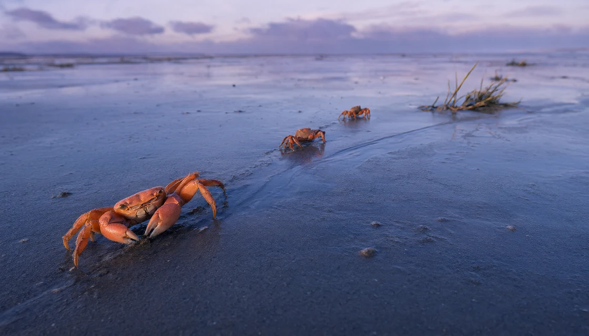</a>

Three small coral-orange shore crabs scuttle in a loose diagonal across a wide blue-gray tidal flat at dusk. The nearest crab is low in the left foreground with its claws folded, the…

**16:9** · Photography · cinematic animal

<details>
<summary>View the full prompt</summary>

```text
Three small coral-orange shore crabs scuttle in a loose diagonal across a wide blue-gray tidal flat at dusk. The nearest crab is low in the left foreground with its claws folded, the second crosses a shallow curved ripple near the center, and the third is tiny beside a distant patch of sea grass. Wet sand mirrors muted purple clouds, with delicate footprints and small beads of water resolving around the nearest animal. Low expansive wildlife photograph, realistic shells and jointed legs, shallow foreground detail fading into a peaceful open coast. Visual medium: High-end photographic realism, believable tactile materials, natural lens perspective, controlled depth of field and subtle fine grain. Keep texture clear without waxy smoothing. Palette: deep blue, coral orange, muted purple. Lighting: a glowing coastal sunset with soft foreground rim light. All human or humanlike figures are clearly adult and fully clothed. Original character and object designs. One coherent finished image, with no added lettering, logos, signatures or watermarks.
```

</details>

**[Try this prompt on HeyDreaming →](https://heydreaming.com/gpt-image-prompts?id=85&utm_source=github&utm_medium=prompt-library&utm_campaign=awesome-gpt-image-prompts&utm_content=85)** · [Permalink](https://heydreaming.com/gpt-image-prompts/coral-crabs-at-dusk) · [TXT](prompts/085_coral-crabs-at-dusk.txt)

---

<a id="prompt-87"></a>

### 087. The opal astrolabe

<a href="https://heydreaming.com/gpt-image-prompts?id=87&utm_source=github&utm_medium=prompt-library&utm_campaign=awesome-gpt-image-prompts&utm_content=87">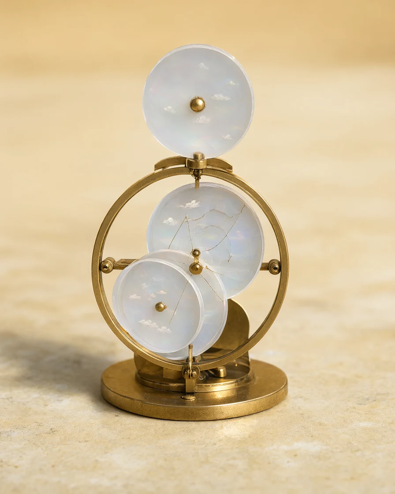</a>

A small brass desktop astrolabe with three translucent opal disks stands on a pale yellow stone surface. Tiny cloud patterns seem suspended inside the glass. A few fine engraved…

**4:5** · Photography · product surreal

<details>
<summary>View the full prompt</summary>

```text
A small brass desktop astrolabe with three translucent opal disks stands on a pale yellow stone surface. Tiny cloud patterns seem suspended inside the glass. A few fine engraved mechanical lines catch the light without forming readable text. Elegant close product photograph, shallow focus, believable refraction and restrained surreal detail. No necklace or pendant. Visual medium: High-end photographic realism, believable tactile materials, natural lens perspective, controlled depth of field and subtle fine grain. Keep texture clear without waxy smoothing. Palette: antique brass, honey cream, misty blue. Lighting: gentle macro product lighting with warm background glow. All human or humanlike figures are clearly adult and fully clothed. Original character and object designs. One coherent finished image, with no added lettering, logos, signatures or watermarks.
```

</details>

**[Try this prompt on HeyDreaming →](https://heydreaming.com/gpt-image-prompts?id=87&utm_source=github&utm_medium=prompt-library&utm_campaign=awesome-gpt-image-prompts&utm_content=87)** · [Permalink](https://heydreaming.com/gpt-image-prompts/the-opal-astrolabe) · [TXT](prompts/087_the-opal-astrolabe.txt)

---

<a id="style-anime"></a>

## Anime

<a id="prompt-3"></a>

### 003. Moon garden reader

<a href="https://heydreaming.com/gpt-image-prompts?id=3&utm_source=github&utm_medium=prompt-library&utm_campaign=awesome-gpt-image-prompts&utm_content=3">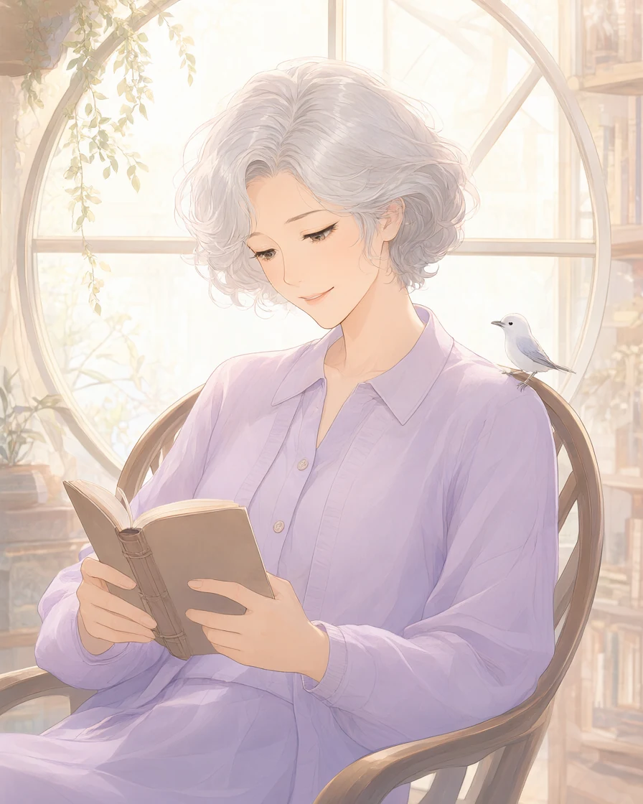</a>

An adult silver-haired woman in a closed-collar lilac cardigan reads a cloth-bound field journal beside a circular greenhouse window. A tiny white mechanical wren rests on the chair…

**4:5** · Anime · soft anime

<details>
<summary>View the full prompt</summary>

```text
An adult silver-haired woman in a closed-collar lilac cardigan reads a cloth-bound field journal beside a circular greenhouse window. A tiny white mechanical wren rests on the chair back. She sits in a relaxed three-quarter pose, with hanging foliage and softly blurred shelves, graceful hands and a quiet smile. Visual medium: Soft luminous anime painting, refined adult features, gentle contour lines, warm translucent skin tones, silky cloth and broad delicate highlights. Palette: warm ivory, pale apricot, soft silver. Lighting: broad warm window light, delicate cool fill. All human or humanlike figures are clearly adult and fully clothed. Original character and object designs. One coherent finished image, with no added lettering, logos, signatures or watermarks.
```

</details>

**[Try this prompt on HeyDreaming →](https://heydreaming.com/gpt-image-prompts?id=3&utm_source=github&utm_medium=prompt-library&utm_campaign=awesome-gpt-image-prompts&utm_content=3)** · [Permalink](https://heydreaming.com/gpt-image-prompts/moon-garden-reader) · [TXT](prompts/003_moon-garden-reader.txt)

---

<a id="prompt-18"></a>

### 018. Midnight cellist

<a href="https://heydreaming.com/gpt-image-prompts?id=18&utm_source=github&utm_medium=prompt-library&utm_campaign=awesome-gpt-image-prompts&utm_content=18">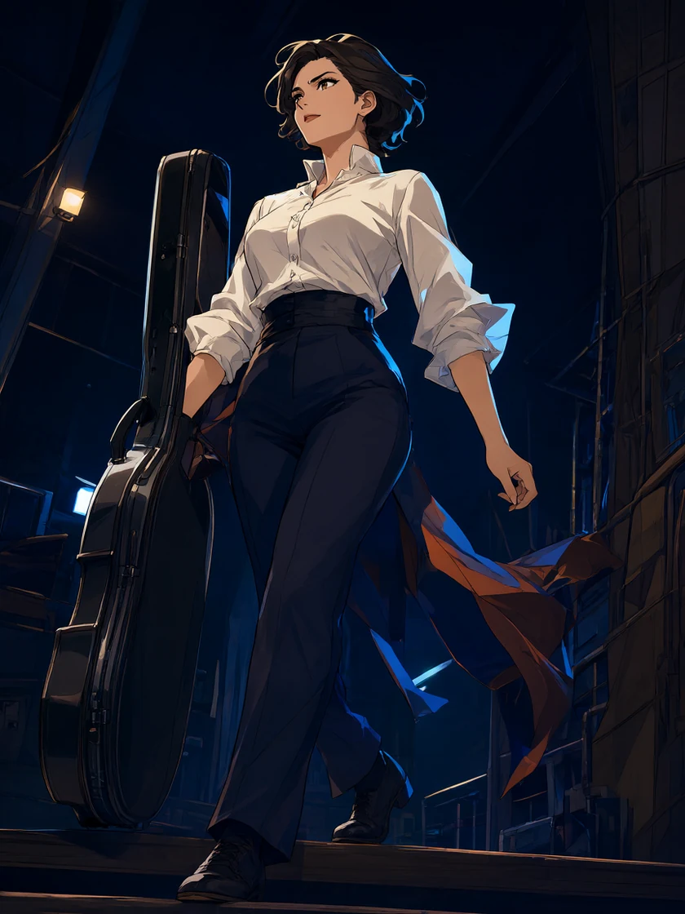</a>

An adult female cellist in a buttoned ivory shirt and fitted navy waistcoat strides down a narrow backstage stair carrying a closed curved instrument case. A loose ribbon and coat hem…

**3:4** · Anime · anime action

<details>
<summary>View the full prompt</summary>

```text
An adult female cellist in a buttoned ivory shirt and fitted navy waistcoat strides down a narrow backstage stair carrying a closed curved instrument case. A loose ribbon and coat hem follow her motion. Slight low angle, energetic diagonal composition, clean adult face design, dark painted theatre setting and crisp stylized highlights. Visual medium: Clearly two-dimensional anime illustration, expressive adult character proportions, confident fine ink contours, layered cel shadows and carefully painted depth. Preserve a drawn finish. Palette: navy, cream, ember orange. Lighting: sharp blue rim light with warm backstage lamps. All human or humanlike figures are clearly adult and fully clothed. Original character and object designs. One coherent finished image, with no added lettering, logos, signatures or watermarks.
```

</details>

**[Try this prompt on HeyDreaming →](https://heydreaming.com/gpt-image-prompts?id=18&utm_source=github&utm_medium=prompt-library&utm_campaign=awesome-gpt-image-prompts&utm_content=18)** · [Permalink](https://heydreaming.com/gpt-image-prompts/midnight-cellist) · [TXT](prompts/018_midnight-cellist.txt)

---

<a id="prompt-28"></a>

### 028. Greenhouse airport pilot

<a href="https://heydreaming.com/gpt-image-prompts?id=28&utm_source=github&utm_medium=prompt-library&utm_campaign=awesome-gpt-image-prompts&utm_content=28">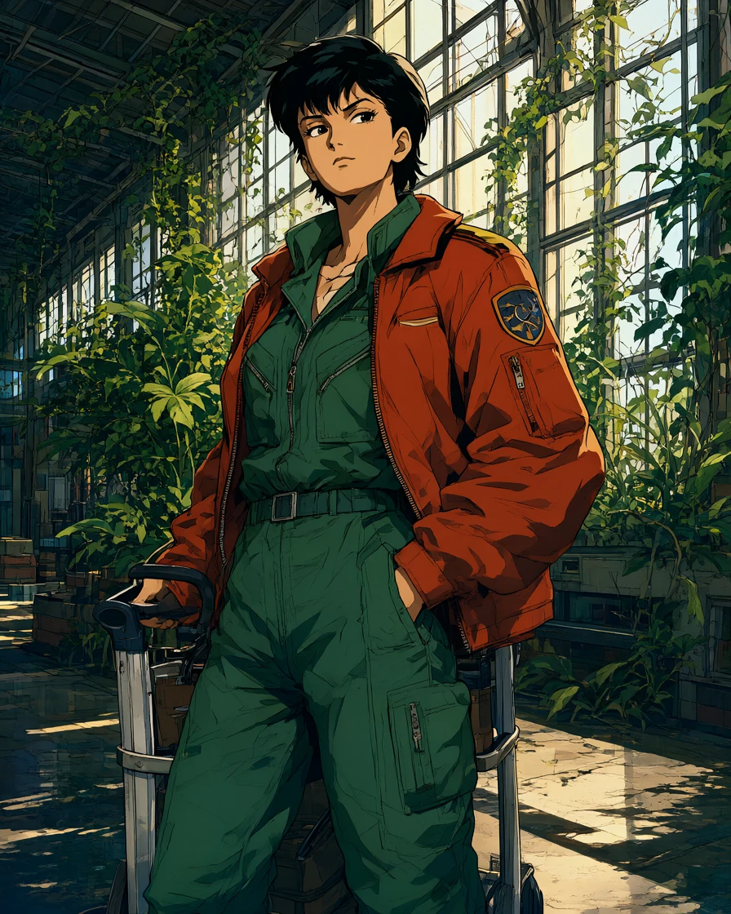</a>

An adult female transport pilot with short black hair wears a rust-orange flight jacket over a closed teal utility suit. She waits beside a small luggage cart in an overgrown greenhouse…

**4:5** · Anime · retro anime

<details>
<summary>View the full prompt</summary>

```text
An adult female transport pilot with short black hair wears a rust-orange flight jacket over a closed teal utility suit. She waits beside a small luggage cart in an overgrown greenhouse airport concourse. Half-body portrait, one hand on the handle, bold adult character design, layered industrial greenery and carefully painted reflections. Visual medium: 1990s-inspired two-dimensional science-fiction anime illustration, confident dark outlines, crisp cel shadows, bold color blocks and a richly painted industrial setting. Palette: rust red, dark green, warm ivory. Lighting: bright directional light through steel-framed windows. All human or humanlike figures are clearly adult and fully clothed. Original character and object designs. One coherent finished image, with no added lettering, logos, signatures or watermarks.
```

</details>

**[Try this prompt on HeyDreaming →](https://heydreaming.com/gpt-image-prompts?id=28&utm_source=github&utm_medium=prompt-library&utm_campaign=awesome-gpt-image-prompts&utm_content=28)** · [Permalink](https://heydreaming.com/gpt-image-prompts/greenhouse-airport-pilot) · [TXT](prompts/028_greenhouse-airport-pilot.txt)

---

<a id="prompt-39"></a>

### 039. Camellia bowl maker

<a href="https://heydreaming.com/gpt-image-prompts?id=39&utm_source=github&utm_medium=prompt-library&utm_campaign=awesome-gpt-image-prompts&utm_content=39">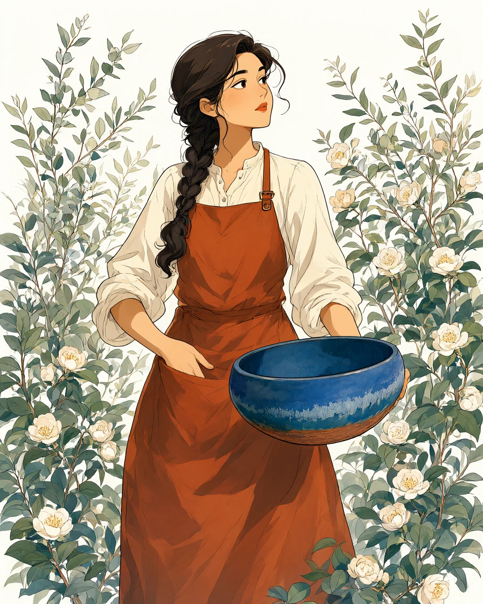</a>

An adult female ceramic artist with a long dark braid wears a rust-colored apron over a closed cream blouse. She carries a wide blue glazed bowl through a garden of eucalyptus and small…

**4:5** · Anime · botanical anime

<details>
<summary>View the full prompt</summary>

```text
An adult female ceramic artist with a long dark braid wears a rust-colored apron over a closed cream blouse. She carries a wide blue glazed bowl through a garden of eucalyptus and small white camellias. Three-quarter figure, flat decorative foliage, graceful adult character proportions and warm thoughtful expression. Visual medium: Clearly two-dimensional anime illustration, expressive adult character proportions, confident fine ink contours, layered cel shadows and carefully painted depth. Preserve a drawn finish. Palette: sage green, rust orange, ivory, deep blue. Lighting: soft even daylight with clean illustrated highlights. All human or humanlike figures are clearly adult and fully clothed. Original character and object designs. One coherent finished image, with no added lettering, logos, signatures or watermarks.
```

</details>

**[Try this prompt on HeyDreaming →](https://heydreaming.com/gpt-image-prompts?id=39&utm_source=github&utm_medium=prompt-library&utm_campaign=awesome-gpt-image-prompts&utm_content=39)** · [Permalink](https://heydreaming.com/gpt-image-prompts/camellia-bowl-maker) · [TXT](prompts/039_camellia-bowl-maker.txt)

---

<a id="prompt-44"></a>

### 044. The evening bookbinder

<a href="https://heydreaming.com/gpt-image-prompts?id=44&utm_source=github&utm_medium=prompt-library&utm_campaign=awesome-gpt-image-prompts&utm_content=44">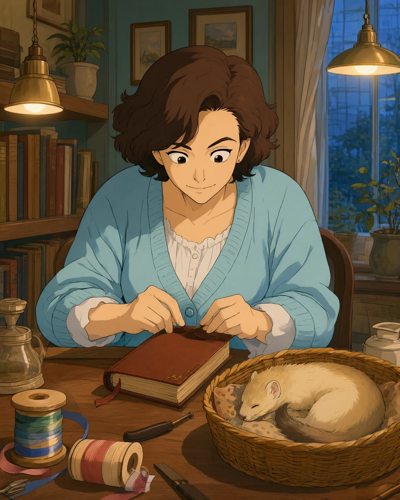</a>

An adult female bookbinder in a pale blue cardigan repairs a cloth-bound journal at a wooden window table. A small weasel sleeps curled in a woven basket beside ribbon spools.…

**4:5** · Anime · cozy anime

<details>
<summary>View the full prompt</summary>

```text
An adult female bookbinder in a pale blue cardigan repairs a cloth-bound journal at a wooden window table. A small weasel sleeps curled in a woven basket beside ribbon spools. Comfortable indoor scene, gentle adult face design, detailed tools, warm layered shelves and a quiet cozy atmosphere. No masks or lettering. Visual medium: Clearly two-dimensional anime illustration, expressive adult character proportions, confident fine ink contours, layered cel shadows and carefully painted depth. Preserve a drawn finish. Palette: honey gold, soft teal, chestnut brown. Lighting: warm hanging lamps balanced by blue evening window light. All human or humanlike figures are clearly adult and fully clothed. Original character and object designs. One coherent finished image, with no added lettering, logos, signatures or watermarks.
```

</details>

**[Try this prompt on HeyDreaming →](https://heydreaming.com/gpt-image-prompts?id=44&utm_source=github&utm_medium=prompt-library&utm_campaign=awesome-gpt-image-prompts&utm_content=44)** · [Permalink](https://heydreaming.com/gpt-image-prompts/the-evening-bookbinder) · [TXT](prompts/044_the-evening-bookbinder.txt)

---

<a id="prompt-47"></a>

### 047. Mushroom mail break

<a href="https://heydreaming.com/gpt-image-prompts?id=47&utm_source=github&utm_medium=prompt-library&utm_campaign=awesome-gpt-image-prompts&utm_content=47">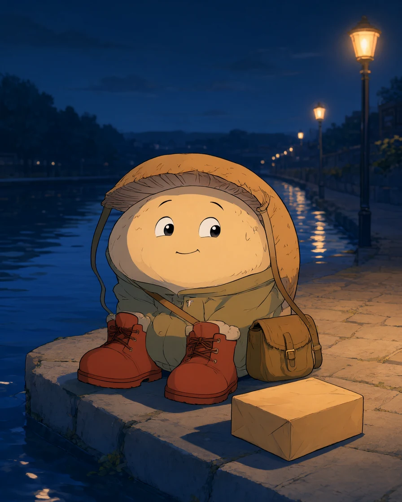</a>

An original round mushroom messenger with two tiny boot-like feet and a woven satchel sits on a low canal step after a long delivery route. A plain paper parcel rests beside it.…

**4:5** · Anime · cute anime

<details>
<summary>View the full prompt</summary>

```text
An original round mushroom messenger with two tiny boot-like feet and a woven satchel sits on a low canal step after a long delivery route. A plain paper parcel rests beside it. Appealing expressive eyes, clean soft outlines, simple adult-free character comedy, quiet blue water and a cozy light halo. No writing. Visual medium: Clearly two-dimensional anime illustration, expressive adult character proportions, confident fine ink contours, layered cel shadows and carefully painted depth. Preserve a drawn finish. Palette: midnight blue, warm apricot, soft red. Lighting: a little amber quay lamp in cool evening air. All human or humanlike figures are clearly adult and fully clothed. Original character and object designs. One coherent finished image, with no added lettering, logos, signatures or watermarks.
```

</details>

**[Try this prompt on HeyDreaming →](https://heydreaming.com/gpt-image-prompts?id=47&utm_source=github&utm_medium=prompt-library&utm_campaign=awesome-gpt-image-prompts&utm_content=47)** · [Permalink](https://heydreaming.com/gpt-image-prompts/mushroom-mail-break) · [TXT](prompts/047_mushroom-mail-break.txt)

---

<a id="prompt-49"></a>

### 049. The root bridge acrobat

<a href="https://heydreaming.com/gpt-image-prompts?id=49&utm_source=github&utm_medium=prompt-library&utm_campaign=awesome-gpt-image-prompts&utm_content=49">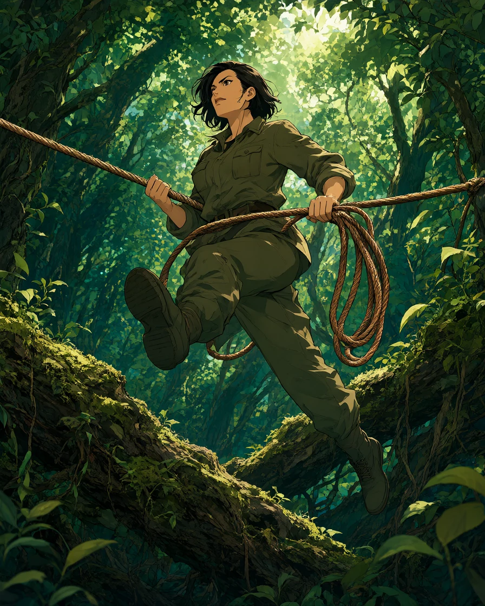</a>

An adult female forest acrobat in a closed dark-green utility tunic and fitted trousers springs from a mossy root bridge carrying a coiled copper rope. Her short black hair follows the…

**4:5** · Anime · dynamic anime

<details>
<summary>View the full prompt</summary>

```text
An adult female forest acrobat in a closed dark-green utility tunic and fitted trousers springs from a mossy root bridge carrying a coiled copper rope. Her short black hair follows the motion. Diagonal full-body action, clear normal human anatomy, original outfit, dense painted greenery and confident sharp 2D linework. Visual medium: Clearly two-dimensional anime illustration, expressive adult character proportions, confident fine ink contours, layered cel shadows and carefully painted depth. Preserve a drawn finish. Palette: forest green, copper, warm skin tones. Lighting: bright patches of sunlight through dense leaves. All human or humanlike figures are clearly adult and fully clothed. Original character and object designs. One coherent finished image, with no added lettering, logos, signatures or watermarks.
```

</details>

**[Try this prompt on HeyDreaming →](https://heydreaming.com/gpt-image-prompts?id=49&utm_source=github&utm_medium=prompt-library&utm_campaign=awesome-gpt-image-prompts&utm_content=49)** · [Permalink](https://heydreaming.com/gpt-image-prompts/the-root-bridge-acrobat) · [TXT](prompts/049_the-root-bridge-acrobat.txt)

---

<a id="prompt-53"></a>

### 053. The furnace glassmaker

<a href="https://heydreaming.com/gpt-image-prompts?id=53&utm_source=github&utm_medium=prompt-library&utm_campaign=awesome-gpt-image-prompts&utm_content=53">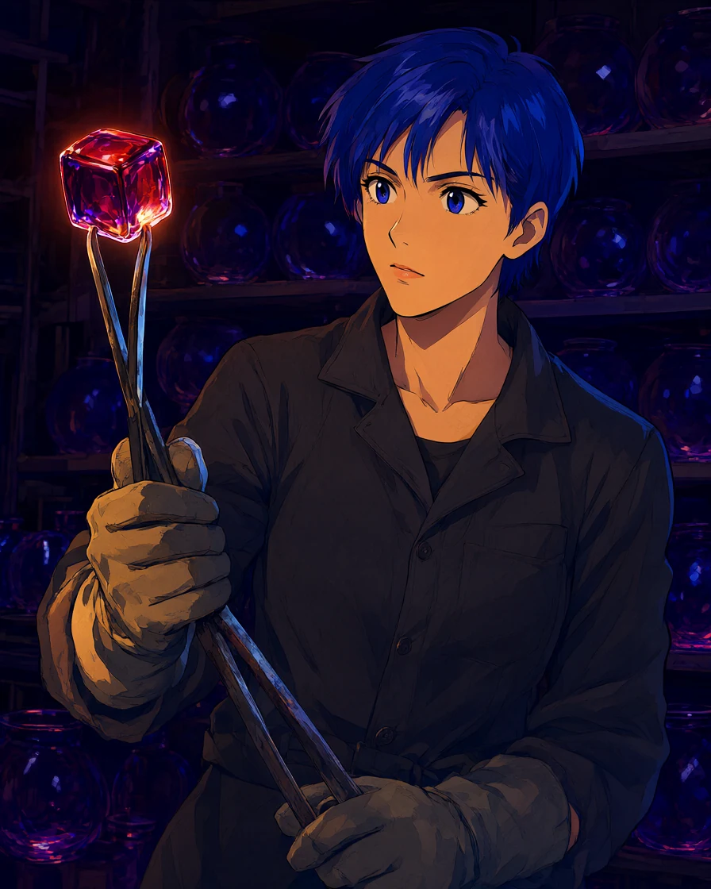</a>

An adult female glassmaker with short cobalt hair wears a buttoned charcoal work jacket and thick gloves. She lifts a small glowing ruby glass cube with long tongs, studying it…

**4:5** · Anime · saturated anime

<details>
<summary>View the full prompt</summary>

```text
An adult female glassmaker with short cobalt hair wears a buttoned charcoal work jacket and thick gloves. She lifts a small glowing ruby glass cube with long tongs, studying it carefully. Tight three-quarter portrait, a dark workshop of round glass vessels behind her, natural unmarked skin, expressive eyes and vivid illustrated color contrast. Visual medium: Clearly two-dimensional anime illustration, expressive adult character proportions, confident fine ink contours, layered cel shadows and carefully painted depth. Preserve a drawn finish. Palette: cobalt, deep violet, glowing orange. Lighting: intense warm furnace light balanced by blue shadows. All human or humanlike figures are clearly adult and fully clothed. Original character and object designs. One coherent finished image, with no added lettering, logos, signatures or watermarks.
```

</details>

**[Try this prompt on HeyDreaming →](https://heydreaming.com/gpt-image-prompts?id=53&utm_source=github&utm_medium=prompt-library&utm_campaign=awesome-gpt-image-prompts&utm_content=53)** · [Permalink](https://heydreaming.com/gpt-image-prompts/the-furnace-glassmaker) · [TXT](prompts/053_the-furnace-glassmaker.txt)

---

<a id="prompt-54"></a>

### 054. The copper cymbal

<a href="https://heydreaming.com/gpt-image-prompts?id=54&utm_source=github&utm_medium=prompt-library&utm_campaign=awesome-gpt-image-prompts&utm_content=54">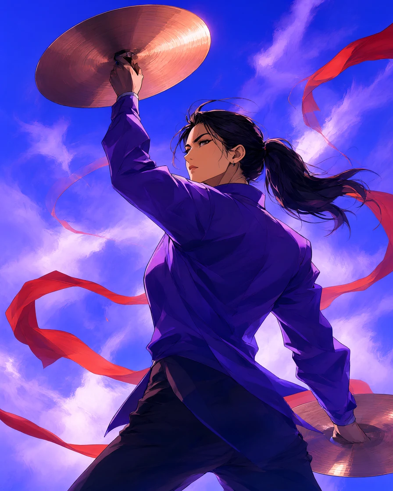</a>

An adult female orchestral drummer with a black ponytail and a fully covering purple stage jacket raises a broad copper cymbal. A long red fabric ribbon arcs behind her as she turns.…

**4:5** · Anime · neon anime action

<details>
<summary>View the full prompt</summary>

```text
An adult female orchestral drummer with a black ponytail and a fully covering purple stage jacket raises a broad copper cymbal. A long red fabric ribbon arcs behind her as she turns. Dynamic triangular composition, clean energetic adult character design, abstract painted stage haze, crisp linework and confident cel shadows. No weapons. Visual medium: Clearly two-dimensional anime illustration, expressive adult character proportions, confident fine ink contours, layered cel shadows and carefully painted depth. Preserve a drawn finish. Palette: electric blue, vermilion, soft lavender. Lighting: sharp luminous rim light through theatrical colored mist. All human or humanlike figures are clearly adult and fully clothed. Original character and object designs. One coherent finished image, with no added lettering, logos, signatures or watermarks.
```

</details>

**[Try this prompt on HeyDreaming →](https://heydreaming.com/gpt-image-prompts?id=54&utm_source=github&utm_medium=prompt-library&utm_campaign=awesome-gpt-image-prompts&utm_content=54)** · [Permalink](https://heydreaming.com/gpt-image-prompts/the-copper-cymbal) · [TXT](prompts/054_the-copper-cymbal.txt)

---

<a id="prompt-61"></a>

### 061. Fern coil conservator

<a href="https://heydreaming.com/gpt-image-prompts?id=61&utm_source=github&utm_medium=prompt-library&utm_campaign=awesome-gpt-image-prompts&utm_content=61">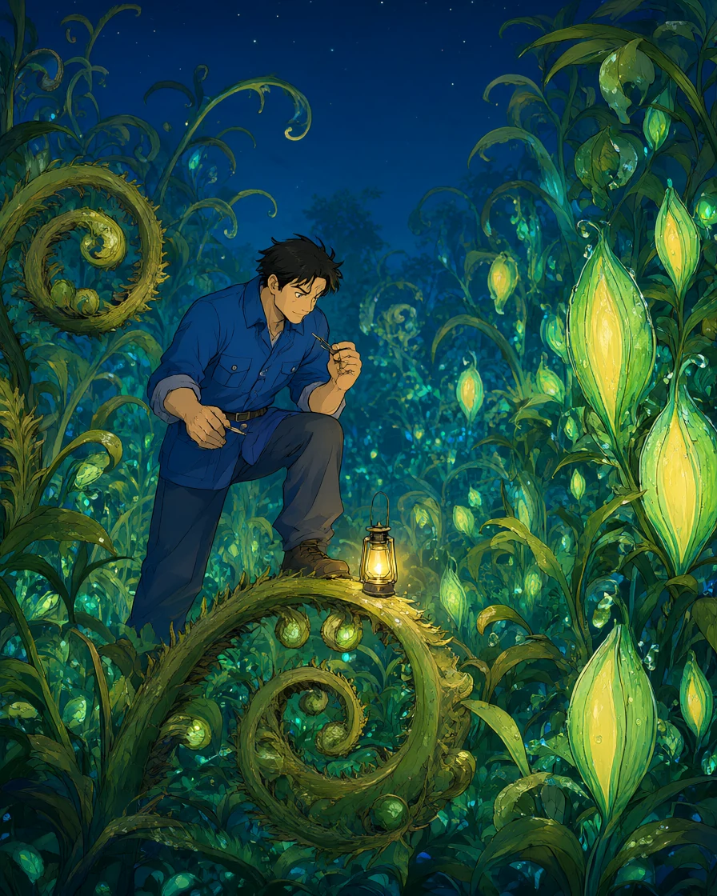</a>

A miniature adult conservator in a buttoned blue work coat balances on a giant coiled fern, checking a tiny amber lantern with a small tool. Tall glassy seed pods and dew-laden leaves…

**4:5** · Anime · glowing anime

<details>
<summary>View the full prompt</summary>

```text
A miniature adult conservator in a buttoned blue work coat balances on a giant coiled fern, checking a tiny amber lantern with a small tool. Tall glassy seed pods and dew-laden leaves form a luminous forest clearing around the figure. Dreamlike painted background, delicate clean 2D character design, readable scale and warm adventurous wonder. No fairy wings. Visual medium: Clearly two-dimensional anime illustration, expressive adult character proportions, confident fine ink contours, layered cel shadows and carefully painted depth. Preserve a drawn finish. Palette: deep blue, jade, amber pinpoints. Lighting: bioluminescent seed pods under a clear starry sky. All human or humanlike figures are clearly adult and fully clothed. Original character and object designs. One coherent finished image, with no added lettering, logos, signatures or watermarks.
```

</details>

**[Try this prompt on HeyDreaming →](https://heydreaming.com/gpt-image-prompts?id=61&utm_source=github&utm_medium=prompt-library&utm_campaign=awesome-gpt-image-prompts&utm_content=61)** · [Permalink](https://heydreaming.com/gpt-image-prompts/fern-coil-conservator) · [TXT](prompts/061_fern-coil-conservator.txt)

---

<a id="prompt-67"></a>

### 067. Night bridge courier

<a href="https://heydreaming.com/gpt-image-prompts?id=67&utm_source=github&utm_medium=prompt-library&utm_campaign=awesome-gpt-image-prompts&utm_content=67">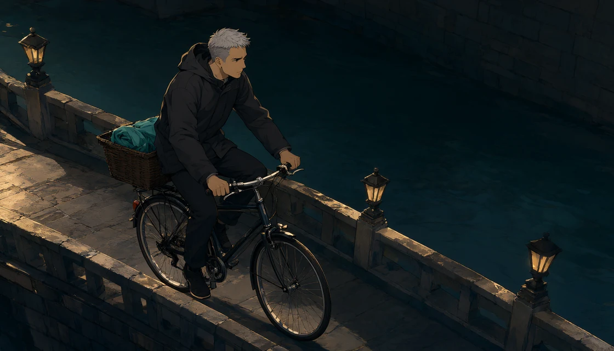</a>

A clearly adult male night courier with silver cropped hair pedals a compact cargo bicycle across a narrow old stone bridge. He wears a closed charcoal raincoat and dark trousers, while…

**16:9** · Anime · anime portrait

<details>
<summary>View the full prompt</summary>

```text
A clearly adult male night courier with silver cropped hair pedals a compact cargo bicycle across a narrow old stone bridge. He wears a closed charcoal raincoat and dark trousers, while a low wicker basket behind the saddle carries rolled teal fabric. An elevated wide view looks diagonally across the whole bridge, with the small cyclist near the lower left and quiet water filling the opposite corner. Antique-gold lanterns cast narrow edge highlights along the damp stone and spokes. Clean expressive adult anime design, readable full-body motion and generous atmospheric depth. Visual medium: Clearly two-dimensional anime illustration, expressive adult character proportions, confident fine ink contours, layered cel shadows and carefully painted depth. Preserve a drawn finish. Palette: charcoal, cool teal, antique gold. Lighting: narrow golden edge light and deep teal interior shadow. All human or humanlike figures are clearly adult and fully clothed. Original character and object designs. One coherent finished image, with no added lettering, logos, signatures or watermarks.
```

</details>

**[Try this prompt on HeyDreaming →](https://heydreaming.com/gpt-image-prompts?id=67&utm_source=github&utm_medium=prompt-library&utm_campaign=awesome-gpt-image-prompts&utm_content=67)** · [Permalink](https://heydreaming.com/gpt-image-prompts/night-bridge-courier) · [TXT](prompts/067_night-bridge-courier.txt)

---

<a id="prompt-70"></a>

### 070. The dumpling counter

<a href="https://heydreaming.com/gpt-image-prompts?id=70&utm_source=github&utm_medium=prompt-library&utm_campaign=awesome-gpt-image-prompts&utm_content=70">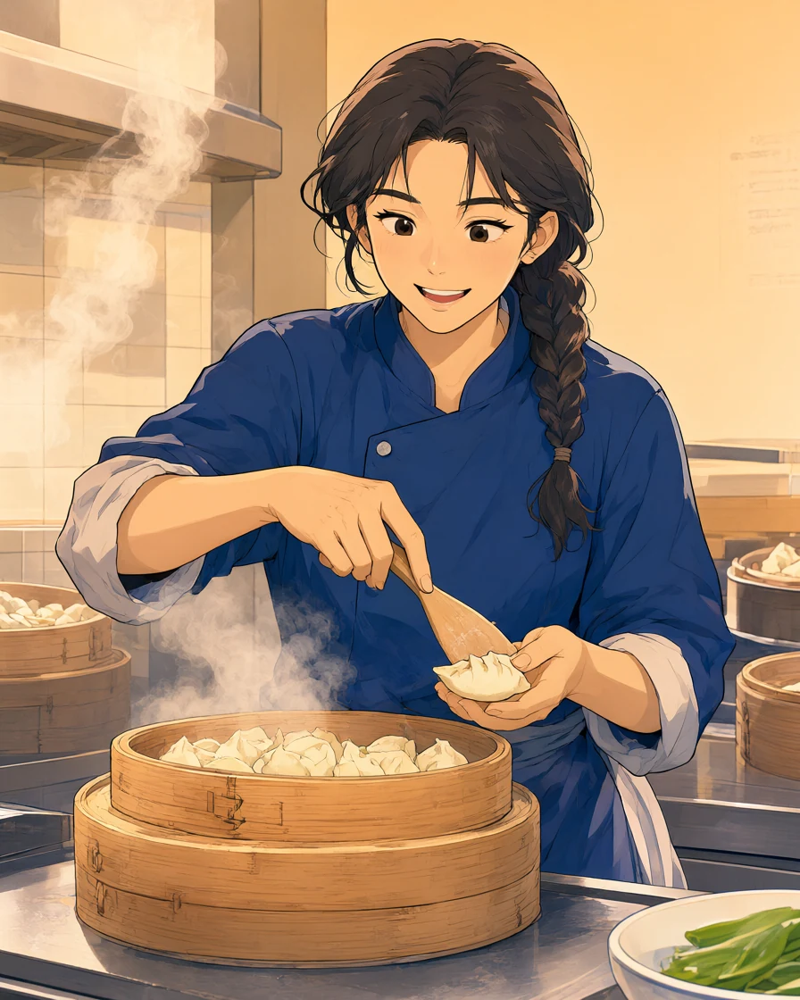</a>

An adult female city cook in an indigo work jacket and a simple side braid folds vegetable dumplings with a small bamboo spatula at an open counter. Steam rises from a plain round…

**4:5** · Anime · anime food

<details>
<summary>View the full prompt</summary>

```text
An adult female city cook in an indigo work jacket and a simple side braid folds vegetable dumplings with a small bamboo spatula at an open counter. Steam rises from a plain round basket. Energetic but comfortable pose, expressive adult character face, crisp illustrated food detail, broad warm color fields and a cheerful uncluttered kitchen setting. Visual medium: Clearly two-dimensional anime illustration, expressive adult character proportions, confident fine ink contours, layered cel shadows and carefully painted depth. Preserve a drawn finish. Palette: warm apricot, indigo, pale cream. Lighting: bright cozy kitchen light with a soft warm glow. All human or humanlike figures are clearly adult and fully clothed. Original character and object designs. One coherent finished image, with no added lettering, logos, signatures or watermarks.
```

</details>

**[Try this prompt on HeyDreaming →](https://heydreaming.com/gpt-image-prompts?id=70&utm_source=github&utm_medium=prompt-library&utm_campaign=awesome-gpt-image-prompts&utm_content=70)** · [Permalink](https://heydreaming.com/gpt-image-prompts/the-dumpling-counter) · [TXT](prompts/070_the-dumpling-counter.txt)

---

<a id="prompt-72"></a>

### 072. Blue kingfisher dive

<a href="https://heydreaming.com/gpt-image-prompts?id=72&utm_source=github&utm_medium=prompt-library&utm_campaign=awesome-gpt-image-prompts&utm_content=72">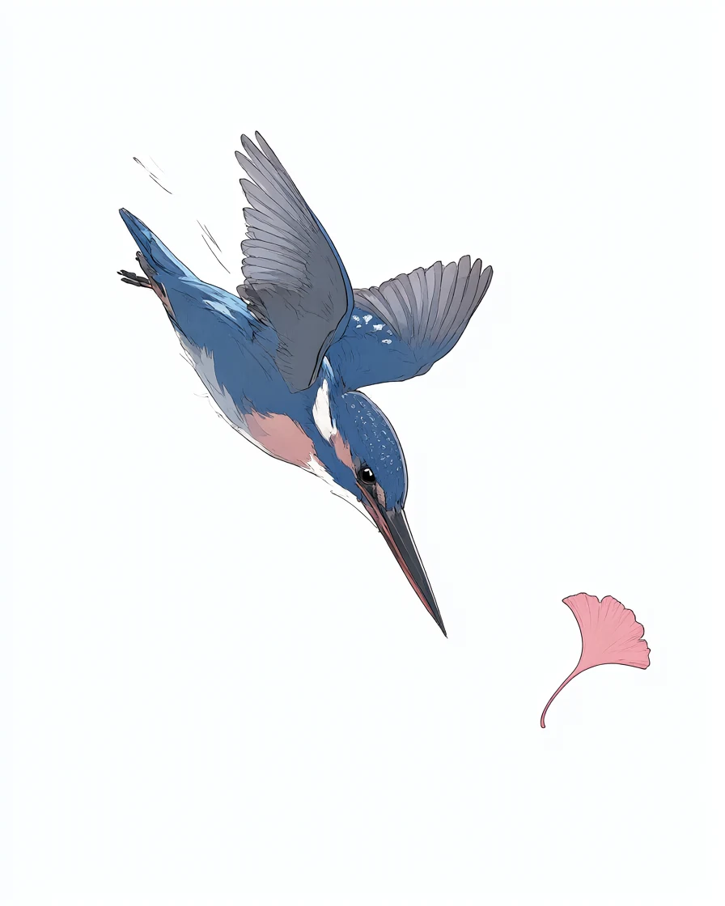</a>

An original small dusky-blue kingfisher with a long squared beak dives diagonally from the upper left toward the lower center of a clean white picture. Its two triangular wings flare at…

**4:5** · Anime · chibi lineart

<details>
<summary>View the full prompt</summary>

```text
An original small dusky-blue kingfisher with a long squared beak dives diagonally from the upper left toward the lower center of a clean white picture. Its two triangular wings flare at different angles, with a few small white feather markings and a dusty-rose patch beneath the throat. One separate rose-colored ginkgo leaf drifts far to the lower right. Side view, clearly avian anatomy, lively flat cel shapes, crisp expressive outlines, open white spacing and two short motion strokes beside the tail. Visual medium: Clearly two-dimensional anime illustration, expressive adult character proportions, confident fine ink contours, layered cel shadows and carefully painted depth. Preserve a drawn finish. Palette: dusky blue, muted rose, clean white. Lighting: flat gentle character lighting. All human or humanlike figures are clearly adult and fully clothed. Original character and object designs. One coherent finished image, with no added lettering, logos, signatures or watermarks.
```

</details>

**[Try this prompt on HeyDreaming →](https://heydreaming.com/gpt-image-prompts?id=72&utm_source=github&utm_medium=prompt-library&utm_campaign=awesome-gpt-image-prompts&utm_content=72)** · [Permalink](https://heydreaming.com/gpt-image-prompts/blue-kingfisher-dive) · [TXT](prompts/072_blue-kingfisher-dive.txt)

---

<a id="prompt-77"></a>

### 077. The purple balcony

<a href="https://heydreaming.com/gpt-image-prompts?id=77&utm_source=github&utm_medium=prompt-library&utm_campaign=awesome-gpt-image-prompts&utm_content=77">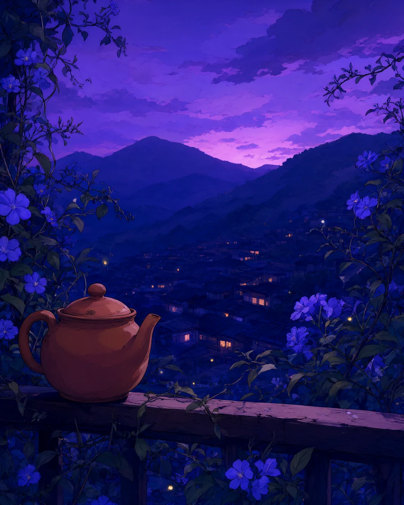</a>

A small terracotta teapot rests on an old balcony rail surrounded by climbing blue flowers. Beyond it lies a layered mountain village beneath a dramatic violet cloud sky. Still-life…

**4:5** · Anime · anime scenery

<details>
<summary>View the full prompt</summary>

```text
A small terracotta teapot rests on an old balcony rail surrounded by climbing blue flowers. Beyond it lies a layered mountain village beneath a dramatic violet cloud sky. Still-life foreground within a sweeping animated background, delicate painted foliage, tiny firefly-like highlights, gentle linework and a dreamy quiet mood. No characters or text. Visual medium: Clearly two-dimensional anime illustration, expressive adult character proportions, confident fine ink contours, layered cel shadows and carefully painted depth. Preserve a drawn finish. Palette: violet, midnight blue, small warm gold lights. Lighting: glowing twilight clouds and distant lit windows. All human or humanlike figures are clearly adult and fully clothed. Original character and object designs. One coherent finished image, with no added lettering, logos, signatures or watermarks.
```

</details>

**[Try this prompt on HeyDreaming →](https://heydreaming.com/gpt-image-prompts?id=77&utm_source=github&utm_medium=prompt-library&utm_campaign=awesome-gpt-image-prompts&utm_content=77)** · [Permalink](https://heydreaming.com/gpt-image-prompts/the-purple-balcony) · [TXT](prompts/077_the-purple-balcony.txt)

---

<a id="prompt-81"></a>

### 081. The paper bird weather vane

<a href="https://heydreaming.com/gpt-image-prompts?id=81&utm_source=github&utm_medium=prompt-library&utm_campaign=awesome-gpt-image-prompts&utm_content=81">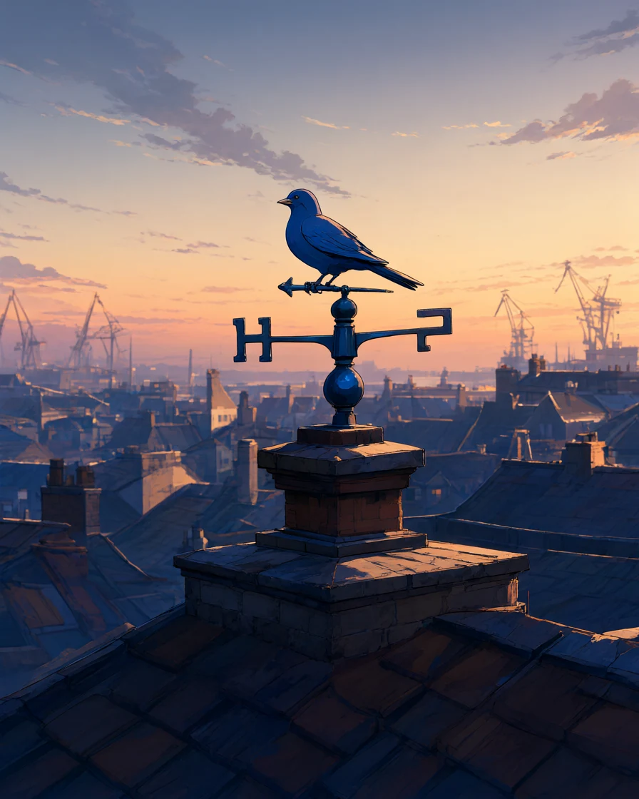</a>

A cobalt-blue folded-metal bird weather vane sits atop an old harbor chimney. Layered roofs and distant crane silhouettes fade into a luminous evening sky. Low foreground detail, small…

**4:5** · Anime · anime sunset

<details>
<summary>View the full prompt</summary>

```text
A cobalt-blue folded-metal bird weather vane sits atop an old harbor chimney. Layered roofs and distant crane silhouettes fade into a luminous evening sky. Low foreground detail, small central object, painterly animated-city depth, delicate cloud shapes and quiet nostalgic atmosphere. No human character or lettering. Visual medium: Clearly two-dimensional anime illustration, expressive adult character proportions, confident fine ink contours, layered cel shadows and carefully painted depth. Preserve a drawn finish. Palette: midnight blue, glowing copper, dusty rose. Lighting: a warm sunset seen through long rooftop shadows. All human or humanlike figures are clearly adult and fully clothed. Original character and object designs. One coherent finished image, with no added lettering, logos, signatures or watermarks.
```

</details>

**[Try this prompt on HeyDreaming →](https://heydreaming.com/gpt-image-prompts?id=81&utm_source=github&utm_medium=prompt-library&utm_campaign=awesome-gpt-image-prompts&utm_content=81)** · [Permalink](https://heydreaming.com/gpt-image-prompts/the-paper-bird-weather-vane) · [TXT](prompts/081_the-paper-bird-weather-vane.txt)

---

<a id="prompt-82"></a>

### 082. The fig messenger

<a href="https://heydreaming.com/gpt-image-prompts?id=82&utm_source=github&utm_medium=prompt-library&utm_campaign=awesome-gpt-image-prompts&utm_content=82">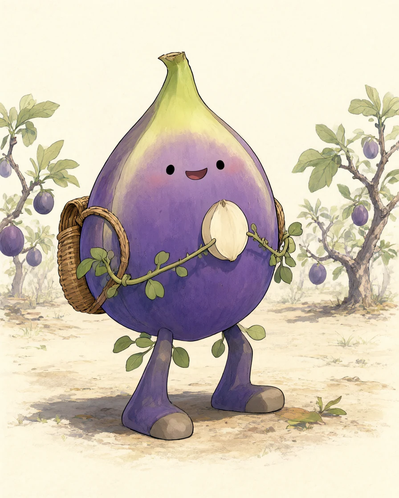</a>

An original round fig creature with tiny leaf arms and two sturdy feet wears a small wicker backpack. It balances a single pale seed between its hands while standing in a simple orchard…

**4:5** · Anime · chibi whimsy

<details>
<summary>View the full prompt</summary>

```text
An original round fig creature with tiny leaf arms and two sturdy feet wears a small wicker backpack. It balances a single pale seed between its hands while standing in a simple orchard clearing. Cheerful expressive face, clean cartoon proportions, soft cel shadows, textured paper-like background and a playful compact silhouette. No human face inside a fruit shell. Visual medium: Clearly two-dimensional anime illustration, expressive adult character proportions, confident fine ink contours, layered cel shadows and carefully painted depth. Preserve a drawn finish. Palette: soft purple, leaf green, warm cream. Lighting: bright even orchard daylight. All human or humanlike figures are clearly adult and fully clothed. Original character and object designs. One coherent finished image, with no added lettering, logos, signatures or watermarks.
```

</details>

**[Try this prompt on HeyDreaming →](https://heydreaming.com/gpt-image-prompts?id=82&utm_source=github&utm_medium=prompt-library&utm_campaign=awesome-gpt-image-prompts&utm_content=82)** · [Permalink](https://heydreaming.com/gpt-image-prompts/the-fig-messenger) · [TXT](prompts/082_the-fig-messenger.txt)

---

<a id="prompt-90"></a>

### 090. Neon ferry runner

<a href="https://heydreaming.com/gpt-image-prompts?id=90&utm_source=github&utm_medium=prompt-library&utm_campaign=awesome-gpt-image-prompts&utm_content=90">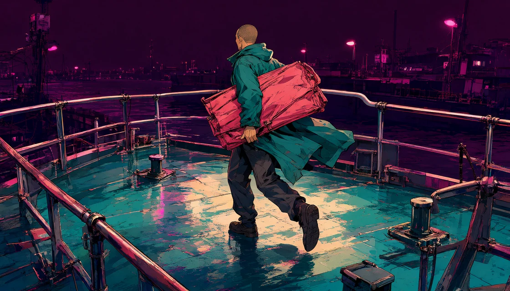</a>

A clearly adult male ferry runner with a close-shaved head strides quickly across a broad rain-wet ferry deck, carrying a folded coral canvas awning under one arm. His closed teal…

**16:9** · Anime · retro cyber anime

<details>
<summary>View the full prompt</summary>

```text
A clearly adult male ferry runner with a close-shaved head strides quickly across a broad rain-wet ferry deck, carrying a folded coral canvas awning under one arm. His closed teal raincoat swings behind him, and practical dark trousers and boots give the figure a grounded working silhouette. Low diagonal full-body view, long railings sweeping toward the far corner, small mooring posts crossing the foreground, and a dark plum harbor skyline dotted with magenta practical lamps. Dense hand-inked metalwork and energetic saturated cel shadows. Visual medium: Retro cyberpunk anime illustration, intricate hand-inked mechanical shapes, saturated cel colors, deep hard-edged shadows and a dense painted harbor environment. Palette: teal, coral pink, dark plum. Lighting: bright reflected deck highlights with magenta harbor lamps. All human or humanlike figures are clearly adult and fully clothed. Original character and object designs. One coherent finished image, with no added lettering, logos, signatures or watermarks.
```

</details>

**[Try this prompt on HeyDreaming →](https://heydreaming.com/gpt-image-prompts?id=90&utm_source=github&utm_medium=prompt-library&utm_campaign=awesome-gpt-image-prompts&utm_content=90)** · [Permalink](https://heydreaming.com/gpt-image-prompts/neon-ferry-runner) · [TXT](prompts/090_neon-ferry-runner.txt)

---

<a id="prompt-91"></a>

### 091. Maple river delta

<a href="https://heydreaming.com/gpt-image-prompts?id=91&utm_source=github&utm_medium=prompt-library&utm_campaign=awesome-gpt-image-prompts&utm_content=91"></a>

A broad jade river delta divides into curving channels around low islands of red maple trees and cream-colored meadow grass. Bird's-eye view from directly above, with the water tracing a…

**16:9** · Anime · anime epic landscape

<details>
<summary>View the full prompt</summary>

```text
A broad jade river delta divides into curving channels around low islands of red maple trees and cream-colored meadow grass. Bird's-eye view from directly above, with the water tracing a loose branching pattern across the whole horizontal frame. Thin wooden footbridges join two small islands near the bottom edge, and pale lavender cloud reflections soften the largest channel on the left. Luminous painted foliage, delicate individual reeds and rounded stones, richly layered color and an inviting quiet landscape. Visual medium: Clearly two-dimensional anime illustration, expressive adult character proportions, confident fine ink contours, layered cel shadows and carefully painted depth. Preserve a drawn finish. Palette: jade, maple red, pale lavender, cloud white. Lighting: soft luminous mountain daylight with reflected water light. All human or humanlike figures are clearly adult and fully clothed. Original character and object designs. One coherent finished image, with no added lettering, logos, signatures or watermarks.
```

</details>

**[Try this prompt on HeyDreaming →](https://heydreaming.com/gpt-image-prompts?id=91&utm_source=github&utm_medium=prompt-library&utm_campaign=awesome-gpt-image-prompts&utm_content=91)** · [Permalink](https://heydreaming.com/gpt-image-prompts/maple-river-delta) · [TXT](prompts/091_maple-river-delta.txt)

---

<a id="prompt-96"></a>

### 096. The robotics captain

<a href="https://heydreaming.com/gpt-image-prompts?id=96&utm_source=github&utm_medium=prompt-library&utm_campaign=awesome-gpt-image-prompts&utm_content=96"></a>

An adult female robotics captain with short plum-colored hair wears a closed ivory high-collar uniform and simple amber joint bracelets. She stands beside a rounded maintenance drone in…

**4:5** · Anime · retro sf anime

<details>
<summary>View the full prompt</summary>

```text
An adult female robotics captain with short plum-colored hair wears a closed ivory high-collar uniform and simple amber joint bracelets. She stands beside a rounded maintenance drone in a quiet station lounge. Waist-up three-quarter view, deliberate adult anime proportions, crisp ink contours, original uniform details and saturated retro-futurist cel colors. Visual medium: Retro-futurist anime character illustration, elegant original adult design, crisp linework, controlled cel shadows and clean colored highlights. Palette: ivory, plum, teal, amber. Lighting: clean cool station light with warm control-panel reflections. All human or humanlike figures are clearly adult and fully clothed. Original character and object designs. One coherent finished image, with no added lettering, logos, signatures or watermarks.
```

</details>

**[Try this prompt on HeyDreaming →](https://heydreaming.com/gpt-image-prompts?id=96&utm_source=github&utm_medium=prompt-library&utm_campaign=awesome-gpt-image-prompts&utm_content=96)** · [Permalink](https://heydreaming.com/gpt-image-prompts/the-robotics-captain) · [TXT](prompts/096_the-robotics-captain.txt)

---

<a id="style-cinematic-fantasy"></a>

## Cinematic & Fantasy

<a id="prompt-4"></a>

### 004. The walking library

<a href="https://heydreaming.com/gpt-image-prompts?id=4&utm_source=github&utm_medium=prompt-library&utm_campaign=awesome-gpt-image-prompts&utm_content=4"></a>

A colossal travelling archive built from stacked stone rooms moves across a dry basin on four immense articulated supports. A tiny adult surveyor in a blue utility cloak stands beside a…

**3:4** · Cinematic & Fantasy · epic realism

<details>
<summary>View the full prompt</summary>

```text
A colossal travelling archive built from stacked stone rooms moves across a dry basin on four immense articulated supports. A tiny adult surveyor in a blue utility cloak stands beside a wheeled measuring tripod in the foreground. Low wide-angle view, huge scale difference, angular architectural silhouette, windblown sand and distant ridges. No battle or monsters. Visual medium: Detailed cinematic concept art, coherent realistic materials, strong silhouette design, dramatic atmospheric depth and a subtle hand-painted finish. Keep the focal subject clear. Palette: dust gold, sandstone, dark umber. Lighting: hard sun broken by drifting dust. All human or humanlike figures are clearly adult and fully clothed. Original character and object designs. One coherent finished image, with no added lettering, logos, signatures or watermarks.
```

</details>

**[Try this prompt on HeyDreaming →](https://heydreaming.com/gpt-image-prompts?id=4&utm_source=github&utm_medium=prompt-library&utm_campaign=awesome-gpt-image-prompts&utm_content=4)** · [Permalink](https://heydreaming.com/gpt-image-prompts/the-walking-library) · [TXT](prompts/004_the-walking-library.txt)

---

<a id="prompt-11"></a>

### 011. Garden pack tortoise

<a href="https://heydreaming.com/gpt-image-prompts?id=11&utm_source=github&utm_medium=prompt-library&utm_campaign=awesome-gpt-image-prompts&utm_content=11"></a>

An enormous friendly tortoise carries a small glass conservatory and wooden herb crates on its broad shell. It walks slowly across a sunlit forest clearing while a tiny adult gardener…

**4:5** · Cinematic & Fantasy · stylized fantasy

<details>
<summary>View the full prompt</summary>

```text
An enormous friendly tortoise carries a small glass conservatory and wooden herb crates on its broad shell. It walks slowly across a sunlit forest clearing while a tiny adult gardener follows with a watering can. Low eye-level view, rich moss textures, rounded readable anatomy, bright adventure-game atmosphere and a generous leafy background. Visual medium: Detailed cinematic concept art, coherent realistic materials, strong silhouette design, dramatic atmospheric depth and a subtle hand-painted finish. Keep the focal subject clear. Palette: leaf green, warm stone, turquoise. Lighting: clear summer light under broken foliage. All human or humanlike figures are clearly adult and fully clothed. Original character and object designs. One coherent finished image, with no added lettering, logos, signatures or watermarks.
```

</details>

**[Try this prompt on HeyDreaming →](https://heydreaming.com/gpt-image-prompts?id=11&utm_source=github&utm_medium=prompt-library&utm_campaign=awesome-gpt-image-prompts&utm_content=11)** · [Permalink](https://heydreaming.com/gpt-image-prompts/garden-pack-tortoise) · [TXT](prompts/011_garden-pack-tortoise.txt)

---

<a id="prompt-12"></a>

### 012. Ice harbor captain

<a href="https://heydreaming.com/gpt-image-prompts?id=12&utm_source=github&utm_medium=prompt-library&utm_campaign=awesome-gpt-image-prompts&utm_content=12"></a>

An adult female rescue captain wears a thick navy expedition coat with original copper buckles and a pale woven collar. She stands on the deck of a frozen harbor tug holding a compact…

**4:5** · Cinematic & Fantasy · fantasy realism

<details>
<summary>View the full prompt</summary>

```text
An adult female rescue captain wears a thick navy expedition coat with original copper buckles and a pale woven collar. She stands on the deck of a frozen harbor tug holding a compact rescue reel. Cold breath, frosted railings and distant harbor cranes, three-quarter full figure, determined expression, detailed practical materials. No sword or helmet. Visual medium: Detailed cinematic concept art, coherent realistic materials, strong silhouette design, dramatic atmospheric depth and a subtle hand-painted finish. Keep the focal subject clear. Palette: steel blue, charcoal, small copper lights. Lighting: overcast winter light with icy edge highlights. All human or humanlike figures are clearly adult and fully clothed. Original character and object designs. One coherent finished image, with no added lettering, logos, signatures or watermarks.
```

</details>

**[Try this prompt on HeyDreaming →](https://heydreaming.com/gpt-image-prompts?id=12&utm_source=github&utm_medium=prompt-library&utm_campaign=awesome-gpt-image-prompts&utm_content=12)** · [Permalink](https://heydreaming.com/gpt-image-prompts/ice-harbor-captain) · [TXT](prompts/012_ice-harbor-captain.txt)

---

<a id="prompt-26"></a>

### 026. Obsidian tide crown

<a href="https://heydreaming.com/gpt-image-prompts?id=26&utm_source=github&utm_medium=prompt-library&utm_campaign=awesome-gpt-image-prompts&utm_content=26"></a>

An immense crown-like formation of black volcanic spines rises through a frozen lake. A small rescue shelter and two distant adult observers stand on the shore, their lamps tiny against…

**4:5** · Cinematic & Fantasy · dark epic

<details>
<summary>View the full prompt</summary>

```text
An immense crown-like formation of black volcanic spines rises through a frozen lake. A small rescue shelter and two distant adult observers stand on the shore, their lamps tiny against the geological mass. Low dramatic viewpoint, swirling vapor, epic scale and layered rock detail. An environmental phenomenon rather than a creature or battle. Visual medium: Detailed cinematic concept art, coherent realistic materials, strong silhouette design, dramatic atmospheric depth and a subtle hand-painted finish. Keep the focal subject clear. Palette: deep umber, ember red, smoky gray. Lighting: a low fiery horizon behind massive dark shapes. All human or humanlike figures are clearly adult and fully clothed. Original character and object designs. One coherent finished image, with no added lettering, logos, signatures or watermarks.
```

</details>

**[Try this prompt on HeyDreaming →](https://heydreaming.com/gpt-image-prompts?id=26&utm_source=github&utm_medium=prompt-library&utm_campaign=awesome-gpt-image-prompts&utm_content=26)** · [Permalink](https://heydreaming.com/gpt-image-prompts/obsidian-tide-crown) · [TXT](prompts/026_obsidian-tide-crown.txt)

---

<a id="prompt-33"></a>

### 033. Glacier lamp keeper

<a href="https://heydreaming.com/gpt-image-prompts?id=33&utm_source=github&utm_medium=prompt-library&utm_campaign=awesome-gpt-image-prompts&utm_content=33"></a>

An adult female glacier researcher in a heavy wool-lined blue coat stands on an icy observation ledge. She holds a brass lantern at chest height while looking across a field of broken…

**4:5** · Cinematic & Fantasy · cinematic fantasy

<details>
<summary>View the full prompt</summary>

```text
An adult female glacier researcher in a heavy wool-lined blue coat stands on an icy observation ledge. She holds a brass lantern at chest height while looking across a field of broken ice. Windblown curls, realistic cloth, distant survey poles, strong depth and dramatic natural weather. No weapons or magic projectiles. Visual medium: Detailed cinematic concept art, coherent realistic materials, strong silhouette design, dramatic atmospheric depth and a subtle hand-painted finish. Keep the focal subject clear. Palette: icy teal, charcoal, glowing orange. Lighting: cold snow light and a warm glass lamp close to the coat. All human or humanlike figures are clearly adult and fully clothed. Original character and object designs. One coherent finished image, with no added lettering, logos, signatures or watermarks.
```

</details>

**[Try this prompt on HeyDreaming →](https://heydreaming.com/gpt-image-prompts?id=33&utm_source=github&utm_medium=prompt-library&utm_campaign=awesome-gpt-image-prompts&utm_content=33)** · [Permalink](https://heydreaming.com/gpt-image-prompts/glacier-lamp-keeper) · [TXT](prompts/033_glacier-lamp-keeper.txt)

---

<a id="prompt-34"></a>

### 034. Red panda mountain post

<a href="https://heydreaming.com/gpt-image-prompts?id=34&utm_source=github&utm_medium=prompt-library&utm_campaign=awesome-gpt-image-prompts&utm_content=34"></a>

An anthropomorphic red panda courier wears an indigo canvas jacket and carries a long bamboo letter case across its back. It walks along a narrow hillside stone path toward a remote mail…

**4:5** · Cinematic & Fantasy · stylized fantasy

<details>
<summary>View the full prompt</summary>

```text
An anthropomorphic red panda courier wears an indigo canvas jacket and carries a long bamboo letter case across its back. It walks along a narrow hillside stone path toward a remote mail hut. Full figure, original practical costume, expressive alert ears, richly textured fur and a bright adventurous painted environment. No armor or real-world insignia. Visual medium: Detailed cinematic concept art, coherent realistic materials, strong silhouette design, dramatic atmospheric depth and a subtle hand-painted finish. Keep the focal subject clear. Palette: rust red, indigo, dry grass gold. Lighting: warm late-afternoon mountain light. All human or humanlike figures are clearly adult and fully clothed. Original character and object designs. One coherent finished image, with no added lettering, logos, signatures or watermarks.
```

</details>

**[Try this prompt on HeyDreaming →](https://heydreaming.com/gpt-image-prompts?id=34&utm_source=github&utm_medium=prompt-library&utm_campaign=awesome-gpt-image-prompts&utm_content=34)** · [Permalink](https://heydreaming.com/gpt-image-prompts/red-panda-mountain-post) · [TXT](prompts/034_red-panda-mountain-post.txt)

---

<a id="prompt-43"></a>

### 043. Storm cartographer

<a href="https://heydreaming.com/gpt-image-prompts?id=43&utm_source=github&utm_medium=prompt-library&utm_campaign=awesome-gpt-image-prompts&utm_content=43"></a>

An adult female storm cartographer with visible short hair wears a heavy woven charcoal coat on the stair of a weather tower. She carries a large circular copper measuring instrument…

**4:5** · Cinematic & Fantasy · dark fantasy realism

<details>
<summary>View the full prompt</summary>

```text
An adult female storm cartographer with visible short hair wears a heavy woven charcoal coat on the stair of a weather tower. She carries a large circular copper measuring instrument under one arm. Three-quarter full figure, rain-slick stone, distant thundercloud layers, intricate practical textures and cinematic atmospheric depth. No sword or hood. Visual medium: Detailed cinematic concept art, coherent realistic materials, strong silhouette design, dramatic atmospheric depth and a subtle hand-painted finish. Keep the focal subject clear. Palette: charcoal, cold blue, small copper highlights. Lighting: electric-blue storm light and faint warm instrument glow. All human or humanlike figures are clearly adult and fully clothed. Original character and object designs. One coherent finished image, with no added lettering, logos, signatures or watermarks.
```

</details>

**[Try this prompt on HeyDreaming →](https://heydreaming.com/gpt-image-prompts?id=43&utm_source=github&utm_medium=prompt-library&utm_campaign=awesome-gpt-image-prompts&utm_content=43)** · [Permalink](https://heydreaming.com/gpt-image-prompts/storm-cartographer) · [TXT](prompts/043_storm-cartographer.txt)

---

<a id="prompt-45"></a>

### 045. Winter bell caster

<a href="https://heydreaming.com/gpt-image-prompts?id=45&utm_source=github&utm_medium=prompt-library&utm_campaign=awesome-gpt-image-prompts&utm_content=45"></a>

An adult male bell caster with tied-back dark hair wears a high-collar silver woven coat and a worn leather work apron. He holds a small engraved brass bell in an empty icy courtyard.…

**4:5** · Cinematic & Fantasy · fantasy realism

<details>
<summary>View the full prompt</summary>

```text
An adult male bell caster with tied-back dark hair wears a high-collar silver woven coat and a worn leather work apron. He holds a small engraved brass bell in an empty icy courtyard. Waist-up side view, visible serious face, fine material texture, faint breath and restrained mysterious atmosphere. No blade or face covering. Visual medium: Detailed cinematic concept art, coherent realistic materials, strong silhouette design, dramatic atmospheric depth and a subtle hand-painted finish. Keep the focal subject clear. Palette: silver gray, deep navy, frosted ivory. Lighting: diffuse cold daylight with pale metal reflections. All human or humanlike figures are clearly adult and fully clothed. Original character and object designs. One coherent finished image, with no added lettering, logos, signatures or watermarks.
```

</details>

**[Try this prompt on HeyDreaming →](https://heydreaming.com/gpt-image-prompts?id=45&utm_source=github&utm_medium=prompt-library&utm_campaign=awesome-gpt-image-prompts&utm_content=45)** · [Permalink](https://heydreaming.com/gpt-image-prompts/winter-bell-caster) · [TXT](prompts/045_winter-bell-caster.txt)

---

<a id="prompt-46"></a>

### 046. The alpine sky manta

<a href="https://heydreaming.com/gpt-image-prompts?id=46&utm_source=github&utm_medium=prompt-library&utm_campaign=awesome-gpt-image-prompts&utm_content=46"></a>

An immense pale winged manta-like sky creature glides above an alpine weather station. Two distant adult researchers watch from a sheltered stone deck. Steep snow peaks, deep layered…

**4:5** · Cinematic & Fantasy · epic landscape

<details>
<summary>View the full prompt</summary>

```text
An immense pale winged manta-like sky creature glides above an alpine weather station. Two distant adult researchers watch from a sheltered stone deck. Steep snow peaks, deep layered cloud, strong scale contrast and graceful sweeping motion. Cinematic environment illustration, realistic weather and a clear nonthreatening creature design. No combat. Visual medium: Detailed cinematic concept art, coherent realistic materials, strong silhouette design, dramatic atmospheric depth and a subtle hand-painted finish. Keep the focal subject clear. Palette: storm blue, pale silver, tiny amber lights. Lighting: overcast mountain light with a bright break in the clouds. All human or humanlike figures are clearly adult and fully clothed. Original character and object designs. One coherent finished image, with no added lettering, logos, signatures or watermarks.
```

</details>

**[Try this prompt on HeyDreaming →](https://heydreaming.com/gpt-image-prompts?id=46&utm_source=github&utm_medium=prompt-library&utm_campaign=awesome-gpt-image-prompts&utm_content=46)** · [Permalink](https://heydreaming.com/gpt-image-prompts/the-alpine-sky-manta) · [TXT](prompts/046_the-alpine-sky-manta.txt)

---

<a id="prompt-51"></a>

### 051. Night pier technician

<a href="https://heydreaming.com/gpt-image-prompts?id=51&utm_source=github&utm_medium=prompt-library&utm_campaign=awesome-gpt-image-prompts&utm_content=51"></a>

An adult male cable technician wears a layered weatherproof field coat and plain leather gloves. He checks a small tethered meter beside an industrial pier railing. Full figure seen…

**4:5** · Cinematic & Fantasy · cinematic noir

<details>
<summary>View the full prompt</summary>

```text
An adult male cable technician wears a layered weatherproof field coat and plain leather gloves. He checks a small tethered meter beside an industrial pier railing. Full figure seen slightly from below, visible face in profile, heavy practical cloth, distant crane silhouettes and atmospheric floating rain. Quiet tension, no weapon or armor. Visual medium: Detailed cinematic concept art, coherent realistic materials, strong silhouette design, dramatic atmospheric depth and a subtle hand-painted finish. Keep the focal subject clear. Palette: desaturated olive, charcoal, narrow gold accents. Lighting: a thin vertical gold work light in a dark misty dock. All human or humanlike figures are clearly adult and fully clothed. Original character and object designs. One coherent finished image, with no added lettering, logos, signatures or watermarks.
```

</details>

**[Try this prompt on HeyDreaming →](https://heydreaming.com/gpt-image-prompts?id=51&utm_source=github&utm_medium=prompt-library&utm_campaign=awesome-gpt-image-prompts&utm_content=51)** · [Permalink](https://heydreaming.com/gpt-image-prompts/night-pier-technician) · [TXT](prompts/051_night-pier-technician.txt)

---

<a id="prompt-52"></a>

### 052. Desert lens cartographer

<a href="https://heydreaming.com/gpt-image-prompts?id=52&utm_source=github&utm_medium=prompt-library&utm_campaign=awesome-gpt-image-prompts&utm_content=52"></a>

An adult female desert cartographer wears a closed bronze-colored uniform and a translucent teal sun visor above her natural visible face. She carries a cluster of round glass map…

**4:5** · Cinematic & Fantasy · textured sf

<details>
<summary>View the full prompt</summary>

```text
An adult female desert cartographer wears a closed bronze-colored uniform and a translucent teal sun visor above her natural visible face. She carries a cluster of round glass map instruments on a simple chest harness. Waist-up portrait beneath the canvas roof of a research shelter, weathered ceramic details, subtle dust and restrained elegant science-fiction design. Visual medium: Detailed cinematic concept art, coherent realistic materials, strong silhouette design, dramatic atmospheric depth and a subtle hand-painted finish. Keep the focal subject clear. Palette: turquoise glass, bronze, warm cream. Lighting: soft beige desert haze with small cyan reflections. All human or humanlike figures are clearly adult and fully clothed. Original character and object designs. One coherent finished image, with no added lettering, logos, signatures or watermarks.
```

</details>

**[Try this prompt on HeyDreaming →](https://heydreaming.com/gpt-image-prompts?id=52&utm_source=github&utm_medium=prompt-library&utm_campaign=awesome-gpt-image-prompts&utm_content=52)** · [Permalink](https://heydreaming.com/gpt-image-prompts/desert-lens-cartographer) · [TXT](prompts/052_desert-lens-cartographer.txt)

---

<a id="prompt-56"></a>

### 056. Moth clock in the fog

<a href="https://heydreaming.com/gpt-image-prompts?id=56&utm_source=github&utm_medium=prompt-library&utm_campaign=awesome-gpt-image-prompts&utm_content=56"></a>

An old brass lantern with hinged mechanical moth wings hangs from a crooked iron hook in a deserted pine grove. Its interior contains a tiny moving clockwork mechanism. Close foreground…

**4:5** · Cinematic & Fantasy · dark fantasy realism

<details>
<summary>View the full prompt</summary>

```text
An old brass lantern with hinged mechanical moth wings hangs from a crooked iron hook in a deserted pine grove. Its interior contains a tiny moving clockwork mechanism. Close foreground object with deep atmospheric trees behind, rain droplets, believable aged metal and a quietly eerie mood. No faces, gore or creatures in robes. Visual medium: Detailed cinematic concept art, coherent realistic materials, strong silhouette design, dramatic atmospheric depth and a subtle hand-painted finish. Keep the focal subject clear. Palette: soot black, dark pine, dim amber. Lighting: one tiny warm glow inside heavy blue-gray fog. All human or humanlike figures are clearly adult and fully clothed. Original character and object designs. One coherent finished image, with no added lettering, logos, signatures or watermarks.
```

</details>

**[Try this prompt on HeyDreaming →](https://heydreaming.com/gpt-image-prompts?id=56&utm_source=github&utm_medium=prompt-library&utm_campaign=awesome-gpt-image-prompts&utm_content=56)** · [Permalink](https://heydreaming.com/gpt-image-prompts/moth-clock-in-the-fog) · [TXT](prompts/056_moth-clock-in-the-fog.txt)

---

<a id="prompt-59"></a>

### 059. Midnight cargo cyclist

<a href="https://heydreaming.com/gpt-image-prompts?id=59&utm_source=github&utm_medium=prompt-library&utm_campaign=awesome-gpt-image-prompts&utm_content=59"></a>

An adult female bicycle messenger in a reflective plum rain jacket walks beside a compact cargo tricycle at a wet city intersection. A stack of plain square parcels is strapped to the…

**4:5** · Cinematic & Fantasy · neon city

<details>
<summary>View the full prompt</summary>

```text
An adult female bicycle messenger in a reflective plum rain jacket walks beside a compact cargo tricycle at a wet city intersection. A stack of plain square parcels is strapped to the rear. Low street viewpoint, layered glass buildings, bright windows without lettering, rippling puddles, realistic rain and polished futuristic urban atmosphere. No combat. Visual medium: Detailed cinematic concept art, coherent realistic materials, strong silhouette design, dramatic atmospheric depth and a subtle hand-painted finish. Keep the focal subject clear. Palette: violet, teal, bright pink, blue-black. Lighting: reflected neon light in heavy evening rain. All human or humanlike figures are clearly adult and fully clothed. Original character and object designs. One coherent finished image, with no added lettering, logos, signatures or watermarks.
```

</details>

**[Try this prompt on HeyDreaming →](https://heydreaming.com/gpt-image-prompts?id=59&utm_source=github&utm_medium=prompt-library&utm_campaign=awesome-gpt-image-prompts&utm_content=59)** · [Permalink](https://heydreaming.com/gpt-image-prompts/midnight-cargo-cyclist) · [TXT](prompts/059_midnight-cargo-cyclist.txt)

---

<a id="prompt-63"></a>

### 063. The hanging grove

<a href="https://heydreaming.com/gpt-image-prompts?id=63&utm_source=github&utm_medium=prompt-library&utm_campaign=awesome-gpt-image-prompts&utm_content=63"></a>

A monumental spiral garden bridge rises above a misty fjord. Three planted terraces curve around its stone supports, holding pine groves and narrow pools. Steep mountain slopes and…

**4:5** · Cinematic & Fantasy · aerial landscape

<details>
<summary>View the full prompt</summary>

```text
A monumental spiral garden bridge rises above a misty fjord. Three planted terraces curve around its stone supports, holding pine groves and narrow pools. Steep mountain slopes and distant snow ridges frame the structure. High aerial viewpoint, immense environmental scale, believable rock and foliage textures, crisp depth and serene cinematic grandeur. Visual medium: Detailed cinematic concept art, coherent realistic materials, strong silhouette design, dramatic atmospheric depth and a subtle hand-painted finish. Keep the focal subject clear. Palette: lush jade, cool gray, cloud white. Lighting: soft high mountain daylight through broken cloud. All human or humanlike figures are clearly adult and fully clothed. Original character and object designs. One coherent finished image, with no added lettering, logos, signatures or watermarks.
```

</details>

**[Try this prompt on HeyDreaming →](https://heydreaming.com/gpt-image-prompts?id=63&utm_source=github&utm_medium=prompt-library&utm_campaign=awesome-gpt-image-prompts&utm_content=63)** · [Permalink](https://heydreaming.com/gpt-image-prompts/the-hanging-grove) · [TXT](prompts/063_the-hanging-grove.txt)

---

<a id="prompt-64"></a>

### 064. Ivory coastal station

<a href="https://heydreaming.com/gpt-image-prompts?id=64&utm_source=github&utm_medium=prompt-library&utm_campaign=awesome-gpt-image-prompts&utm_content=64"></a>

A terraced ivory weather station clings to a sheer coastal cliff above a pale gray ocean. Seen obliquely from far above, its low rectangular rooms step across the rock face in an…

**16:9** · Cinematic & Fantasy · surreal architecture

<details>
<summary>View the full prompt</summary>

```text
A terraced ivory weather station clings to a sheer coastal cliff above a pale gray ocean. Seen obliquely from far above, its low rectangular rooms step across the rock face in an asymmetric zigzag. Three small brushed-gold sail canopies shelter exposed instruments on the roofs, and a narrow outdoor stair follows the cliff to a landing. Wind-swept grasses grow between smooth stone panels. Wide exterior architectural view with open sky, ocean haze and delicately resolved practical surfaces. Visual medium: Detailed cinematic concept art, coherent realistic materials, strong silhouette design, dramatic atmospheric depth and a subtle hand-painted finish. Keep the focal subject clear. Palette: warm ivory, brushed gold, pale gray. Lighting: long soft shafts of morning light through airy coastal haze. All human or humanlike figures are clearly adult and fully clothed. Original character and object designs. One coherent finished image, with no added lettering, logos, signatures or watermarks.
```

</details>

**[Try this prompt on HeyDreaming →](https://heydreaming.com/gpt-image-prompts?id=64&utm_source=github&utm_medium=prompt-library&utm_campaign=awesome-gpt-image-prompts&utm_content=64)** · [Permalink](https://heydreaming.com/gpt-image-prompts/ivory-coastal-station) · [TXT](prompts/064_ivory-coastal-station.txt)

---

<a id="prompt-65"></a>

### 065. Moss antelope crossing

<a href="https://heydreaming.com/gpt-image-prompts?id=65&utm_source=github&utm_medium=prompt-library&utm_campaign=awesome-gpt-image-prompts&utm_content=65"></a>

A long-legged mechanical antelope with moss-green ceramic plates carries canvas botany packs across a narrow root bridge. Its body is articulated like careful handmade engineering, with…

**4:5** · Cinematic & Fantasy · fantasy animal action

<details>
<summary>View the full prompt</summary>

```text
A long-legged mechanical antelope with moss-green ceramic plates carries canvas botany packs across a narrow root bridge. Its body is articulated like careful handmade engineering, with a soft amber lens and thin bronze joints. Sweeping diagonal motion, painted forest depth, rich texture and a vivid original adventure illustration. No rider or weapon. Visual medium: Detailed cinematic concept art, coherent realistic materials, strong silhouette design, dramatic atmospheric depth and a subtle hand-painted finish. Keep the focal subject clear. Palette: emerald, warm ochre, slate metal. Lighting: broken sunbeams through a dense bright canopy. All human or humanlike figures are clearly adult and fully clothed. Original character and object designs. One coherent finished image, with no added lettering, logos, signatures or watermarks.
```

</details>

**[Try this prompt on HeyDreaming →](https://heydreaming.com/gpt-image-prompts?id=65&utm_source=github&utm_medium=prompt-library&utm_campaign=awesome-gpt-image-prompts&utm_content=65)** · [Permalink](https://heydreaming.com/gpt-image-prompts/moss-antelope-crossing) · [TXT](prompts/065_moss-antelope-crossing.txt)

---

<a id="prompt-68"></a>

### 068. The organ restorer

<a href="https://heydreaming.com/gpt-image-prompts?id=68&utm_source=github&utm_medium=prompt-library&utm_campaign=awesome-gpt-image-prompts&utm_content=68"></a>

An adult pale-haired organ restorer in a high-neck dark work coat and a blue leather apron pauses beside a huge antique pipe organ. A small brass tuning key rests in one gloved hand.…

**4:5** · Cinematic & Fantasy · gothic portrait

<details>
<summary>View the full prompt</summary>

```text
An adult pale-haired organ restorer in a high-neck dark work coat and a blue leather apron pauses beside a huge antique pipe organ. A small brass tuning key rests in one gloved hand. Close three-quarter portrait, visible unpainted face, focused expression, detailed cloth and old metal, restrained gothic atmosphere and strong dark background depth. No hood. Visual medium: Detailed cinematic concept art, coherent realistic materials, strong silhouette design, dramatic atmospheric depth and a subtle hand-painted finish. Keep the focal subject clear. Palette: desaturated plum, gunmetal, pale silver. Lighting: cool soft light along tall organ pipes. All human or humanlike figures are clearly adult and fully clothed. Original character and object designs. One coherent finished image, with no added lettering, logos, signatures or watermarks.
```

</details>

**[Try this prompt on HeyDreaming →](https://heydreaming.com/gpt-image-prompts?id=68&utm_source=github&utm_medium=prompt-library&utm_campaign=awesome-gpt-image-prompts&utm_content=68)** · [Permalink](https://heydreaming.com/gpt-image-prompts/the-organ-restorer) · [TXT](prompts/068_the-organ-restorer.txt)

---

<a id="prompt-71"></a>

### 071. Lunar freight engineer

<a href="https://heydreaming.com/gpt-image-prompts?id=71&utm_source=github&utm_medium=prompt-library&utm_campaign=awesome-gpt-image-prompts&utm_content=71"></a>

An adult female lunar freight engineer braces her magnetic boots on a metal gantry while opening a huge orange cargo airlock. Small inspection drones gather near the hinges. The mining…

**4:5** · Cinematic & Fantasy · cinematic sf

<details>
<summary>View the full prompt</summary>

```text
An adult female lunar freight engineer braces her magnetic boots on a metal gantry while opening a huge orange cargo airlock. Small inspection drones gather near the hinges. The mining basin and angular machinery stretch far below. Dynamic wide-angle perspective, layered practical work suit, plausible industrial details and cinematic science-fiction scale. No ancient symbols or battle. Visual medium: Detailed cinematic concept art, coherent realistic materials, strong silhouette design, dramatic atmospheric depth and a subtle hand-painted finish. Keep the focal subject clear. Palette: burnt orange, dusty gold, cool cyan. Lighting: strong quarry work lights through suspended dust. All human or humanlike figures are clearly adult and fully clothed. Original character and object designs. One coherent finished image, with no added lettering, logos, signatures or watermarks.
```

</details>

**[Try this prompt on HeyDreaming →](https://heydreaming.com/gpt-image-prompts?id=71&utm_source=github&utm_medium=prompt-library&utm_campaign=awesome-gpt-image-prompts&utm_content=71)** · [Permalink](https://heydreaming.com/gpt-image-prompts/lunar-freight-engineer) · [TXT](prompts/071_lunar-freight-engineer.txt)

---

<a id="prompt-76"></a>

### 076. The bronze canyon crane

<a href="https://heydreaming.com/gpt-image-prompts?id=76&utm_source=github&utm_medium=prompt-library&utm_campaign=awesome-gpt-image-prompts&utm_content=76"></a>

A monumental weather-worn bronze construction crane looms above a tiny adult geologist standing beside a red measuring tripod in a canyon. The machine's enormous curved boom reaches over…

**4:5** · Cinematic & Fantasy · cinematic dust

<details>
<summary>View the full prompt</summary>

```text
A monumental weather-worn bronze construction crane looms above a tiny adult geologist standing beside a red measuring tripod in a canyon. The machine's enormous curved boom reaches over a dry riverbed. Low dramatic perspective, swirling dust, readable human scale, detailed aged metal and cinematic environmental realism. No creature or fighting pose. Visual medium: Detailed cinematic concept art, coherent realistic materials, strong silhouette design, dramatic atmospheric depth and a subtle hand-painted finish. Keep the focal subject clear. Palette: ochre, bronze, deep brown. Lighting: hard shafts of golden light through airborne dust. All human or humanlike figures are clearly adult and fully clothed. Original character and object designs. One coherent finished image, with no added lettering, logos, signatures or watermarks.
```

</details>

**[Try this prompt on HeyDreaming →](https://heydreaming.com/gpt-image-prompts?id=76&utm_source=github&utm_medium=prompt-library&utm_campaign=awesome-gpt-image-prompts&utm_content=76)** · [Permalink](https://heydreaming.com/gpt-image-prompts/the-bronze-canyon-crane) · [TXT](prompts/076_the-bronze-canyon-crane.txt)

---

<a id="prompt-83"></a>

### 083. Firefly hare

<a href="https://heydreaming.com/gpt-image-prompts?id=83&utm_source=github&utm_medium=prompt-library&utm_campaign=awesome-gpt-image-prompts&utm_content=83"></a>

A silver-gray long-eared hare sits on dark smooth stone, lifting one forepaw as a small firefly floats nearby. Fine amber reflections trace its fur and whiskers. Three-quarter animal…

**4:5** · Cinematic & Fantasy · luminous animal

<details>
<summary>View the full prompt</summary>

```text
A silver-gray long-eared hare sits on dark smooth stone, lifting one forepaw as a small firefly floats nearby. Fine amber reflections trace its fur and whiskers. Three-quarter animal portrait, quiet focused eyes, deep soft background, realistic luminous detail and a magical naturalistic mood. No clothing or character accessories. Visual medium: Detailed cinematic concept art, coherent realistic materials, strong silhouette design, dramatic atmospheric depth and a subtle hand-painted finish. Keep the focal subject clear. Palette: silver gray, deep brown, warm gold. Lighting: tiny warm firefly lights catching individual strands of fur. All human or humanlike figures are clearly adult and fully clothed. Original character and object designs. One coherent finished image, with no added lettering, logos, signatures or watermarks.
```

</details>

**[Try this prompt on HeyDreaming →](https://heydreaming.com/gpt-image-prompts?id=83&utm_source=github&utm_medium=prompt-library&utm_campaign=awesome-gpt-image-prompts&utm_content=83)** · [Permalink](https://heydreaming.com/gpt-image-prompts/firefly-hare) · [TXT](prompts/083_firefly-hare.txt)

---

<a id="prompt-98"></a>

### 098. The silver-eared night fox

<a href="https://heydreaming.com/gpt-image-prompts?id=98&utm_source=github&utm_medium=prompt-library&utm_campaign=awesome-gpt-image-prompts&utm_content=98"></a>

A dark-blue fox with silver ear tips lifts its muzzle toward the sky on a quiet snowy ridge. Fine crystalline amber mist curls from its breath while individual fur strands catch the…

**4:5** · Cinematic & Fantasy · luminous animal

<details>
<summary>View the full prompt</summary>

```text
A dark-blue fox with silver ear tips lifts its muzzle toward the sky on a quiet snowy ridge. Fine crystalline amber mist curls from its breath while individual fur strands catch the light. Elegant profile animal portrait, deep starry background, realistic detail with restrained magical highlights and a clear original silhouette. No headphones or clothing. Visual medium: Detailed cinematic concept art, coherent realistic materials, strong silhouette design, dramatic atmospheric depth and a subtle hand-painted finish. Keep the focal subject clear. Palette: midnight blue, silver white, warm amber. Lighting: a soft halo of drifting star-like snow and warm luminous breath. All human or humanlike figures are clearly adult and fully clothed. Original character and object designs. One coherent finished image, with no added lettering, logos, signatures or watermarks.
```

</details>

**[Try this prompt on HeyDreaming →](https://heydreaming.com/gpt-image-prompts?id=98&utm_source=github&utm_medium=prompt-library&utm_campaign=awesome-gpt-image-prompts&utm_content=98)** · [Permalink](https://heydreaming.com/gpt-image-prompts/the-silver-eared-night-fox) · [TXT](prompts/098_the-silver-eared-night-fox.txt)

---

<a id="prompt-99"></a>

### 099. The mossback valley keeper

<a href="https://heydreaming.com/gpt-image-prompts?id=99&utm_source=github&utm_medium=prompt-library&utm_campaign=awesome-gpt-image-prompts&utm_content=99"></a>

An immense gentle salamander with moss-covered blue-gray skin crawls slowly through a steep root-lined valley. A tiny adult biologist stands safely on the opposite bank beside a weather…

**4:5** · Cinematic & Fantasy · dark creature

<details>
<summary>View the full prompt</summary>

```text
An immense gentle salamander with moss-covered blue-gray skin crawls slowly through a steep root-lined valley. A tiny adult biologist stands safely on the opposite bank beside a weather instrument. Wide low viewpoint, detailed wet stone, layered mist, expressive original creature anatomy and a calm dark-fantasy atmosphere. No humanoid monster or combat. Visual medium: Detailed cinematic concept art, coherent realistic materials, strong silhouette design, dramatic atmospheric depth and a subtle hand-painted finish. Keep the focal subject clear. Palette: blue-gray, dark green, small warm gold lights. Lighting: soft forest fog and one distant amber research lamp. All human or humanlike figures are clearly adult and fully clothed. Original character and object designs. One coherent finished image, with no added lettering, logos, signatures or watermarks.
```

</details>

**[Try this prompt on HeyDreaming →](https://heydreaming.com/gpt-image-prompts?id=99&utm_source=github&utm_medium=prompt-library&utm_campaign=awesome-gpt-image-prompts&utm_content=99)** · [Permalink](https://heydreaming.com/gpt-image-prompts/the-mossback-valley-keeper) · [TXT](prompts/099_the-mossback-valley-keeper.txt)

---

<a id="style-ink-paper"></a>

## Ink & Paper

<a id="prompt-13"></a>

### 013. Heron of the night garden

<a href="https://heydreaming.com/gpt-image-prompts?id=13&utm_source=github&utm_medium=prompt-library&utm_campaign=awesome-gpt-image-prompts&utm_content=13"></a>

A tall white heron stands among curling water reeds beside a narrow cascade in a midnight botanical garden. Fine ribbons of cloud coil above the bird, dotted with small seed-like lights.…

**4:5** · Ink & Paper · ornamental ink

<details>
<summary>View the full prompt</summary>

```text
A tall white heron stands among curling water reeds beside a narrow cascade in a midnight botanical garden. Fine ribbons of cloud coil above the bird, dotted with small seed-like lights. The composition rises vertically in decorative layers, with flowing negative space, delicate feather shapes, handmade paper texture and elegant botanical ornament. Visual medium: Decorative ink-and-watercolor illustration on textured paper, flowing organic lines, luminous ivory shapes and intricate but readable botanical patterning. Palette: deep navy, ivory, soft jade. Lighting: luminous pale forms against a dark flat field. All human or humanlike figures are clearly adult and fully clothed. Original character and object designs. One coherent finished image, with no added lettering, logos, signatures or watermarks.
```

</details>

**[Try this prompt on HeyDreaming →](https://heydreaming.com/gpt-image-prompts?id=13&utm_source=github&utm_medium=prompt-library&utm_campaign=awesome-gpt-image-prompts&utm_content=13)** · [Permalink](https://heydreaming.com/gpt-image-prompts/heron-of-the-night-garden) · [TXT](prompts/013_heron-of-the-night-garden.txt)

---

<a id="prompt-15"></a>

### 015. Marsh signal post

<a href="https://heydreaming.com/gpt-image-prompts?id=15&utm_source=github&utm_medium=prompt-library&utm_campaign=awesome-gpt-image-prompts&utm_content=15"></a>

A solitary black waterbird perches on a weathered signal post above a still salt marsh. Crooked reeds, distant low islands and a small abandoned footbridge create layered silhouettes.…

**4:5** · Ink & Paper · ink silhouette

<details>
<summary>View the full prompt</summary>

```text
A solitary black waterbird perches on a weathered signal post above a still salt marsh. Crooked reeds, distant low islands and a small abandoned footbridge create layered silhouettes. Tall composition, generous moonlit negative space, a few delicate reflected lines, weathered paper and spare confident ink marks. No people or boats. Visual medium: Spare sepia ink landscape on aged paper, delicate silhouette layering, controlled reflected lines and carefully reserved pale negative space. Palette: sepia, soot black, aged ivory. Lighting: a large pale moon behind thin mist. All human or humanlike figures are clearly adult and fully clothed. Original character and object designs. One coherent finished image, with no added lettering, logos, signatures or watermarks.
```

</details>

**[Try this prompt on HeyDreaming →](https://heydreaming.com/gpt-image-prompts?id=15&utm_source=github&utm_medium=prompt-library&utm_campaign=awesome-gpt-image-prompts&utm_content=15)** · [Permalink](https://heydreaming.com/gpt-image-prompts/marsh-signal-post) · [TXT](prompts/015_marsh-signal-post.txt)

---

<a id="prompt-25"></a>

### 025. Evening clay workshop

<a href="https://heydreaming.com/gpt-image-prompts?id=25&utm_source=github&utm_medium=prompt-library&utm_campaign=awesome-gpt-image-prompts&utm_content=25"></a>

An overhead view of two clearly adult potters kneeling on opposite sides of a low rectangular workbench in an open courtyard. One wears a dark olive work smock and shapes a small clay…

**16:9** · Ink & Paper · ink poster

<details>
<summary>View the full prompt</summary>

```text
An overhead view of two clearly adult potters kneeling on opposite sides of a low rectangular workbench in an open courtyard. One wears a dark olive work smock and shapes a small clay vessel; the other wears a burnt-orange shirt and lays out curved carving tools. Rows of fresh ochre bowls create a loose zigzag across the work surface. A folded orange awning cuts diagonally across one corner, with long crisp shadows and tactile clay dust. Wide horizontal graphic composition focused on hands, tools and shared craft. Visual medium: Cinematic ink-and-wash poster illustration, expressive fine linework, broad ochre color blocks, aged-paper texture and confident black silhouette shapes. No poster text. Palette: ochre, burnt orange, dark olive. Lighting: a hot setting sun with ink-black foreground shadows. All human or humanlike figures are clearly adult and fully clothed. Original character and object designs. One coherent finished image, with no added lettering, logos, signatures or watermarks.
```

</details>

**[Try this prompt on HeyDreaming →](https://heydreaming.com/gpt-image-prompts?id=25&utm_source=github&utm_medium=prompt-library&utm_campaign=awesome-gpt-image-prompts&utm_content=25)** · [Permalink](https://heydreaming.com/gpt-image-prompts/evening-clay-workshop) · [TXT](prompts/025_evening-clay-workshop.txt)

---

<a id="prompt-30"></a>

### 030. Plum paper kites

<a href="https://heydreaming.com/gpt-image-prompts?id=30&utm_source=github&utm_medium=prompt-library&utm_campaign=awesome-gpt-image-prompts&utm_content=30"></a>

An overhead ornamental still life of folded handmade paper kites spread across a warm ivory worktable. One large plum-colored diamond kite rests in the lower right, three small…

**16:9** · Ink & Paper · ornamental ink

<details>
<summary>View the full prompt</summary>

```text
An overhead ornamental still life of folded handmade paper kites spread across a warm ivory worktable. One large plum-colored diamond kite rests in the lower right, three small antique-gold swallowtail kites fan across the upper left, and thin black strings weave graceful open curves between them. A ceramic spool and a pair of blunt brass shears sit near the far edge. Visible paper fibers, delicate hand-painted edges, a few botanical embossing marks and generous clean spacing. Wide graphic composition with objects arranged at distinctly different angles. Visual medium: Decorative ink-and-watercolor illustration on textured paper, flowing organic lines, luminous ivory shapes and intricate but readable botanical patterning. Palette: warm ivory, black, antique gold, muted plum. Lighting: soft sunset glow suggested with foil-like highlights. All human or humanlike figures are clearly adult and fully clothed. Original character and object designs. One coherent finished image, with no added lettering, logos, signatures or watermarks.
```

</details>

**[Try this prompt on HeyDreaming →](https://heydreaming.com/gpt-image-prompts?id=30&utm_source=github&utm_medium=prompt-library&utm_campaign=awesome-gpt-image-prompts&utm_content=30)** · [Permalink](https://heydreaming.com/gpt-image-prompts/plum-paper-kites) · [TXT](prompts/030_plum-paper-kites.txt)

---

<a id="prompt-31"></a>

### 031. Rain avenue cyclist

<a href="https://heydreaming.com/gpt-image-prompts?id=31&utm_source=github&utm_medium=prompt-library&utm_campaign=awesome-gpt-image-prompts&utm_content=31"></a>

An adult woman in a plain charcoal raincoat walks a slender bicycle across an old arched rooftop passage. Distant wind towers dissolve in the rain. Three-quarter rear view, off-center…

**4:5** · Ink & Paper · ink poster

<details>
<summary>View the full prompt</summary>

```text
An adult woman in a plain charcoal raincoat walks a slender bicycle across an old arched rooftop passage. Distant wind towers dissolve in the rain. Three-quarter rear view, off-center figure, broad orange negative space, expressive ink splashes, fine architectural lines and a calm cinematic rhythm. No lettering. Visual medium: Cinematic ink-and-wash poster illustration, expressive fine linework, broad ochre color blocks, aged-paper texture and confident black silhouette shapes. No poster text. Palette: burnt orange, sepia, cream, black. Lighting: an orange evening sky reflecting on wet stone. All human or humanlike figures are clearly adult and fully clothed. Original character and object designs. One coherent finished image, with no added lettering, logos, signatures or watermarks.
```

</details>

**[Try this prompt on HeyDreaming →](https://heydreaming.com/gpt-image-prompts?id=31&utm_source=github&utm_medium=prompt-library&utm_campaign=awesome-gpt-image-prompts&utm_content=31)** · [Permalink](https://heydreaming.com/gpt-image-prompts/rain-avenue-cyclist) · [TXT](prompts/031_rain-avenue-cyclist.txt)

---

<a id="prompt-32"></a>

### 032. Ochre print workshop

<a href="https://heydreaming.com/gpt-image-prompts?id=32&utm_source=github&utm_medium=prompt-library&utm_campaign=awesome-gpt-image-prompts&utm_content=32"></a>

Two clearly adult printmakers stand on opposite sides of a low wooden hand press in an open courtyard. A woman with a short dark braid wears an emerald work smock; a man with…

**16:9** · Ink & Paper · ink poster

<details>
<summary>View the full prompt</summary>

```text
Two clearly adult printmakers stand on opposite sides of a low wooden hand press in an open courtyard. A woman with a short dark braid wears an emerald work smock; a man with close-cropped hair wears a plain ochre shirt. They lift a large blank cream sheet between them, creating a strong horizontal band across the picture. Three shallow ink trays and a stack of unprinted paper anchor the lower corner. Elevated three-quarter wide view, full figures, angular afternoon shadows, spontaneous fine contours and broad textured color masses. Visual medium: Cinematic ink-and-wash poster illustration, expressive fine linework, broad ochre color blocks, aged-paper texture and confident black silhouette shapes. No poster text. Palette: ochre, dark emerald, ink black. Lighting: a narrow warm highlight against deep cool shadow. All human or humanlike figures are clearly adult and fully clothed. Original character and object designs. One coherent finished image, with no added lettering, logos, signatures or watermarks.
```

</details>

**[Try this prompt on HeyDreaming →](https://heydreaming.com/gpt-image-prompts?id=32&utm_source=github&utm_medium=prompt-library&utm_campaign=awesome-gpt-image-prompts&utm_content=32)** · [Permalink](https://heydreaming.com/gpt-image-prompts/ochre-print-workshop) · [TXT](prompts/032_ochre-print-workshop.txt)

---

<a id="prompt-35"></a>

### 035. The mechanical songbird

<a href="https://heydreaming.com/gpt-image-prompts?id=35&utm_source=github&utm_medium=prompt-library&utm_campaign=awesome-gpt-image-prompts&utm_content=35"></a>

An adult female horologist in a charcoal buttoned coat studies a small articulated mechanical songbird resting on her glove. Her short dark hair and round plain spectacles frame a…

**4:5** · Ink & Paper · comic ink

<details>
<summary>View the full prompt</summary>

```text
An adult female horologist in a charcoal buttoned coat studies a small articulated mechanical songbird resting on her glove. Her short dark hair and round plain spectacles frame a focused face. Tight half-body composition, cluttered clockwork studio suggested with sparse lines, energetic ink edges and a few pale blue washes. Visual medium: Handmade ink illustration, purposeful thick and thin contours, strong grouped shadows, expressive paper texture and restrained colored washes. The picture remains visibly drawn. Palette: black, pale cream, muted blue. Lighting: hard window light broken into expressive ink shadows. All human or humanlike figures are clearly adult and fully clothed. Original character and object designs. One coherent finished image, with no added lettering, logos, signatures or watermarks.
```

</details>

**[Try this prompt on HeyDreaming →](https://heydreaming.com/gpt-image-prompts?id=35&utm_source=github&utm_medium=prompt-library&utm_campaign=awesome-gpt-image-prompts&utm_content=35)** · [Permalink](https://heydreaming.com/gpt-image-prompts/the-mechanical-songbird) · [TXT](prompts/035_the-mechanical-songbird.txt)

---

<a id="prompt-42"></a>

### 042. The bell rope

<a href="https://heydreaming.com/gpt-image-prompts?id=42&utm_source=github&utm_medium=prompt-library&utm_campaign=awesome-gpt-image-prompts&utm_content=42"></a>

An adult female lighthouse keeper in a long practical coat pulls a thick bell rope on a storm terrace. A gull crosses above the railing and angular waves fill the lower background. Full…

**4:5** · Ink & Paper · monochrome woodcut

<details>
<summary>View the full prompt</summary>

```text
An adult female lighthouse keeper in a long practical coat pulls a thick bell rope on a storm terrace. A gull crosses above the railing and angular waves fill the lower background. Full figure, tense but calm gesture, bold positive-negative shapes, dense carved-looking hatch lines and a clear expressive silhouette. Visual medium: Pure black-and-ivory woodcut illustration, carved angular hatching, daring positive-negative shapes and a clear expressive graphic silhouette. No gray photographic shading. Palette: pure ivory and deep black. Lighting: strong white edge light cutting through black shapes. All human or humanlike figures are clearly adult and fully clothed. Original character and object designs. One coherent finished image, with no added lettering, logos, signatures or watermarks.
```

</details>

**[Try this prompt on HeyDreaming →](https://heydreaming.com/gpt-image-prompts?id=42&utm_source=github&utm_medium=prompt-library&utm_campaign=awesome-gpt-image-prompts&utm_content=42)** · [Permalink](https://heydreaming.com/gpt-image-prompts/the-bell-rope) · [TXT](prompts/042_the-bell-rope.txt)

---

<a id="prompt-58"></a>

### 058. The dusk herder

<a href="https://heydreaming.com/gpt-image-prompts?id=58&utm_source=github&utm_medium=prompt-library&utm_campaign=awesome-gpt-image-prompts&utm_content=58"></a>

An adult female herder in a long simple coat leads two angular pack goats across a high ridge. The animals and the figure form a rhythmic uneven silhouette. A weather tower and low mesas…

**4:5** · Ink & Paper · silhouette poster

<details>
<summary>View the full prompt</summary>

```text
An adult female herder in a long simple coat leads two angular pack goats across a high ridge. The animals and the figure form a rhythmic uneven silhouette. A weather tower and low mesas recede into the distance. Graphic landscape poster, bold cut-paper shapes, sparse fine ink lines, dusty paper grain and strong vertical spacing. Visual medium: Handmade ink illustration, purposeful thick and thin contours, strong grouped shadows, expressive paper texture and restrained colored washes. The picture remains visibly drawn. Palette: burnt orange, soot black, faded ivory. Lighting: a broad pale dusk glow behind a distant wind tower. All human or humanlike figures are clearly adult and fully clothed. Original character and object designs. One coherent finished image, with no added lettering, logos, signatures or watermarks.
```

</details>

**[Try this prompt on HeyDreaming →](https://heydreaming.com/gpt-image-prompts?id=58&utm_source=github&utm_medium=prompt-library&utm_campaign=awesome-gpt-image-prompts&utm_content=58)** · [Permalink](https://heydreaming.com/gpt-image-prompts/the-dusk-herder) · [TXT](prompts/058_the-dusk-herder.txt)

---

<a id="prompt-60"></a>

### 060. The auburn flutist

<a href="https://heydreaming.com/gpt-image-prompts?id=60&utm_source=github&utm_medium=prompt-library&utm_campaign=awesome-gpt-image-prompts&utm_content=60"></a>

An adult female flutist with a short auburn bob wears a charcoal buttoned coat and a narrow red scarf. She holds a dark wooden flute at her side, shoulders angled left and gaze directed…

**4:5** · Ink & Paper · line wash

<details>
<summary>View the full prompt</summary>

```text
An adult female flutist with a short auburn bob wears a charcoal buttoned coat and a narrow red scarf. She holds a dark wooden flute at her side, shoulders angled left and gaze directed away. Tight editorial portrait on ivory paper, expressive fine lines, loose watercolor shapes around the hair and delicate natural facial features. Visual medium: Contemporary line-and-watercolor portrait illustration, casual expressive ink contours, loose pigment blooms, visible ivory paper and crisp focal facial details. Palette: rust orange, warm gray, aged cream. Lighting: soft even portrait light with a few sharp ink shadows. All human or humanlike figures are clearly adult and fully clothed. Original character and object designs. One coherent finished image, with no added lettering, logos, signatures or watermarks.
```

</details>

**[Try this prompt on HeyDreaming →](https://heydreaming.com/gpt-image-prompts?id=60&utm_source=github&utm_medium=prompt-library&utm_campaign=awesome-gpt-image-prompts&utm_content=60)** · [Permalink](https://heydreaming.com/gpt-image-prompts/the-auburn-flutist) · [TXT](prompts/060_the-auburn-flutist.txt)

---

<a id="prompt-84"></a>

### 084. The long orange ribbon

<a href="https://heydreaming.com/gpt-image-prompts?id=84&utm_source=github&utm_medium=prompt-library&utm_campaign=awesome-gpt-image-prompts&utm_content=84"></a>

An adult female contemporary dancer in a fully covering olive utility jumpsuit turns diagonally while holding a long orange fabric ribbon. The ribbon and loose brush marks form an open…

**4:5** · Ink & Paper · ink action

<details>
<summary>View the full prompt</summary>

```text
An adult female contemporary dancer in a fully covering olive utility jumpsuit turns diagonally while holding a long orange fabric ribbon. The ribbon and loose brush marks form an open arc around the figure. Full-body motion, clear adult anatomy, confident sweeping ink lines, textured pigment splashes and a powerful original silhouette. No fighting or franchise costume. Visual medium: Handmade ink illustration, purposeful thick and thin contours, strong grouped shadows, expressive paper texture and restrained colored washes. The picture remains visibly drawn. Palette: black ink, olive green, bright orange. Lighting: graphic light against a warm pale field. All human or humanlike figures are clearly adult and fully clothed. Original character and object designs. One coherent finished image, with no added lettering, logos, signatures or watermarks.
```

</details>

**[Try this prompt on HeyDreaming →](https://heydreaming.com/gpt-image-prompts?id=84&utm_source=github&utm_medium=prompt-library&utm_campaign=awesome-gpt-image-prompts&utm_content=84)** · [Permalink](https://heydreaming.com/gpt-image-prompts/the-long-orange-ribbon) · [TXT](prompts/084_the-long-orange-ribbon.txt)

---

<a id="prompt-93"></a>

### 093. The running map courier

<a href="https://heydreaming.com/gpt-image-prompts?id=93&utm_source=github&utm_medium=prompt-library&utm_campaign=awesome-gpt-image-prompts&utm_content=93"></a>

An adult female courier in loose cream trousers and a rust-red work jacket runs across a rain-darkened stone platform carrying rolled maps under one arm. A long teal scarf describes her…

**4:5** · Ink & Paper · expressive ink

<details>
<summary>View the full prompt</summary>

```text
An adult female courier in loose cream trousers and a rust-red work jacket runs across a rain-darkened stone platform carrying rolled maps under one arm. A long teal scarf describes her motion. Full-body diagonal action, grounded believable gesture, broad dry-brush strokes, spare ink contours and a lively illustrated rhythm. No acrobatic fighting pose. Visual medium: Handmade ink illustration, purposeful thick and thin contours, strong grouped shadows, expressive paper texture and restrained colored washes. The picture remains visibly drawn. Palette: rust orange, cream, muted turquoise. Lighting: clear graphic highlights on a textured neutral field. All human or humanlike figures are clearly adult and fully clothed. Original character and object designs. One coherent finished image, with no added lettering, logos, signatures or watermarks.
```

</details>

**[Try this prompt on HeyDreaming →](https://heydreaming.com/gpt-image-prompts?id=93&utm_source=github&utm_medium=prompt-library&utm_campaign=awesome-gpt-image-prompts&utm_content=93)** · [Permalink](https://heydreaming.com/gpt-image-prompts/the-running-map-courier) · [TXT](prompts/093_the-running-map-courier.txt)

---

<a id="prompt-97"></a>

### 097. Blue harbor rainwatch

<a href="https://heydreaming.com/gpt-image-prompts?id=97&utm_source=github&utm_medium=prompt-library&utm_campaign=awesome-gpt-image-prompts&utm_content=97"></a>

An adult female harbor watchkeeper in a high-collar blue waterproof coat holds a closed copper-handled umbrella at her side. She stands beneath a narrow stone arcade with distant warm…

**4:5** · Ink & Paper · graphic rain

<details>
<summary>View the full prompt</summary>

```text
An adult female harbor watchkeeper in a high-collar blue waterproof coat holds a closed copper-handled umbrella at her side. She stands beneath a narrow stone arcade with distant warm harbor lights reflected below. Three-quarter figure, bare head with tied-back hair, bold graphic shadows, clean expressive rain lines and moody illustrated texture. No hat or blade. Visual medium: Handmade ink illustration, purposeful thick and thin contours, strong grouped shadows, expressive paper texture and restrained colored washes. The picture remains visibly drawn. Palette: black, pale blue, a few copper-orange lights. Lighting: sharp blue highlights in heavy dark rain. All human or humanlike figures are clearly adult and fully clothed. Original character and object designs. One coherent finished image, with no added lettering, logos, signatures or watermarks.
```

</details>

**[Try this prompt on HeyDreaming →](https://heydreaming.com/gpt-image-prompts?id=97&utm_source=github&utm_medium=prompt-library&utm_campaign=awesome-gpt-image-prompts&utm_content=97)** · [Permalink](https://heydreaming.com/gpt-image-prompts/blue-harbor-rainwatch) · [TXT](prompts/097_blue-harbor-rainwatch.txt)

---

<a id="style-3d-miniatures"></a>

## 3D & Miniatures

<a id="prompt-5"></a>

### 005. Otter ferry workshop

<a href="https://heydreaming.com/gpt-image-prompts?id=5&utm_source=github&utm_medium=prompt-library&utm_campaign=awesome-gpt-image-prompts&utm_content=5"></a>

A small otter craftsperson wearing a woven blue apron repairs a miniature wooden ferry at a sheltered creek landing. Brass tools and rolled canvas lie neatly on the dock. Lush canyon…

**4:5** · 3D & Miniatures · storybook 3d

<details>
<summary>View the full prompt</summary>

```text
A small otter craftsperson wearing a woven blue apron repairs a miniature wooden ferry at a sheltered creek landing. Brass tools and rolled canvas lie neatly on the dock. Lush canyon plants curve around the water, rounded appealing shapes, tactile handmade wood, charming miniature scale and a clear central subject. Visual medium: Polished stylized 3D character rendering, appealing original proportions, tactile ceramic or soft organic materials, careful shape design and physically coherent light. Palette: emerald water, moss green, warm honey. Lighting: bright filtered daylight with luminous water reflections. All human or humanlike figures are clearly adult and fully clothed. Original character and object designs. One coherent finished image, with no added lettering, logos, signatures or watermarks.
```

</details>

**[Try this prompt on HeyDreaming →](https://heydreaming.com/gpt-image-prompts?id=5&utm_source=github&utm_medium=prompt-library&utm_campaign=awesome-gpt-image-prompts&utm_content=5)** · [Permalink](https://heydreaming.com/gpt-image-prompts/otter-ferry-workshop) · [TXT](prompts/005_otter-ferry-workshop.txt)

---

<a id="prompt-7"></a>

### 007. Nautilus mechanic

<a href="https://heydreaming.com/gpt-image-prompts?id=7&utm_source=github&utm_medium=prompt-library&utm_campaign=awesome-gpt-image-prompts&utm_content=7"></a>

An original small nautilus-like mechanic with a rounded spiral shell and two expressive eyes repairs a brass water pump inside a transparent sea garage. A tiny tool belt wraps around the…

**4:5** · 3D & Miniatures · character 3d

<details>
<summary>View the full prompt</summary>

```text
An original small nautilus-like mechanic with a rounded spiral shell and two expressive eyes repairs a brass water pump inside a transparent sea garage. A tiny tool belt wraps around the shell. Sea grass and soft coral silhouettes outside, clean appealing character proportions, witty serious expression and polished animated-film materials. No lettering. Visual medium: Polished stylized 3D character rendering, appealing original proportions, tactile ceramic or soft organic materials, careful shape design and physically coherent light. Palette: deep teal, coral orange, electric blue. Lighting: underwater caustics and a warm workshop lamp. All human or humanlike figures are clearly adult and fully clothed. Original character and object designs. One coherent finished image, with no added lettering, logos, signatures or watermarks.
```

</details>

**[Try this prompt on HeyDreaming →](https://heydreaming.com/gpt-image-prompts?id=7&utm_source=github&utm_medium=prompt-library&utm_campaign=awesome-gpt-image-prompts&utm_content=7)** · [Permalink](https://heydreaming.com/gpt-image-prompts/nautilus-mechanic) · [TXT](prompts/007_nautilus-mechanic.txt)

---

<a id="prompt-24"></a>

### 024. Ivory survey automaton

<a href="https://heydreaming.com/gpt-image-prompts?id=24&utm_source=github&utm_medium=prompt-library&utm_campaign=awesome-gpt-image-prompts&utm_content=24"></a>

An original three-legged surveying automaton with a broad rounded ivory body unfolds two translucent sensor panels on a sandstone terrace. Its amber lens looks toward a distant green…

**4:5** · 3D & Miniatures · retro sf

<details>
<summary>View the full prompt</summary>

```text
An original three-legged surveying automaton with a broad rounded ivory body unfolds two translucent sensor panels on a sandstone terrace. Its amber lens looks toward a distant green oasis. Exposed brass hinges, small practical tool compartments, elegant retro-futurist engineering, open sky and clear polished surfaces. The design is compact and nonhumanoid. Visual medium: Polished stylized 3D character rendering, appealing original proportions, tactile ceramic or soft organic materials, careful shape design and physically coherent light. Palette: ivory, pale gold, turquoise. Lighting: bright desert daylight with crisp colored bounce. All human or humanlike figures are clearly adult and fully clothed. Original character and object designs. One coherent finished image, with no added lettering, logos, signatures or watermarks.
```

</details>

**[Try this prompt on HeyDreaming →](https://heydreaming.com/gpt-image-prompts?id=24&utm_source=github&utm_medium=prompt-library&utm_campaign=awesome-gpt-image-prompts&utm_content=24)** · [Permalink](https://heydreaming.com/gpt-image-prompts/ivory-survey-automaton) · [TXT](prompts/024_ivory-survey-automaton.txt)

---

<a id="prompt-29"></a>

### 029. Lantern turtle automaton

<a href="https://heydreaming.com/gpt-image-prompts?id=29&utm_source=github&utm_medium=prompt-library&utm_campaign=awesome-gpt-image-prompts&utm_content=29"></a>

An original small teal porcelain turtle automaton stands upright on stout mechanical feet, holding an amber lantern in two brass grippers. Folded copper gliding panels sit on its back.…

**4:5** · 3D & Miniatures · character 3d

<details>
<summary>View the full prompt</summary>

```text
An original small teal porcelain turtle automaton stands upright on stout mechanical feet, holding an amber lantern in two brass grippers. Folded copper gliding panels sit on its back. Rounded sculptural design, two small curious lenses, subtle ceramic chips and polished high-quality toy materials. No robes, swords or symbols. Visual medium: Polished stylized 3D character rendering, appealing original proportions, tactile ceramic or soft organic materials, careful shape design and physically coherent light. Palette: deep burgundy, teal ceramic, amber. Lighting: dramatic warm lamp light on a black studio background. All human or humanlike figures are clearly adult and fully clothed. Original character and object designs. One coherent finished image, with no added lettering, logos, signatures or watermarks.
```

</details>

**[Try this prompt on HeyDreaming →](https://heydreaming.com/gpt-image-prompts?id=29&utm_source=github&utm_medium=prompt-library&utm_campaign=awesome-gpt-image-prompts&utm_content=29)** · [Permalink](https://heydreaming.com/gpt-image-prompts/lantern-turtle-automaton) · [TXT](prompts/029_lantern-turtle-automaton.txt)

---

<a id="prompt-36"></a>

### 036. Raven in a rain cape

<a href="https://heydreaming.com/gpt-image-prompts?id=36&utm_source=github&utm_medium=prompt-library&utm_campaign=awesome-gpt-image-prompts&utm_content=36"></a>

A sculptural black raven with an expressive tilted head wears a tiny matte coral rain cape fastened by one plain brass stud. It stands on a low charcoal pedestal. Smooth stylized anatomy…

**4:5** · 3D & Miniatures · studio 3d

<details>
<summary>View the full prompt</summary>

```text
A sculptural black raven with an expressive tilted head wears a tiny matte coral rain cape fastened by one plain brass stud. It stands on a low charcoal pedestal. Smooth stylized anatomy mixed with fine feather detail, clean premium 3D materials, striking silhouette and minimal product-photography spacing. No eyewear or text. Visual medium: Polished stylized 3D character rendering, appealing original proportions, tactile ceramic or soft organic materials, careful shape design and physically coherent light. Palette: matte black, muted coral, cold silver. Lighting: precise studio rim lights on a black field. All human or humanlike figures are clearly adult and fully clothed. Original character and object designs. One coherent finished image, with no added lettering, logos, signatures or watermarks.
```

</details>

**[Try this prompt on HeyDreaming →](https://heydreaming.com/gpt-image-prompts?id=36&utm_source=github&utm_medium=prompt-library&utm_campaign=awesome-gpt-image-prompts&utm_content=36)** · [Permalink](https://heydreaming.com/gpt-image-prompts/raven-in-a-rain-cape) · [TXT](prompts/036_raven-in-a-rain-cape.txt)

---

<a id="prompt-55"></a>

### 055. The rainy tram parcel

<a href="https://heydreaming.com/gpt-image-prompts?id=55&utm_source=github&utm_medium=prompt-library&utm_campaign=awesome-gpt-image-prompts&utm_content=55"></a>

A tall anthropomorphic badger conductor in a simple olive coat rolls a large wicker parcel crate beside a small otter assistant at an old tram depot. Wet cobbles, plain luggage tags…

**4:5** · 3D & Miniatures · whimsical animal

<details>
<summary>View the full prompt</summary>

```text
A tall anthropomorphic badger conductor in a simple olive coat rolls a large wicker parcel crate beside a small otter assistant at an old tram depot. Wet cobbles, plain luggage tags without writing, warm expressive faces, realistic soft fur mixed with charming stylized proportions, a candid storybook moment and cinematic shallow focus. Visual medium: Polished stylized 3D character rendering, appealing original proportions, tactile ceramic or soft organic materials, careful shape design and physically coherent light. Palette: warm brown, faded green, muted brick red. Lighting: soft gray station daylight with amber practical lamps. All human or humanlike figures are clearly adult and fully clothed. Original character and object designs. One coherent finished image, with no added lettering, logos, signatures or watermarks.
```

</details>

**[Try this prompt on HeyDreaming →](https://heydreaming.com/gpt-image-prompts?id=55&utm_source=github&utm_medium=prompt-library&utm_campaign=awesome-gpt-image-prompts&utm_content=55)** · [Permalink](https://heydreaming.com/gpt-image-prompts/the-rainy-tram-parcel) · [TXT](prompts/055_the-rainy-tram-parcel.txt)

---

<a id="prompt-69"></a>

### 069. The pearl puffin

<a href="https://heydreaming.com/gpt-image-prompts?id=69&utm_source=github&utm_medium=prompt-library&utm_campaign=awesome-gpt-image-prompts&utm_content=69"></a>

An original small puffin-like bird with a crescent teal crest and a tiny copper neck bell stands among three smooth gray pebbles. It tilts its head with a curious expression. Rounded…

**4:5** · 3D & Miniatures · studio cute 3d

<details>
<summary>View the full prompt</summary>

```text
An original small puffin-like bird with a crescent teal crest and a tiny copper neck bell stands among three smooth gray pebbles. It tilts its head with a curious expression. Rounded expressive proportions, fine soft feather material, clean pale-pink studio background, charming premium 3D character rendering and a strong simple silhouette. Visual medium: Polished stylized 3D character rendering, appealing original proportions, tactile ceramic or soft organic materials, careful shape design and physically coherent light. Palette: pearl white, pale teal, soft rose. Lighting: large diffuse studio lights with gentle ground shadows. All human or humanlike figures are clearly adult and fully clothed. Original character and object designs. One coherent finished image, with no added lettering, logos, signatures or watermarks.
```

</details>

**[Try this prompt on HeyDreaming →](https://heydreaming.com/gpt-image-prompts?id=69&utm_source=github&utm_medium=prompt-library&utm_campaign=awesome-gpt-image-prompts&utm_content=69)** · [Permalink](https://heydreaming.com/gpt-image-prompts/the-pearl-puffin) · [TXT](prompts/069_the-pearl-puffin.txt)

---

<a id="prompt-88"></a>

### 088. The pinecone traveler

<a href="https://heydreaming.com/gpt-image-prompts?id=88&utm_source=github&utm_medium=prompt-library&utm_campaign=awesome-gpt-image-prompts&utm_content=88"></a>

An original small pinecone creature with overlapping amber scales, short wooden feet and two jade leaf wings braces against a sudden gust while carrying a blue cloth bundle. Rainy rocks…

**4:5** · 3D & Miniatures · cartoon dynamic

<details>
<summary>View the full prompt</summary>

```text
An original small pinecone creature with overlapping amber scales, short wooden feet and two jade leaf wings braces against a sudden gust while carrying a blue cloth bundle. Rainy rocks and flying leaves create energetic motion. Appealing expressive character, polished 2.5D cartoon materials, dramatic perspective and a clear unique silhouette. No electric powers or familiar mascot features. Visual medium: Polished stylized 3D character rendering, appealing original proportions, tactile ceramic or soft organic materials, careful shape design and physically coherent light. Palette: warm amber, jade, storm blue. Lighting: a bright windbreak in a rainy sky. All human or humanlike figures are clearly adult and fully clothed. Original character and object designs. One coherent finished image, with no added lettering, logos, signatures or watermarks.
```

</details>

**[Try this prompt on HeyDreaming →](https://heydreaming.com/gpt-image-prompts?id=88&utm_source=github&utm_medium=prompt-library&utm_campaign=awesome-gpt-image-prompts&utm_content=88)** · [Permalink](https://heydreaming.com/gpt-image-prompts/the-pinecone-traveler) · [TXT](prompts/088_the-pinecone-traveler.txt)

---

<a id="style-graphic-design"></a>

## Graphic Design

<a id="prompt-10"></a>

### 010. Apricot terraces

<a href="https://heydreaming.com/gpt-image-prompts?id=10&utm_source=github&utm_medium=prompt-library&utm_campaign=awesome-gpt-image-prompts&utm_content=10"></a>

A bird's-eye graphic landscape of terraced apricot orchards beside a broad curling river. Pale rectangular plots step diagonally from the upper left toward a small landing at the lower…

**16:9** · Graphic Design · minimal landscape

<details>
<summary>View the full prompt</summary>

```text
A bird's-eye graphic landscape of terraced apricot orchards beside a broad curling river. Pale rectangular plots step diagonally from the upper left toward a small landing at the lower right. Two tiny fully clothed adult harvesters stand far apart among the orchard rows, with woven baskets casting long narrow shadows. Wide horizontal composition, river occupying a generous open crescent on the left, crisp interlocking field shapes and a few soft peach clouds reflected in the water. Visual medium: Minimal graphic environment poster, elegant geometric masses, soft flat gradients, long simple shadows and abundant unlettered negative space. Palette: pale gold, burnt orange, soft peach. Lighting: flat dawn glow with long clean shadows. All human or humanlike figures are clearly adult and fully clothed. Original character and object designs. One coherent finished image, with no added lettering, logos, signatures or watermarks.
```

</details>

**[Try this prompt on HeyDreaming →](https://heydreaming.com/gpt-image-prompts?id=10&utm_source=github&utm_medium=prompt-library&utm_campaign=awesome-gpt-image-prompts&utm_content=10)** · [Permalink](https://heydreaming.com/gpt-image-prompts/apricot-terraces) · [TXT](prompts/010_apricot-terraces.txt)

---

<a id="prompt-19"></a>

### 019. Studio illustrator

<a href="https://heydreaming.com/gpt-image-prompts?id=19&utm_source=github&utm_medium=prompt-library&utm_campaign=awesome-gpt-image-prompts&utm_content=19"></a>

An adult female industrial illustrator with a short copper bob wears a fully covering teal utility jumpsuit. She stands against an off-white studio wall, one hand holding a rolled…

**4:5** · Graphic Design · comic editorial

<details>
<summary>View the full prompt</summary>

```text
An adult female industrial illustrator with a short copper bob wears a fully covering teal utility jumpsuit. She stands against an off-white studio wall, one hand holding a rolled portfolio and the other resting on a workbench. Confident sideways stance, expressive eyebrows, strong graphic silhouette, visible sketch-like color edges and a small red tool case. Visual medium: Designed graphic illustration with bold clean color masses, disciplined negative space, precise focal contours and selective texture. Favor a distinctive readable silhouette. Palette: copper red, teal, cream. Lighting: bright clean editorial lighting. All human or humanlike figures are clearly adult and fully clothed. Original character and object designs. One coherent finished image, with no added lettering, logos, signatures or watermarks.
```

</details>

**[Try this prompt on HeyDreaming →](https://heydreaming.com/gpt-image-prompts?id=19&utm_source=github&utm_medium=prompt-library&utm_campaign=awesome-gpt-image-prompts&utm_content=19)** · [Permalink](https://heydreaming.com/gpt-image-prompts/studio-illustrator) · [TXT](prompts/019_studio-illustrator.txt)

---

<a id="prompt-23"></a>

### 023. Red sky astronomer

<a href="https://heydreaming.com/gpt-image-prompts?id=23&utm_source=github&utm_medium=prompt-library&utm_campaign=awesome-gpt-image-prompts&utm_content=23"></a>

An adult female astronomer with a sleek black bob wears a high-neck ivory coat with angular shoulders. She stands beside a tall open copper astrolabe against an abstract scarlet evening…

**4:5** · Graphic Design · graphic fantasy

<details>
<summary>View the full prompt</summary>

```text
An adult female astronomer with a sleek black bob wears a high-neck ivory coat with angular shoulders. She stands beside a tall open copper astrolabe against an abstract scarlet evening sky. Waist-up three-quarter figure, cool controlled expression, spare geometry, fine ornamental lines and a crisp dark silhouette. Natural face, no horns or face markings. Visual medium: Designed graphic illustration with bold clean color masses, disciplined negative space, precise focal contours and selective texture. Favor a distinctive readable silhouette. Palette: scarlet, deep black, warm cream. Lighting: graphic backlight with strong flat shadows. All human or humanlike figures are clearly adult and fully clothed. Original character and object designs. One coherent finished image, with no added lettering, logos, signatures or watermarks.
```

</details>

**[Try this prompt on HeyDreaming →](https://heydreaming.com/gpt-image-prompts?id=23&utm_source=github&utm_medium=prompt-library&utm_campaign=awesome-gpt-image-prompts&utm_content=23)** · [Permalink](https://heydreaming.com/gpt-image-prompts/red-sky-astronomer) · [TXT](prompts/023_red-sky-astronomer.txt)

---

<a id="prompt-48"></a>

### 048. Coral silk pavilion

<a href="https://heydreaming.com/gpt-image-prompts?id=48&utm_source=github&utm_medium=prompt-library&utm_campaign=awesome-gpt-image-prompts&utm_content=48"></a>

A suspended angular canopy of coral-red silk folds above a low black stone platform. Three long ivory thread loops trace open curves in the air without forming letters. No human figure.…

**4:5** · Graphic Design · abstract textile

<details>
<summary>View the full prompt</summary>

```text
A suspended angular canopy of coral-red silk folds above a low black stone platform. Three long ivory thread loops trace open curves in the air without forming letters. No human figure. Minimal surreal textile sculpture, rich tactile fabric, bold asymmetry, scattered pigment-like flecks and strong graphic negative space. Visual medium: Designed graphic illustration with bold clean color masses, disciplined negative space, precise focal contours and selective texture. Favor a distinctive readable silhouette. Palette: crimson coral, ebony, a few ivory strokes. Lighting: grazing light revealing folds against a deep black field. All human or humanlike figures are clearly adult and fully clothed. Original character and object designs. One coherent finished image, with no added lettering, logos, signatures or watermarks.
```

</details>

**[Try this prompt on HeyDreaming →](https://heydreaming.com/gpt-image-prompts?id=48&utm_source=github&utm_medium=prompt-library&utm_campaign=awesome-gpt-image-prompts&utm_content=48)** · [Permalink](https://heydreaming.com/gpt-image-prompts/coral-silk-pavilion) · [TXT](prompts/048_coral-silk-pavilion.txt)

---

<a id="prompt-50"></a>

### 050. Jellyfish beacon keeper

<a href="https://heydreaming.com/gpt-image-prompts?id=50&utm_source=github&utm_medium=prompt-library&utm_campaign=awesome-gpt-image-prompts&utm_content=50"></a>

An original small mechanical jellyfish beacon keeper has a round glass lamp body, three thin articulated supports and ribbon-like antennae. It checks a tiny floating weather dial.…

**4:5** · Graphic Design · neon graphic

<details>
<summary>View the full prompt</summary>

```text
An original small mechanical jellyfish beacon keeper has a round glass lamp body, three thin articulated supports and ribbon-like antennae. It checks a tiny floating weather dial. Graphic poster composition, thick confident contours, vivid flat neon color planes, a few precise metallic highlights and a playful mysterious mood. No hat or lettering. Visual medium: Vibrant graphic character poster, thick expressive contours, flat saturated cyan and magenta planes, selective hard metallic highlights and deep black negative space. Palette: electric cyan, violet, hot magenta. Lighting: bright luminous edges on a near-black background. All human or humanlike figures are clearly adult and fully clothed. Original character and object designs. One coherent finished image, with no added lettering, logos, signatures or watermarks.
```

</details>

**[Try this prompt on HeyDreaming →](https://heydreaming.com/gpt-image-prompts?id=50&utm_source=github&utm_medium=prompt-library&utm_campaign=awesome-gpt-image-prompts&utm_content=50)** · [Permalink](https://heydreaming.com/gpt-image-prompts/jellyfish-beacon-keeper) · [TXT](prompts/050_jellyfish-beacon-keeper.txt)

---

<a id="prompt-73"></a>

### 073. The glass station

<a href="https://heydreaming.com/gpt-image-prompts?id=73&utm_source=github&utm_medium=prompt-library&utm_campaign=awesome-gpt-image-prompts&utm_content=73"></a>

A lone adult cyclist walks a bicycle through a vaulted glass station at night. Irregular colored panels arch overhead, creating an off-center luminous passage. Tall environmental…

**4:5** · Graphic Design · neon architecture

<details>
<summary>View the full prompt</summary>

```text
A lone adult cyclist walks a bicycle through a vaulted glass station at night. Irregular colored panels arch overhead, creating an off-center luminous passage. Tall environmental composition, small clear human silhouette, layered perspective, elegant futuristic geometry and saturated reflected light. No circular portal or readable signage. Visual medium: Designed graphic illustration with bold clean color masses, disciplined negative space, precise focal contours and selective texture. Favor a distinctive readable silhouette. Palette: cyan, violet, amber, deep magenta. Lighting: rhythmic colored light strips reflected on a polished floor. All human or humanlike figures are clearly adult and fully clothed. Original character and object designs. One coherent finished image, with no added lettering, logos, signatures or watermarks.
```

</details>

**[Try this prompt on HeyDreaming →](https://heydreaming.com/gpt-image-prompts?id=73&utm_source=github&utm_medium=prompt-library&utm_campaign=awesome-gpt-image-prompts&utm_content=73)** · [Permalink](https://heydreaming.com/gpt-image-prompts/the-glass-station) · [TXT](prompts/073_the-glass-station.txt)

---

<a id="prompt-74"></a>

### 074. Copper paperfold

<a href="https://heydreaming.com/gpt-image-prompts?id=74&utm_source=github&utm_medium=prompt-library&utm_campaign=awesome-gpt-image-prompts&utm_content=74"></a>

A clearly adult woman with dark cropped curls sits cross-legged on a low black bench, carefully folding a small ivory paper bird between both hands. She wears a loose high-neck copper…

**16:9** · Graphic Design · gothic ornamental

<details>
<summary>View the full prompt</summary>

```text
A clearly adult woman with dark cropped curls sits cross-legged on a low black bench, carefully folding a small ivory paper bird between both hands. She wears a loose high-neck copper jacket and wide charcoal trousers. Frontal three-quarter full-figure view, subject positioned near the right edge, with a tall rectangular doorway and a small square brass lamp far to the left. Her gaze follows the paper in her lap. Sparse geometric copper ornament traces the lower corners of a wide black field, leaving generous asymmetric negative space. Visual medium: Refined dark ornamental figure illustration, delicate copper linework, sparse geometric ornament, pale sculptural features and quiet black negative space. Palette: pale ivory, black, restrained copper. Lighting: soft sculptural face light against a quiet dark field. All human or humanlike figures are clearly adult and fully clothed. Original character and object designs. One coherent finished image, with no added lettering, logos, signatures or watermarks.
```

</details>

**[Try this prompt on HeyDreaming →](https://heydreaming.com/gpt-image-prompts?id=74&utm_source=github&utm_medium=prompt-library&utm_campaign=awesome-gpt-image-prompts&utm_content=74)** · [Permalink](https://heydreaming.com/gpt-image-prompts/copper-paperfold) · [TXT](prompts/074_copper-paperfold.txt)

---

## Data & links

- [prompts.json](prompts.json): 100 structured entries with stable IDs, prompts, preview paths, and individual page links.
- [prompts/](prompts/): one TXT file per prompt.
- [assets/previews/](assets/previews/): 100 example previews.
- [Contributing](CONTRIBUTING.md): submit an example or correction.

Share links use `https://heydreaming.com/gpt-image-prompts?id=<id>`. Dedicated pages use `/gpt-image-prompts/<slug>`. IDs and slugs remain stable.

Run `npm run build` to generate the READMEs from the catalog. Run `npm run verify` to validate previews, prompt text, IDs, and link mappings.

**[Find your next idea →](https://heydreaming.com/gpt-image-prompts)**
